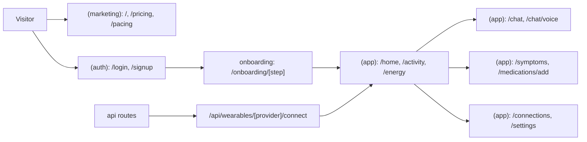
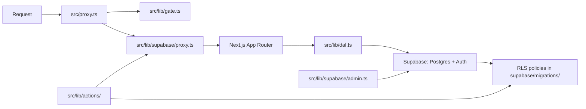

[Contents](../README.md) · [1.1 Getting Started & Local Development](1.1-getting-started-local-development.md) →

---

# Overview

Relevant source files

The following files were used as context for generating this wiki page:

- `.gitignore`
- `AGENTS.md`
- `README.md`

## Purpose and scope

immune.fit is a mobile-first web app for people with chronic and autoimmune conditions. It helps users track symptoms, energy, medications, and activity while training toward a sustainable “active-life sweet spot.” The marketing site is desktop-first. This page summarizes the product, stack, route structure, and major architectural boundaries; implementation and setup details are covered in the child pages. `README.md:1-4` `AGENTS.md:11-15`

Sources: `README.md`, `AGENTS.md`

## Stack and product surfaces

The app uses Next.js 16 App Router, React 19, Tailwind v4, and Supabase for Postgres and authentication. The repository also identifies Turbopack and Cache Components as part of its Next.js setup. `AGENTS.md:24-27`

| Area | Role |
|---|---|
| `(marketing)` | Desktop-first, static marketing and legal pages. |
| `(auth)` | Login, signup, and email confirmation. |
| `onboarding` | Full-screen, step-based intake flow. |
| `(app)` | Authenticated tracking, settings, connections, and companion surfaces. |
| `api` | Application endpoints, including wearable integration routes. |

The route groups give each surface its own layout and behavior. For route and shell details—including `AppNav`, page anatomy, and UI primitives—see [Routing & App Shell](1.2-routing-app-shell.md). For environment setup and local development, see [Getting Started & Local Development](1.1-getting-started-local-development.md). `AGENTS.md:29-46`

Sources: `AGENTS.md`

## High-level architecture

At a high level, users enter through the marketing, authentication, or onboarding surfaces, then use the `(app)` routes for health tracking and related features. The app’s server-side data access is organized around the DAL; private health data is additionally protected by Supabase row-level security (RLS). [AGENTS.md:29-43] `AGENTS.md:67-89`

**Diagram: Product surfaces mapped to route entities**

Sources: `AGENTS.md`

**Diagram: Request and data-security boundaries mapped to code entities**

The proxy performs session refresh and optimistic redirects; it is not the security boundary. Reads are routed through `src/lib/dal.ts`, while RLS policies provide the database-level boundary for private data. The service-role client is reserved for server-side use. [AGENTS.md:67-89] `AGENTS.md:93-100`

Sources: `AGENTS.md`

## Child pages

- [Getting Started & Local Development](1.1-getting-started-local-development.md) — Setup, environment variables, scripts, configuration, styles, and root layout.
- [Routing & App Shell](1.2-routing-app-shell.md) — Route groups, navigation, page layout primitives, and UI components.

Sources: `AGENTS.md:29-51`

---

[Contents](../README.md) · [1.1 Getting Started & Local Development](1.1-getting-started-local-development.md) →
