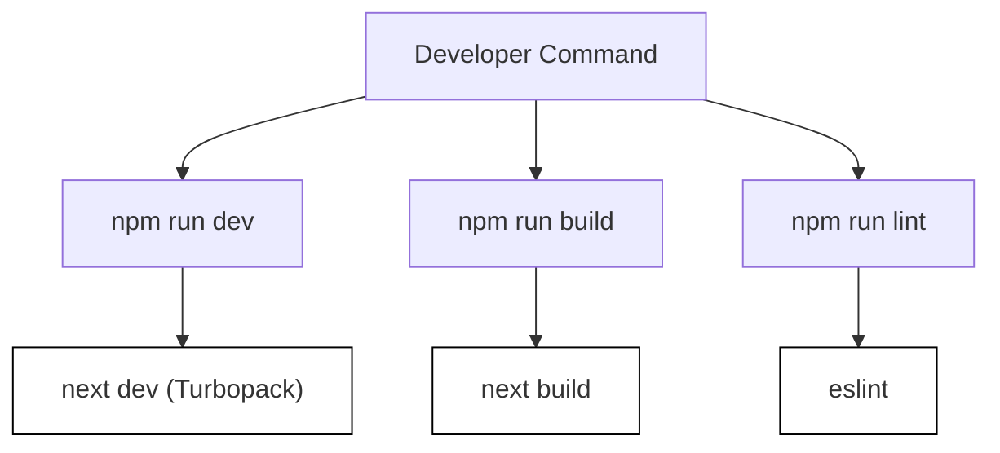
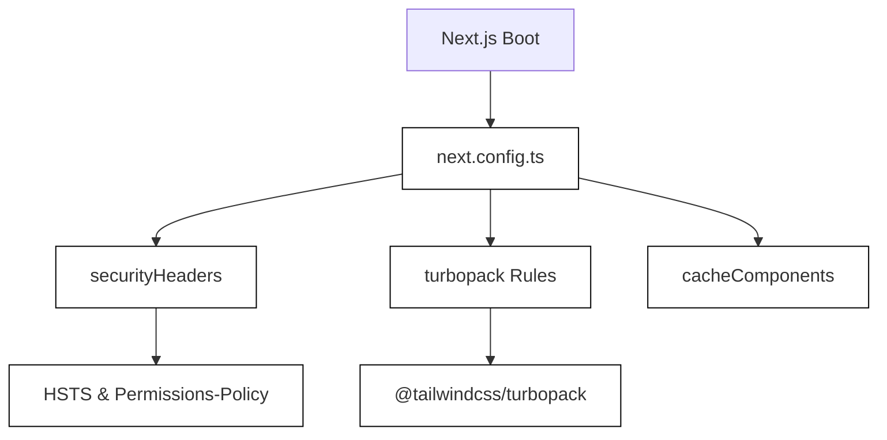
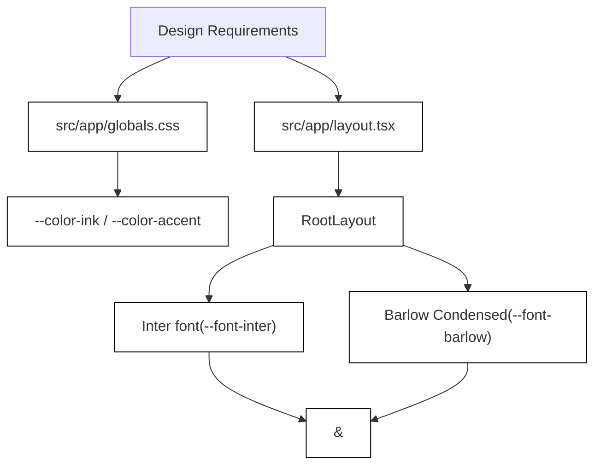

← [1 Overview](1-overview.md) · [Contents](../README.md) · [1.2 Routing & App Shell](1.2-routing-app-shell.md) →

---

# Getting Started & Local Development

<details>
<summary>Relevant source files</summary>

The following files were used as context for generating this wiki page:

- `eslint.config.mjs`
- `next.config.ts`
- `package-lock.json`
- `package.json`
- `src/app/globals.css`
- `src/app/layout.tsx`
- `tsconfig.json`

</details>


## Purpose and Scope

This page covers the technical setup, environment configuration, build scripts, core configuration files (`tsconfig.json`, `eslint.config.mjs`, `next.config.ts`), global styling architecture (`globals.css`), and the root layout (`src/app/layout.tsx`) for `immune.fit`. It provides a complete reference for bootstrapping a local development environment and understanding the build toolchain.

---

## Development Prerequisites & Setup

`immune.fit` is built on Next.js 16 (App Router), React 19, Tailwind CSS v4, and Supabase. To run the application locally, ensure you have Node.js (v18+) and npm installed.

After cloning the repository, install dependencies defined in `package.json`: `package.json:11-32`.

```bash
npm install
```

### Environment Variables (`.env.example`)

While a literal `.env.example` file is part of the deployment contract, local execution requires environment keys connecting Supabase, Anthropic, and other service integrations. Typical required variables include:
- `NEXT_PUBLIC_SUPABASE_URL`: Supabase project URL.
- `NEXT_PUBLIC_SUPABASE_ANON_KEY`: Supabase anonymous/public API key.
- `SUPABASE_SERVICE_ROLE_KEY`: Supabase administrative key for backend sync queues and cron jobs.
- `ANTHROPIC_API_KEY`: API key for the Claude-powered AI companion.
- `CRON_SECRET`: Authorization secret for Vercel cron endpoints.

---

## Package Scripts & Execution Flow

The `package.json` file exposes standard scripts for development, production builds, and static analysis: `package.json:5-10`

```json
  "scripts": {
    "dev": "next dev",
    "build": "next build",
    "start": "next start",
    "lint": "eslint"
  },
```

- `npm run dev`: Boots the local Next.js development server with Turbopack enabled.
- `npm run build`: Compiles the application for production using `next build`.
- `npm run start`: Serves the prebuilt production bundle locally.
- `npm run lint`: Runs ESLint across the codebase using `eslint.config.mjs`.


*Figure 1: Script Execution Pipeline mapping natural language commands to Next.js and ESLint code entities.*

**Sources:** `package.json:1-33`

---

## Build, Lint & TypeScript Tooling

### TypeScript Configuration (`tsconfig.json`)

TypeScript is configured in strict mode with path aliases pointing to `src/`: `tsconfig.json:2-24`

Key options include:
- `"target": "ES2017"` `tsconfig.json:3`
- `"moduleResolution": "bundler"` `tsconfig.json:11`
- `"jsx": "react-jsx"` `tsconfig.json:14`
- `"paths": { "@/*": ["./src/*"] }` `tsconfig.json:21-23` allowing clean absolute imports.

### ESLint Configuration (`eslint.config.mjs`)

Linting leverages the flat config format (`eslint.config.mjs`), extending Next.js core web vitals and TypeScript rules while ignoring build artifacts: `eslint.config.mjs:1-18`

### Next.js Configuration (`next.config.ts`)

`next.config.ts` configures security HTTP headers, Turbopack CSS loaders, and component caching flags: `next.config.ts:6-36`

- **Security Headers**: Injects `Strict-Transport-Security`, `X-Content-Type-Options`, `X-Frame-Options`, `Referrer-Policy`, and a restricted `Permissions-Policy` (allowing microphone access self-contained for voice check-ins) across all routes (`/:path*`). `next.config.ts:6-20`
- **Turbopack & Caching**: Enables `cacheComponents: true`, `partialPrefetching: true`, and custom CSS loaders for Tailwind v4 via Turbopack. `next.config.ts:22-32`


*Figure 2: Build configuration mapping infrastructure requirements to `next.config.ts` exports.*

**Sources:** `tsconfig.json:1-34`, `eslint.config.mjs:1-18`, `next.config.ts:1-38`

---

## Global Styles & Design System Architecture

`src/app/globals.css` imports Tailwind v4 (`@import "tailwindcss";`) and establishes the application's dark athletic design tokens: `src/app/globals.css:1-38`

### Design Tokens (`@theme`)

Every visual token is centrally defined to ensure consistent branding (dark grays paired with orange-yellow accents):
- **Surfaces**: `--color-ink` (`#0e0f11`, page background), `--color-surface` (`#17191c`, modules/cards), `--color-raised` (`#202328`, inputs/chips), `--color-line` (`#2c3036`, hairlines). `src/app/globals.css:10-15`
- **Text**: `--color-fg` (`#f3f1ec`, warm white), `--color-muted` (`#a0a6ae`), `--color-faint` (`#6b7179`). `src/app/globals.css:17-20`
- **Brand**: `--color-accent` (`#ffa51f`, orange-yellow), `--color-accent-strong` (`#ff8a00`), `--color-accent-soft`, `--color-on-accent`. `src/app/globals.css:22-26`
- **Geometry**: `--radius-module` (`1.25rem`), `--radius-control` (`0.875rem`), tabbar and sidebar spacing variables. `src/app/globals.css:32-37`

The file also includes specialized UI styles such as custom range inputs (`input[type="range"].scale`), dialog backdrops, and reduced motion queries. `src/app/globals.css:64-124`

**Sources:** `src/app/globals.css:1-134`

---

## Root Layout & Typography

`src/app/layout.tsx` defines the `RootLayout` component, loading Google Fonts via `next/font/google`, establishing global metadata, viewport configurations, and the root `<html>` and `<body>` tags: `src/app/layout.tsx:1-39`

### Font Integration

- **Inter**: Loaded as `--font-inter` for body and general sans-serif typography. `src/app/layout.tsx:5-8`
- **Barlow Condensed**: Loaded as `--font-barlow` (weights 500, 600, 700) as `--font-display` for athletic headers and stats. `src/app/layout.tsx:10-14`


*Figure 3: Style and layout mapping from design tokens in `globals.css` and font variables in `layout.tsx` to the HTML shell.*

### Metadata and Viewport

- **Metadata**: Sets default and template titles (`immune.fit — find your active-life sweet spot`), application description, and Apple Web App capabilities. `src/app/layout.tsx:16-25`
- **Viewport**: Configures theme color (`#0e0f11`), dark color scheme, and `viewportFit: "cover"` for edge-to-edge mobile rendering. `src/app/layout.tsx:27-31`
- **Root Shell**: Renders the language attribute, font class variables, antialiasing, and background colors: `src/app/layout.tsx:33-39`

```typescript
export default function RootLayout({ children }: LayoutProps<"/">) {
  return (
    <html lang="en" className={`${inter.variable} ${barlow.variable} antialiased`}>
      <body className="min-h-dvh bg-ink font-sans text-fg">{children}</body>
    </html>
  );
}
```

**Sources:** `src/app/layout.tsx:1-39`

---

← [1 Overview](1-overview.md) · [Contents](../README.md) · [1.2 Routing & App Shell](1.2-routing-app-shell.md) →
