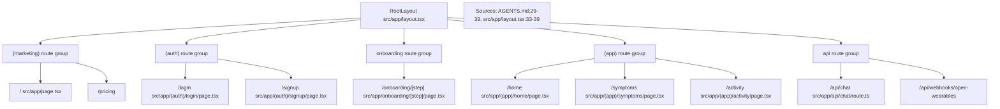
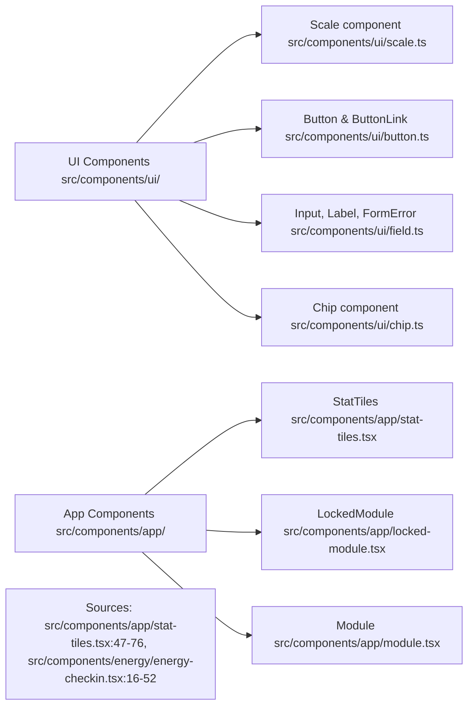

← [1.1 Getting Started & Local Development](1.1-getting-started-local-development.md) · [Contents](../README.md) · [2 Access Control & Data Access Layer](2-access-control-data-access-layer.md) →

---

# Routing & App Shell

<details>
<summary>Relevant source files</summary>

The following files were used as context for generating this wiki page:

- `AGENTS.md`
- `src/app/(app)/symptoms/page.tsx`
- `src/app/layout.tsx`
- `src/components/activity/goal-card.tsx`
- `src/components/activity/goal-form.tsx`
- `src/components/app/stat-tiles.tsx`
- `src/components/charts/axis.ts`
- `src/components/energy/energy-checkin.tsx`

</details>


This page details the routing structure, layout primitives, navigation system, and UI component architecture of `immune.fit`. The app uses Next.js 16 App Router with React 19 and Tailwind v4, organizing routes into isolated route groups that enforce distinct visual frames, authentication postures, and rendering constraints `AGENTS.md:26-39`.

---

## 1. Route Groups & File-System Architecture

The Next.js App Router layout uses route groups (`(group)`) to organize segments without affecting URL paths. The codebase separates concerns across five primary route groups:

| Route Group | URL Paths | Visual Frame & Security Posture |
|---|---|---|
| `(marketing)` | `/`, `/pricing`, `/pacing`, `/privacy`, `/terms` | Desktop-first static layout with site header/footer. DAL session reads are strictly prohibited `AGENTS.md:35`. |
| `(auth)` | `/login`, `/signup`, `auth/confirm` | Centered authentication card frame `AGENTS.md:36`. |
| `onboarding` | `/onboarding/[step]` | Full-screen wizard, one question per screen, progress bar, omitting navigation `AGENTS.md:37`. |
| `(app)` | `/home`, `/chat`, `/chat/voice`, `/symptoms`, `/symptoms/report`, `/energy`, `/activity`, `/medications/add`, `/connections`, `/settings` | Authenticated app shell combining `AppNav` and content columns `AGENTS.md:38`. |
| `api` | `/api/*` | Server-side endpoints for chat, webhooks, voice, and device sync queues. |


*Sources: `AGENTS.md:29-39`, `src/app/layout.tsx:33-39`*

---

## 2. Navigation & App Shell (`AppNav`)

Within the `(app)` route group, navigation is handled by a unified component: `AppNav`. It renders as a bottom tab bar on mobile viewports and shifts to a persistent sidebar at the `lg` breakpoint `AGENTS.md:45`.

The mapping of active routes to tabs, icon assignments, and sub-path lighting rules are centralized in `src/lib/nav.ts`. Every page inside `(app)` follows a strict structural anatomy consisting of a `PageHeader` (display title, optional back action, profile trigger) followed by a `ModuleStack` containing `Module` cards `AGENTS.md:40-43`.

```mermaid
graph TD
    SubApp["(app) Layout / Segment"] --> AppNav["AppNav component"]
    AppNav --> MobileNav["Bottom Tab Bar viewport < lg"]
    AppNav --> DesktopSidebar["Persistent Sidebar viewport >= lg"]
    SubNavConfig["src/lib/nav.ts"] --> AppNav
    
    SubApp --> PageHeader["PageHeader component"]
    PageHeader --> ModuleStack["ModuleStack container"]
    ModuleStack --> Suspense["React Suspense Boundary"]
    Suspense --> Fallback["ModuleSkeleton loading state"]
    Suspense --> TargetModule["Module card / LockedModule"]

    sub-graph-sources[Sources: AGENTS.md:40-46, src/app/(app)/symptoms/page.tsx:21-38]
```
*Sources: `AGENTS.md:40-46`, `src/app/(app)/symptoms/page.tsx:21-38`*

---

## 3. Layout Primitives & Page Anatomy

To enforce UI consistency and support React 19 Suspense streaming, the codebase implements standard layout primitives in `src/components/app/`:

*   **`ModuleStack`**: A vertical flex container spacing out modules and content blocks.
*   **`Module`**: A container card featuring an optional action slot, title, and rich child content.
*   **`LockedModule`**: Used for progressive disclosure. Displays unlock criteria (e.g., days of logging) and progress metrics toward availability `AGENTS.md:41`. Example usage is seen in the Doctor Report module `src/app/(app)/symptoms/page.tsx:116-140`.
*   **`ModuleSkeleton`**: Provides animated loading skeletons matching the geometry of `Module` headers and content blocks during async DAL resolutions `AGENTS.md:57`, `src/app/(app)/symptoms/page.tsx:26-34`.

Every operation reading cookies or invoking the Data Access Layer (DAL) must execute inside a `<Suspense>` boundary paired with a `<ModuleSkeleton>` fallback to prevent blocking segment rendering `AGENTS.md:55-57`.

```typescript
// Typical page structure pattern found across (app) routes
export default function SymptomsPage({ searchParams }: PageProps<"/symptoms">) {
  return (
    <>
      <PageHeader title="Symptoms" />
      <ModuleStack>
        <Suspense fallback={<ModuleSkeleton title="Symptom activity" height="h-48" />}>
          <WeekChart searchParams={searchParams} />
        </Suspense>
        <Suspense fallback={<ModuleSkeleton title="Log a symptom" />}>
          <LogModule />
        </Suspense>
        <Suspense fallback={<ModuleSkeleton title="Doctor report" />}>
          <DoctorReportModule />
        </Suspense>
      </ModuleStack>
    </>
  );
}
```
*Sources: `AGENTS.md:55-60`, `src/app/(app)/symptoms/page.tsx:21-38`*

---

## 4. UI Component Library

Common form interactions, inputs, and display cards are abstracted into reusable UI components (`src/components/ui/` and `src/components/app/`). These components integrate with React action hooks and Tailwind v4 design tokens (`bg-ink`, `bg-raised`, `text-fg`, `text-muted`).

*   **`GoalCard` & `GoalForm`**: Provide interactive displays and form controls for tracking activity and pacing targets. Server-derived metric sentences are rendered safely in client components `src/components/activity/goal-card.tsx:14-40`.
*   **`EnergyCheckin`**: Combines range inputs (`Scale`), action state handlers (`useActionState`), and timestamped day logging `src/components/energy/energy-checkin.tsx:16-52`.
*   **`StatTiles`**: A responsive CSS grid container displaying aggregated device metrics read via server utilities (`readDaily`) `src/components/app/stat-tiles.tsx:35-76`.


*Sources: `src/components/app/stat-tiles.tsx:47-76`, `src/components/energy/energy-checkin.tsx:16-52` *

---

← [1.1 Getting Started & Local Development](1.1-getting-started-local-development.md) · [Contents](../README.md) · [2 Access Control & Data Access Layer](2-access-control-data-access-layer.md) →
