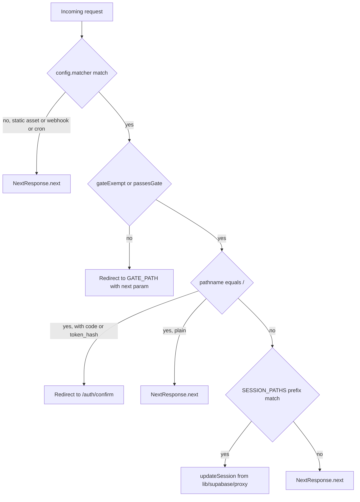
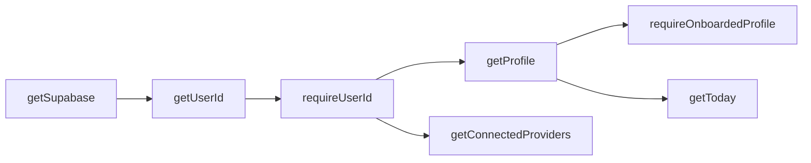
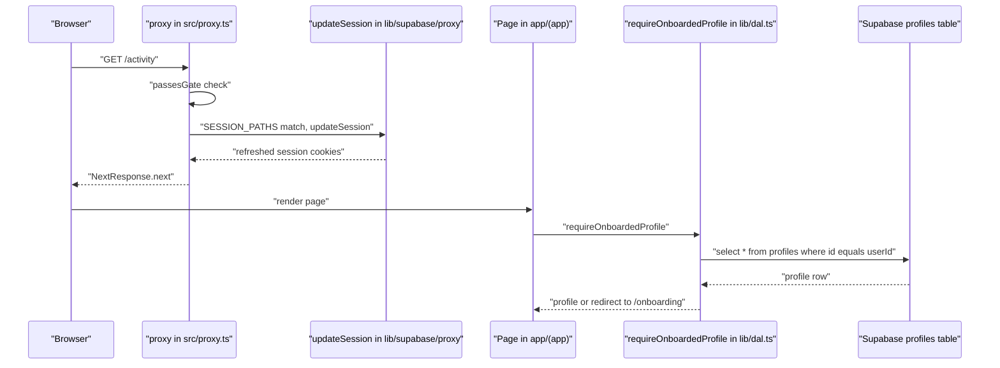

← [1.2 Routing & App Shell](1.2-routing-app-shell.md) · [Contents](../README.md) · [2.1 Proxy, Site Gate & Authentication](2.1-proxy-site-gate-authentication.md) →

---

# Access Control & Data Access Layer

Relevant source files

The following files were used as context for generating this wiki page:

- `src/app/(auth)/login/page.tsx`
- `src/components/auth/auth-form.tsx`
- `src/lib/dal.ts`
- `src/proxy.ts`

This section covers how immune.fit decides who a request belongs to and how server code reads user data. It is an overview. Each sub-topic has its own child page with implementation detail.

The system has three layers:

1. **Request gating** in `src/proxy.ts` decides which paths need a session, and redirects unauthenticated visitors through the site-password gate. See [Proxy, Site Gate & Authentication](2.1-proxy-site-gate-authentication.md).
2. **Identity and data access** in `src/lib/dal.ts` is the single place server code asks "who is signed in" and loads the user's profile. See [Data Access Layer (src/lib/dal.ts)](2.2-data-access-layer-src-lib-dal-ts.md).
3. **Database security** relies on Supabase row-level security, the generated types, and the migrations. See [Database Schema, RLS & Migrations](2.3-database-schema-rls-migrations.md).

Sources: `src/proxy.ts`, `src/lib/dal.ts`

## Request Gating

`src/proxy.ts` runs before pages and routes. Its `config.matcher` covers every path except build assets, files with extensions, and the device webhook and cron routes, which are machine traffic with no session `src/proxy.ts:56-61`. The matcher is broad because the site-password gate applies to every page.

The `proxy` function runs in this order:

1. If the request is not gate-exempt and does not pass the gate, it redirects to `GATE_PATH` and passes the original path in the `next` query parameter `src/proxy.ts:30-37`.
2. The bare `/` route is handled specially. If it carries a `code` or `token_hash` parameter from an email link, it is redirected to `/auth/confirm` `src/proxy.ts:39-48`.
3. Only paths in `SESSION_PATHS` call `updateSession` from `src/lib/supabase/proxy` `src/proxy.ts:9-25, 50-52`. The list includes the app surfaces (`/home`, `/chat`, `/energy`, `/activity`, and others), the auth pages (`/login`, `/signup`, `/auth`), and the API routes (`/api/wearables`, `/api/chat`, `/api/voice`).
4. Marketing paths such as `/`, `/pricing`, and `/pacing` stay static and never reach the auth server `src/proxy.ts:5-7`.

A comment requires `SESSION_PATHS` to stay in sync with `PROTECTED` and `AUTH_PAGES` in `src/lib/supabase/proxy.ts` `src/proxy.ts:8`. Those two lists must change together.

Sources: `src/proxy.ts`

### Gating flow

Sources: `src/proxy.ts`

## Session Identity and the DAL

`src/lib/dal.ts` is marked `server-only` `src/lib/dal.ts:1` and states that every server-side read of user data starts there `src/lib/dal.ts:7-10`. Each helper is wrapped in React `cache()`, so repeated calls within one request share one result.

The helpers form a chain:

| Symbol | Role | Citation |
|---|---|---|
| `getSupabase` | Cached wrapper around `createClient` from `@/lib/supabase/server` | `src/lib/dal.ts:16` |
| `getUserId` | Reads the `sub` claim from `auth.getClaims()`, returns `string \| null`. Used by route handlers to answer 401 | `src/lib/dal.ts:18-23` |
| `requireUserId` | Calls `getUserId`, redirects to `/login` when signed out | `src/lib/dal.ts:25-30` |
| `getProfile` | Loads the `profiles` row for the signed-in user, throws if missing | `src/lib/dal.ts:32-42` |
| `requireOnboardedProfile` | Redirects to `/onboarding` when `onboarding_completed_at` is unset | `src/lib/dal.ts:44-49` |
| `getConnectedProviders` | Returns a `Set` of providers with `status` equal to `connected` from `device_connections` | `src/lib/dal.ts:51-61` |
| `getToday` | Returns the user's local date via `todayIn(profile.timezone)` | `src/lib/dal.ts:63-67` |
| `Profile` | Type derived from the return type of `getProfile` | `src/lib/dal.ts:69` |

Route handlers and pages use different helpers. Pages call `requireUserId` or `requireOnboardedProfile`, which redirect. API routes call `getUserId` and return 401 when it is null. The distinction comes from the JSDoc on each helper `src/lib/dal.ts:18, 25, 44`.

Reads are scoped in application code. `getProfile` filters with `.eq("id", userId)` `src/lib/dal.ts:35-39` and `getConnectedProviders` filters with `.eq("user_id", userId)` `src/lib/dal.ts:55-59`. Database-level enforcement is covered in [Database Schema, RLS & Migrations](2.3-database-schema-rls-migrations.md).

For the full helper contract, Suspense rules, and the Supabase client variants (server, admin, proxy), see [Data Access Layer (src/lib/dal.ts)](2.2-data-access-layer-src-lib-dal-ts.md).

Sources: `src/lib/dal.ts`

### Helper dependency graph

Sources: `src/lib/dal.ts`

## Auth Entry Points

The sign-in UI is a thin layer over the proxy and DAL. `AuthForm` in `src/components/auth/auth-form.tsx` takes a `mode` of `"login"` or `"signup"` and binds the matching server action from `@/app/(auth)/actions` with `useActionState` `src/components/auth/auth-form.tsx:10-11`. After a signup, the form switches to a "Check your email" state when `state.sent` is set `src/components/auth/auth-form.tsx:13-26`.

The `next` value is passed through a hidden input so the action can return the user to their original path `src/components/auth/auth-form.tsx:44`. That value originates from the proxy's gate redirect and from the `next` search parameter in `src/app/(auth)/login/page.tsx`.

The login page wraps `LoginForm` in `Suspense` `src/app/(auth)/login/page.tsx:12-14` because it reads `searchParams` `src/app/(auth)/login/page.tsx:18-19`. When `error` equals `"link"`, it shows `LINK_NOTICE`, which covers expired or cross-browser email links `src/app/(auth)/login/page.tsx:7-8, 24`.

For the action implementations, the gate, and `/auth/confirm`, see [Proxy, Site Gate & Authentication](2.1-proxy-site-gate-authentication.md).

Sources: `src/components/auth/auth-form.tsx`, `src/app/(auth)/login/page.tsx`

### Request lifecycle for an app page

Sources: `src/proxy.ts`, `src/lib/dal.ts`, `src/app/(auth)/login/page.tsx`

## Database Security

The DAL checks identity in application code, and the database enforces access through row-level security. The DAL is the first check and not the only one. Row-level security policies, the generated `Database` types, the table inventory, the migrations under `supabase/migrations`, and the `rls_check.sql` verification suite are all covered in [Database Schema, RLS & Migrations](2.3-database-schema-rls-migrations.md).

Sources: `src/lib/dal.ts`

## Cross-Cutting Rules

Three conventions apply across this layer:

- **Suspense for cookie reads.** Anything that calls the DAL reads cookies, so with Cache Components enabled it must render inside a `<Suspense>` boundary `src/lib/dal.ts:12-13`.
- **Request-scoped dedupe.** React `cache()` collapses repeated helper calls in one request, so many components asking for the profile cost one query `src/lib/dal.ts:9-10`.
- **Marketing stays static.** The proxy never touches the auth server for marketing paths `src/proxy.ts:5-7`. Pages in that surface must not read the session. See [Marketing Pages & Layout](6.1-marketing-pages-layout.md) for the rendering constraints.

Sources: `src/lib/dal.ts`, `src/proxy.ts`

## Child Pages

- [Proxy, Site Gate & Authentication](2.1-proxy-site-gate-authentication.md): `src/proxy.ts` matcher and `SESSION_PATHS`, the site-password gate, login and signup, auth actions, and `auth/confirm`.
- [Data Access Layer (src/lib/dal.ts)](2.2-data-access-layer-src-lib-dal-ts.md): helper contracts, React cache dedupe, Suspense rules, and the Supabase client variants.
- [Database Schema, RLS & Migrations](2.3-database-schema-rls-migrations.md): generated types, table relationships, migrations, RLS conventions, `rls_check.sql`, and `delete_my_account`.

Sources: `src/proxy.ts`, `src/lib/dal.ts`, `src/components/auth/auth-form.tsx`, `src/app/(auth)/login/page.tsx`

---

← [1.2 Routing & App Shell](1.2-routing-app-shell.md) · [Contents](../README.md) · [2.1 Proxy, Site Gate & Authentication](2.1-proxy-site-gate-authentication.md) →
