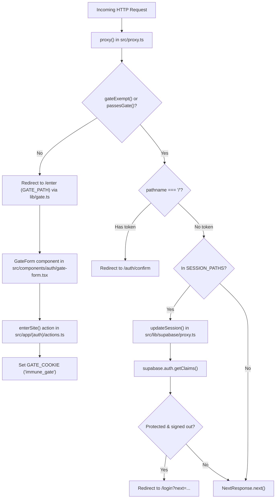
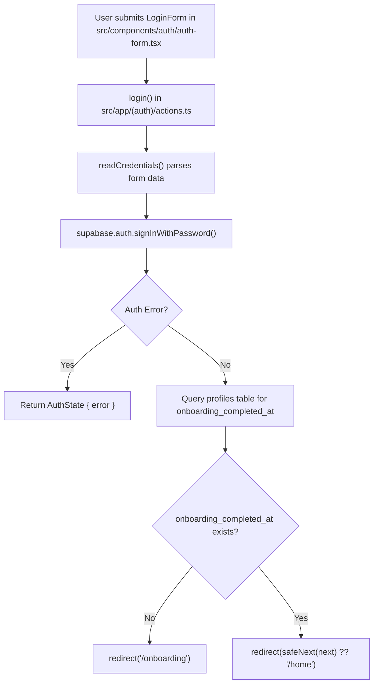

← [2 Access Control & Data Access Layer](2-access-control-data-access-layer.md) · [Contents](../README.md) · [2.2 Data Access Layer (src/lib/dal.ts)](2.2-data-access-layer-src-lib-dal-ts.md) →

---

# Proxy, Site Gate & Authentication

<details>
<summary>Relevant source files</summary>

The following files were used as context for generating this wiki page:

- `.env.example`
- `src/app/(auth)/actions.ts`
- `src/app/(auth)/enter/page.tsx`
- `src/app/(auth)/login/page.tsx`
- `src/app/(marketing)/privacy/page.tsx`
- `src/components/auth/auth-form.tsx`
- `src/components/auth/gate-form.tsx`
- `src/lib/gate.ts`
- `src/lib/supabase/proxy.ts`
- `src/proxy.ts`

</details>


This page details the request gating, proxy logic, session management, and authentication flows implemented in `immune.fit`. It covers the Next.js middleware proxy (`src/proxy.ts`), the optional soft site-password gate (`src/lib/gate.ts`), Supabase session updates (`src/lib/supabase/proxy.ts`), and server actions for authentication and site entry (`src/app/(auth)/actions.ts`).

---

## 1. Request Proxy & Middleware Matcher (`src/proxy.ts`)

The Next.js middleware proxy intercepts incoming HTTP requests before they reach route handlers or server components. Defined in `src/proxy.ts`, it coordinates two main checks: the site-password gate and Supabase session verification for protected routes `src/proxy.ts:27-54`.

The proxy uses a specific `matcher` configuration to skip static build assets, public files with extensions, and machine traffic endpoints like webhooks and crons `src/proxy.ts:59-61`:

```typescript
export const config = {
  matcher: ["/((?!_next/|api/webhooks|api/cron|.*\\.[a-zA-Z0-9]+$).*)"],
};
```

When a request arrives, `proxy(request)` performs the following logic:
1. **Site Gate Check**: Evaluates whether the visitor has passed the soft site-password gate `src/proxy.ts:31-37`.
2. **Root & Auth Confirm Routing**: Intercepts bare `/` requests carrying email verification tokens (`code` or `token_hash`) and routes them to `/auth/confirm` `src/proxy.ts:39-48`.
3. **Session Path Check**: If the pathname matches entries in `SESSION_PATHS` (e.g., `/home`, `/chat`, `/settings`, `/api/chat`), it delegates to `updateSession(request)` from `src/lib/supabase/proxy.ts` `src/proxy.ts:9-25, 50-52`.

Sources: `src/proxy.ts:1-61`

---

## 2. Site-Password Gate (`src/lib/gate.ts`, `gate-form`, `/enter`)

Because `immune.fit` is private during early testing, signed-out visitors must pass a soft site-password gate `src/lib/gate.ts:3-7`. This is handled via `src/lib/gate.ts`, the UI component `src/components/auth/gate-form.tsx`, and the server action `enterSite` in `src/app/(auth)/actions.ts`.

### Constants and Exclusions
* `GATE_COOKIE = "immune_gate"` `src/lib/gate.ts:8`
* `SITE_PASSWORD = "MIT"` `src/lib/gate.ts:9`
* `GATE_PATH = "/enter"` `src/lib/gate.ts:10`
* `GATE_EXEMPT`: Includes `/enter` and `/auth` routes, plus bare root URLs containing Supabase verification tokens `src/lib/gate.ts:12-20`.

### Verification Helpers
* `gateExempt(request)`: Determines if a request path skips the gate requirement `src/lib/gate.ts:15-20`.
* `passesGate(request)`: Returns true if the client presents either the `immune_gate` cookie or an optimistic Supabase auth token cookie (`sb-*-auth-token`) `src/lib/gate.ts:23-27`.

If a user fails the gate, they are redirected to `/enter?next=...` `src/proxy.ts:31-37`. The `EnterPage` renders `GateForm`, which collects the password and invokes `enterSite` `src/app/(auth)/enter/page.tsx:1-18`, `src/components/auth/gate-form.tsx:1-29`. The action verifies the password, sets the HTTP-only cookie for one year, and redirects back to the intended path `src/app/(auth)/actions.ts:78-90`.

Sources: `src/lib/gate.ts:1-27`, `src/app/(auth)/enter/page.tsx:1-18`, `src/components/auth/gate-form.tsx:1-29`, `src/app/(auth)/actions.ts:78-90`

---

## 3. Session Management & Supabase Proxy (`src/lib/supabase/proxy.ts`)

For paths listed in `SESSION_PATHS`, `src/proxy.ts` hands execution to `updateSession(request)` in `src/lib/supabase/proxy.ts` `src/proxy.ts:50-52`, `src/lib/supabase/proxy.ts:32-80`.

### Implementation Details
`updateSession` instantiates a Supabase server client using `@supabase/ssr` with custom cookie handling that bridges Next.js request and response cookie stores `src/lib/supabase/proxy.ts:35-56`. 

1. It calls `supabase.auth.getClaims()` to validate and refresh expired JWT tokens `src/lib/supabase/proxy.ts:58-60`.
2. It checks `signedIn` status via claims representation (`data?.claims?.sub`) `src/lib/supabase/proxy.ts:61`.
3. **Protected Route Enforcement**: If the user is unauthenticated and requests a route matching `PROTECTED` prefixes (e.g., `/home`, `/settings`, `/api/chat`), they are redirected to `/login` with a `next` query parameter `src/lib/supabase/proxy.ts:6-19, 64-70`.
4. **Auth Page Bypass**: If an authenticated user attempts to visit `AUTH_PAGES` (`/login`, `/signup`), they are redirected directly to `/home` `src/lib/supabase/proxy.ts:21-22, 72-77`.

Sources: `src/lib/supabase/proxy.ts:1-93`, `src/proxy.ts:9-25`

---

## 4. Authentication Pages & Server Actions (`src/app/(auth)/actions.ts`)

Authentication actions are co-located in `src/app/(auth)/actions.ts` and handle credential verification, account creation, and security constraints `src/app/(auth)/actions.ts:1-90`.

### Key Functions
* `safeNext(value)`: Validates query parameters (`?next=`) to ensure redirects remain strictly same-site, preventing open redirect vulnerabilities (`//` or `/\` paths are rejected) `src/app/(auth)/actions.ts:11-15`.
* `login(_prev, formData)`: Authenticates users via `supabase.auth.signInWithPassword`. It inspects the `profiles` table for `onboarding_completed_at`; if null, the user is redirected to `/onboarding`, otherwise to their `next` destination or `/home` `src/app/(auth)/actions.ts:23-46`.
* `signup(_prev, formData)`: Validates email syntax and password length ($\ge 8$ chars), then calls `supabase.auth.signUp` with a redirect URL pointing to `/auth/confirm?next=/onboarding` `src/app/(auth)/actions.ts:48-75`.

The client-side form (`src/components/auth/auth-form.tsx`) utilizes React's `useActionState` hook to manage submission states, validation errors, and email-sent confirmations `src/components/auth/auth-form.tsx:1-86`.

Sources: `src/app/(auth)/actions.ts:1-90`, `src/components/auth/auth-form.tsx:1-86`, `src/app/(auth)/login/page.tsx:1-28`

---

## 5. Architectural Data Flows

The following diagrams bridge the natural language description of access control to the concrete code entities in the repository.

### Request Pipeline & Gate Evaluation



Sources: `src/proxy.ts:27-54`, `src/lib/gate.ts:15-27`, `src/lib/supabase/proxy.ts:32-80`, `src/app/(auth)/actions.ts:78-90`

### Authentication & Login Data Flow



Sources: `src/app/(auth)/actions.ts:17-46`, `src/components/auth/auth-form.tsx:10-65`

---

← [2 Access Control & Data Access Layer](2-access-control-data-access-layer.md) · [Contents](../README.md) · [2.2 Data Access Layer (src/lib/dal.ts)](2.2-data-access-layer-src-lib-dal-ts.md) →
