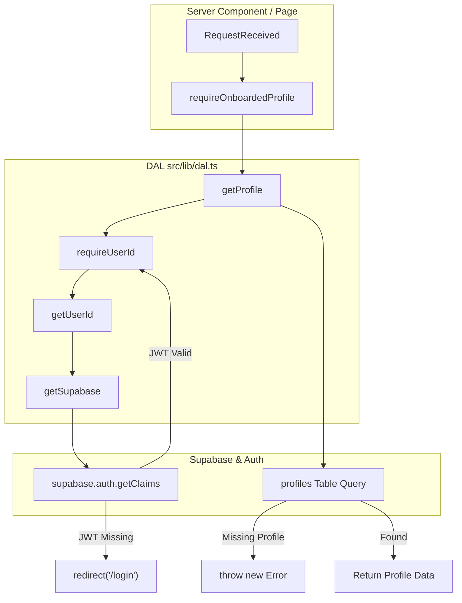
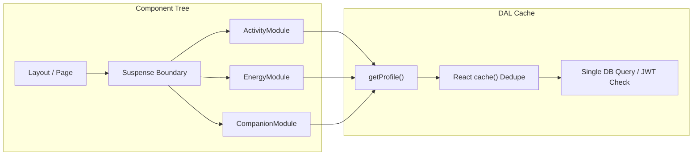
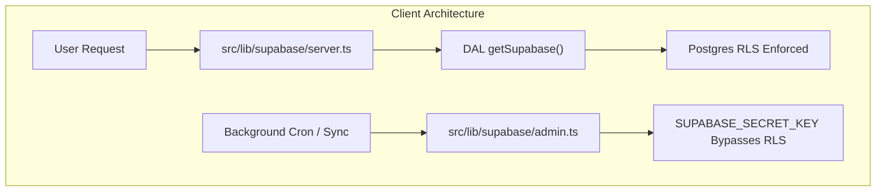
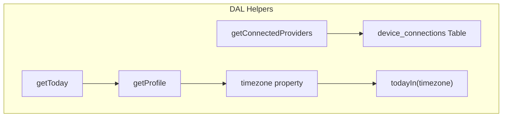

← [2.1 Proxy, Site Gate & Authentication](2.1-proxy-site-gate-authentication.md) · [Contents](../README.md) · [2.3 Database Schema, RLS & Migrations](2.3-database-schema-rls-migrations.md) →

---

# Data Access Layer (src/lib/dal.ts)

Relevant source files

The following files were used as context for generating this wiki page:

- `src/lib/dal.ts`
- `src/lib/dates.ts`
- `src/lib/supabase/admin.ts`

Every server-side read of user data in `immune.fit` flows through the Data Access Layer (DAL) located in `src/lib/dal.ts`. Its primary purpose is to centralize session verification, identity resolution, and profile gating so that authorization checks happen uniformly across all server components and route handlers. 

Sources: ``src/lib/dal.ts:1-14``

---

## 1. Core DAL Functions & Request Gating

The DAL provides a set of asynchronous functions responsible for inspecting incoming requests, verifying JWT claims via Supabase, and enforcing access rules such as onboarding status.

* `getSupabase()`: Wrapped with React `cache()`, this returns the request-scoped Supabase server client `src/lib/dal.ts:16`.
* `getUserId()`: Extracts and returns the signed-in user's identifier (`sub` claim) from the Supabase JWT, or returns `null` if unauthenticated `src/lib/dal.ts:19-23`.
* `requireUserId()`: Calls `getUserId()`. If no user ID is present, it immediately throws a Next.js `redirect("/login")` `src/lib/dal.ts:26-30`.
* `getProfile()`: Requires a user ID, queries the `profiles` table for the matching user record, and throws an error if the profile is missing `src/lib/dal.ts:32-42`.
* `requireOnboardedProfile()`: Fetches the user profile and checks `onboarding_completed_at`. If null, it redirects the user back to `/onboarding` `src/lib/dal.ts:45-49`.

Sources: ``src/lib/dal.ts:16-49``

---

## 2. React Cache Deduplication & Suspense Rules

Because Next.js App Router executes components concurrently during rendering, multiple components on a single page might independently require the current user's profile or active session. 

To prevent redundant database roundtrips, every major DAL function is wrapped in React's `cache()` utility [src/lib/dal.ts:2]:
* **Deduplication**: Ten distinct child components calling `getProfile()` or `requireUserId()` within the same request lifecycle share a single underlying database query and token verification check `src/lib/dal.ts:9-10`.
* **Suspense Requirements**: Because DAL functions read request cookies (via Supabase server clients), any component calling them forces dynamic rendering and **must** be wrapped inside a `<Suspense>` boundary in the component tree `src/lib/dal.ts:12-14`.

Sources: ``src/lib/dal.ts:1-16``

---

## 3. Supabase Client Variants

The application manages database and auth state through distinct Supabase client factories depending on the execution context. Row-Level Security (RLS) is strictly preserved through user-facing clients, while background automation relies on service-role credentials.

| Client Factory File | Purpose & RLS Behavior | When to Use |
| :--- | :--- | :--- |
| `src/lib/supabase/server.ts` | Cookie-aware client bound to the incoming HTTP request; enforces RLS. | User-facing Server Components, Server Actions, and Route Handlers. |
| `src/lib/supabase/admin.ts` | Service-role client (`SUPABASE_SECRET_KEY`) that **bypasses** RLS `src/lib/supabase/admin.ts:5-10`. | Background cron jobs, wearable sync queues, and administrative scripts. |
| `src/lib/supabase/proxy.ts` | Handles token refresh and session forwarding across proxy layers. | Middleware and edge routing rules. |

Sources: `[src/lib/dal.ts:16]`, ``src/lib/supabase/admin.ts:1-17``

---

## 4. Date & Provider Helpers Integration

The DAL also exposes helper queries tied directly to user metadata, such as active connected wearables and localized calendar days:

* `getConnectedProviders()`: Queries the `device_connections` table for the signed-in user where `status = 'connected'` and returns a JavaScript `Set` of provider strings (e.g., `"apple_health"`, `"garmin"`) `src/lib/dal.ts:52-61`.
* `getToday()`: Resolves the user's profile timezone and computes their local calendar date string (`YYYY-MM-DD`) via `todayIn()` from `src/lib/dates.ts` `src/lib/dal.ts:63-67`, ensuring consistent date-boundary calculations across time zones `src/lib/dates.ts:1-15`.

Sources: `[src/lib/dal.ts:52-67]`, ``src/lib/dates.ts:9-15``

---

← [2.1 Proxy, Site Gate & Authentication](2.1-proxy-site-gate-authentication.md) · [Contents](../README.md) · [2.3 Database Schema, RLS & Migrations](2.3-database-schema-rls-migrations.md) →
