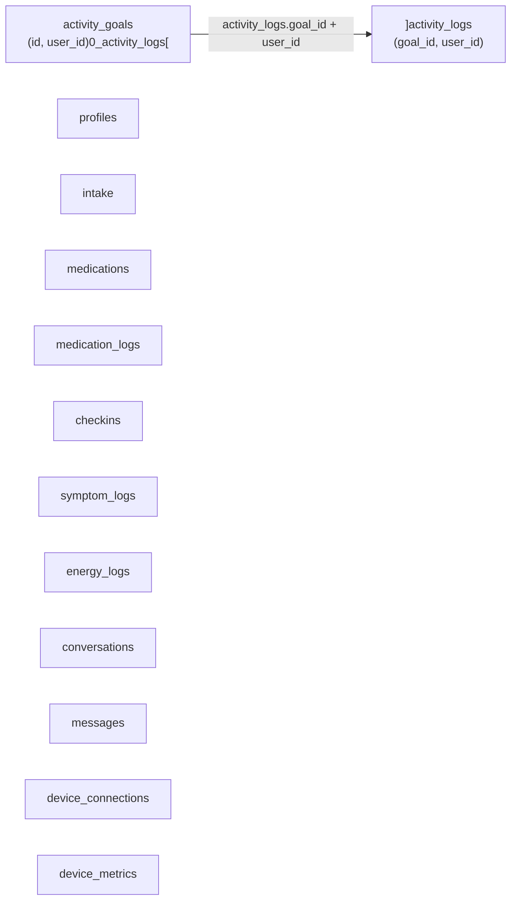
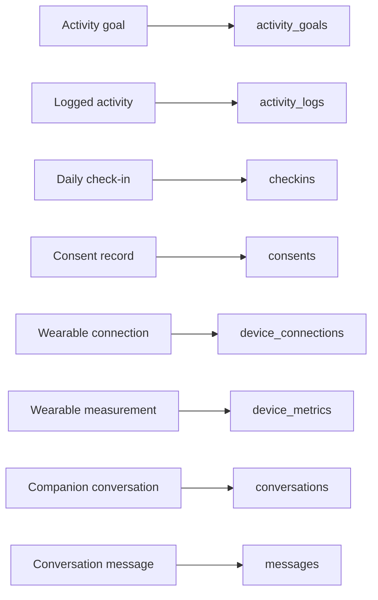
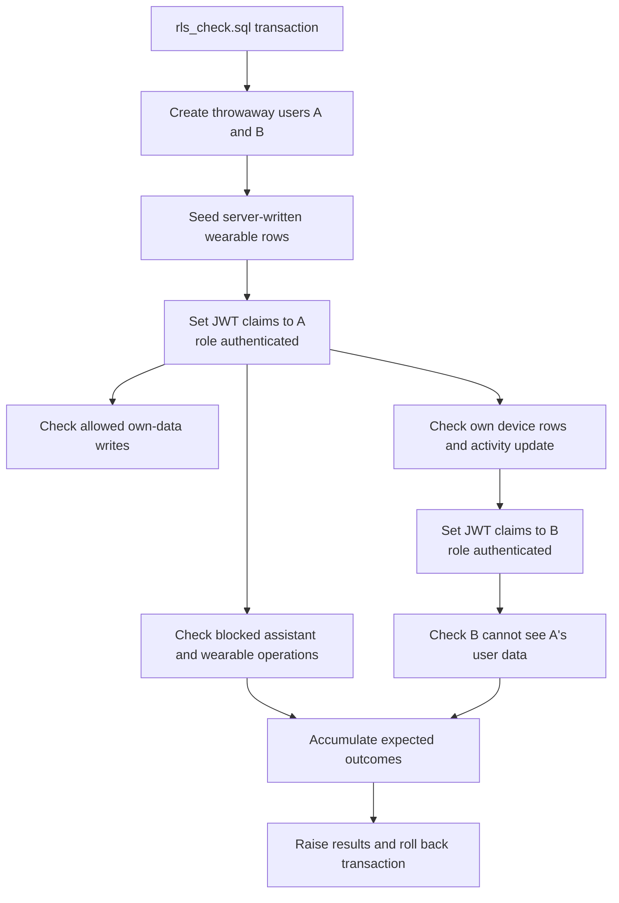
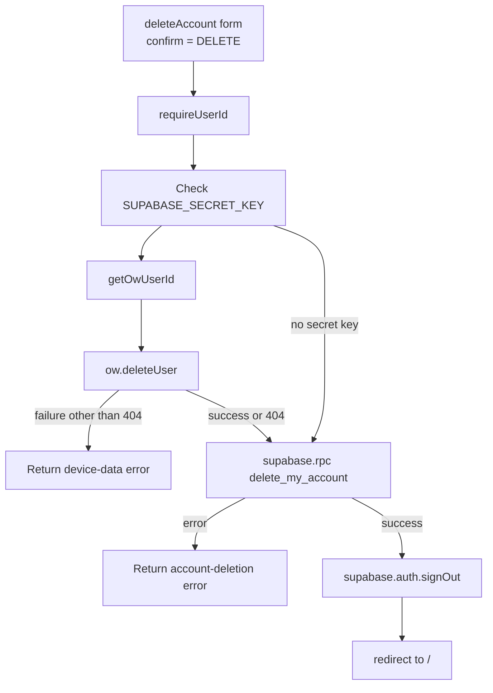

← [2.2 Data Access Layer (src/lib/dal.ts)](2.2-data-access-layer-src-lib-dal-ts.md) · [Contents](../README.md) · [3 Tracking Features (App)](3-tracking-features-app.md) →

---

# Database Schema, RLS & Migrations

Relevant source files

The following files were used as context for generating this wiki page:

- `src/lib/actions/account.ts`
- `src/lib/supabase/types.ts`
- `supabase/migrations/20261022180000_daily_stats_and_effort.sql`
- `supabase/migrations/20261022200000_flexible_activity_goals.sql`
- `supabase/tests/rls_check.sql`

## Purpose and scope

This page describes the database contract exposed by the generated Supabase `Database` type, the tables visible in the provided schema and RLS verification material, the supplied migrations, and the account-deletion flow. The available material includes an excerpt of the generated type file, an excerpt of `rls_check.sql`, and two migration files; details not shown there are not inferred. `src/lib/supabase/types.ts:1-257`, `supabase/tests/rls_check.sql:1-133`, `supabase/migrations/20261022180000_daily_stats_and_effort.sql:1-29`, `supabase/migrations/20261022200000_flexible_activity_goals.sql:1-31`, `src/lib/actions/account.ts:33-63`

Sources: `src/lib/supabase/types.ts`, `supabase/tests/rls_check.sql`, `supabase/migrations/20261022180000_daily_stats_and_effort.sql`, `supabase/migrations/20261022200000_flexible_activity_goals.sql`, `src/lib/actions/account.ts`

## Generated database types

`src/lib/supabase/types.ts` defines `Json` and the `Database` type. `Database` includes a `public` schema with table-specific `Row`, `Insert`, `Update`, and `Relationships` definitions. It also includes `graphql_public`, whose shown `graphql` function accepts optional query-operation arguments and returns `Json`. `src/lib/supabase/types.ts:1-39`, `src/lib/supabase/types.ts:40-76`

The type distinguishes stored row shapes from write shapes: fields that can be omitted on insert are optional there, and some generated columns are marked as non-insertable. For example, `activity_logs` has required `activity` and `logged_on` insert fields, while `id`, `logged_at`, and `user_id` are optional; `device_metrics.id` is marked `never` for insert and update. `src/lib/supabase/types.ts:78-112`, `src/lib/supabase/types.ts:113-139`, `src/lib/supabase/types.ts:233-257`

Sources: `src/lib/supabase/types.ts`

## Table inventory and relationships

The following inventory is limited to tables present in the displayed type excerpt or named in the displayed RLS test excerpt. The test names tables such as `profiles`, `intake`, `medications`, and `messages`, but their full column definitions are not present in the supplied type excerpt. `src/lib/supabase/types.ts:40-257`, `supabase/tests/rls_check.sql:35-46`, `supabase/tests/rls_check.sql:111-133`

| Table | Role or fields visible in the supplied material |
|---|---|
| `activity_goals` | User-owned goals with activity, unit, period, target, direction, and active state. `src/lib/supabase/types.ts:42-76` |
| `activity_logs` | Logged activities, including duration, effort, source, date, and optional device/workout metrics. `src/lib/supabase/types.ts:78-129` |
| `checkins` | User-associated daily records keyed by `day`. `src/lib/supabase/types.ts:140-156` |
| `consents` | User-associated consent records with kind, version, and acceptance timestamp. `src/lib/supabase/types.ts:158-180` |
| `conversations` | User-associated conversations with mode and start time. `src/lib/supabase/types.ts:182-201` |
| `device_connections` | Provider connection status and synchronization metadata for a user. `src/lib/supabase/types.ts:203-231` |
| `device_metrics` | Provider metric values with metric name and recorded date/time. `src/lib/supabase/types.ts:233-257` |
| `profiles`, `intake`, `medications`, `medication_logs`, `symptom_logs`, `energy_logs`, `messages` | Named by the RLS verification script; their columns are not shown in the provided type excerpt. `supabase/tests/rls_check.sql:35-46`, `supabase/tests/rls_check.sql:111-133` |
| `wearable_accounts`, `wearable_sync_requests` | Named in the RLS verification script; the script tests authenticated-user access to these tables. `supabase/tests/rls_check.sql:25-30`, `supabase/tests/rls_check.sql:55-67` |

The generated relationship metadata shown for `activity_logs` declares a composite foreign key from `(goal_id, user_id)` to `(id, user_id)` on `activity_goals`. This ties an activity log’s optional goal reference to a goal belonging to the same user. No other relationship metadata is visible in the supplied excerpt. `src/lib/supabase/types.ts:130-138`

Sources: `src/lib/supabase/types.ts`, `supabase/tests/rls_check.sql`

### Relationship map

The diagram shows the explicit relationship in the provided generated types; other table names are included only as inventory context and are not shown as related entities. `src/lib/supabase/types.ts:78-138`, `supabase/tests/rls_check.sql:35-46`

**Diagram: Generated table relationship and user data areas**

Sources: `src/lib/supabase/types.ts`, `supabase/tests/rls_check.sql`

### Natural-language concepts mapped to code entities

These names connect product concepts in this page to database identifiers that can be searched in the type file and RLS test. The diagram does not assert additional foreign-key relationships. `src/lib/supabase/types.ts:42-53`, `src/lib/supabase/types.ts:78-95`, `src/lib/supabase/types.ts:203-257`, `supabase/tests/rls_check.sql:35-46`

**Diagram: Tracking, consent, and wearable concepts in schema code**

Sources: `src/lib/supabase/types.ts`, `supabase/tests/rls_check.sql`

## Migration behavior

The supplied migrations are dated SQL files under `supabase/migrations`. They modify existing tables in place; both explicitly retain existing grants and own-row policies for the affected tables. `supabase/migrations/20261022180000_daily_stats_and_effort.sql:21-29`, `supabase/migrations/20261022200000_flexible_activity_goals.sql:11-31`

### Daily device statistics and activity effort

`20261022180000_daily_stats_and_effort.sql` expands the allowed `device_metrics.metric` values to include daily statistics such as distance, calorie totals, flights, heart rate, sleep efficiency, and sleep-stage durations. It adds `distance_m`, `energy_kcal`, `avg_hr`, `max_hr`, and `effort` to `activity_logs`, with nonnegative, heart-rate-range, and effort-enum checks. `supabase/migrations/20261022180000_daily_stats_and_effort.sql:11-26`

The migration notes that device sync does not write `effort`; its upsert only updates columns it sends, preserving a user’s effort rating on a re-sync. It also states that `activity_logs` keeps its existing grants and own-row policies, including the ability for owners to update their own effort value. `supabase/migrations/20261022180000_daily_stats_and_effort.sql:8-9`, `supabase/migrations/20261022180000_daily_stats_and_effort.sql:28-29`

Sources: `supabase/migrations/20261022180000_daily_stats_and_effort.sql`

### Flexible activity goals

`20261022200000_flexible_activity_goals.sql` changes goals from a weekly activity-count shape to a target, unit, period, direction, and optional activity. Allowed units are `steps`, `distance_m`, `minutes`, `active_days`, and `active_kcal`; periods are `day`, `week`, and `month`; directions are `at_least` and `at_most`. `supabase/migrations/20261022200000_flexible_activity_goals.sql:11-16`

Existing goals are migrated to `active_days` per week, with the prior `per_week` value capped at seven. The migration then makes the new goal fields non-null, removes `per_week`, and adds constraints: step and active-calorie goals cannot be tied to one activity, and active-day goals cannot use a daily period. It states that existing grants and own-row policies remain. `supabase/migrations/20261022200000_flexible_activity_goals.sql:18-31`

The migration comments explain that goal progress is computed from `activity_logs` and `device_metrics`, rather than stored as a progress value. They also specify that distance targets use meters. `supabase/migrations/20261022200000_flexible_activity_goals.sql:3-9`

Sources: `supabase/migrations/20261022200000_flexible_activity_goals.sql`

## RLS policy conventions and verification

The supplied RLS test documents a per-user isolation convention: it creates two users, sets authenticated JWT claims for each, switches to the `authenticated` role, and checks whether reads and writes are allowed or blocked. It describes itself as read-only in effect because the transaction is intentionally rolled back after results are raised in an exception message. `supabase/tests/rls_check.sql:1-8`, `supabase/tests/rls_check.sql:10-23`, `supabase/tests/rls_check.sql:32-45`

For user A, the script attempts inserts into user data tables, checks that an assistant message cannot be forged, and expects `wearable_accounts` and `wearable_sync_requests` to be inaccessible to the authenticated user. It also checks that A can see their own device connection and metric and update their own activity log. `supabase/tests/rls_check.sql:32-82`

The script further expects authenticated users not to insert their own `device_metrics`, edit or directly delete their `device_connections`, and not to see another user’s records. For user B, the displayed checks include own-profile and own-intake visibility and zero visible rows for A’s medications, medication logs, check-ins, symptom logs, energy logs, activity goals, activity logs, consents, and conversations. `supabase/tests/rls_check.sql:84-105`, `supabase/tests/rls_check.sql:107-133`

The test file instructs maintainers to add a check whenever a table is added. Its documented invocation is `npx supabase db query --linked -f supabase/tests/rls_check.sql`; the shown SQL accumulates outcomes and raises them after the checks, with each result expected to end in `ok`. `supabase/tests/rls_check.sql:1-8`

Sources: `supabase/tests/rls_check.sql`

### RLS verification flow

**Diagram: `rls_check.sql` test actors and policy assertions**

Sources: `supabase/tests/rls_check.sql`

## Account deletion: `delete_my_account`

`deleteAccount` is a server action in `src/lib/actions/account.ts`. It requires the form value `confirm` to equal `DELETE`, obtains the authenticated user ID through `requireUserId()`, and attempts to remove the user’s Open Wearables record before deleting the Supabase account. `src/lib/actions/account.ts:33-46`

If `SUPABASE_SECRET_KEY` is present, the action looks up the Open Wearables user ID and calls `ow.deleteUser`. A 404 from Open Wearables is treated as already absent; other failures are logged and return an error, stopping the Supabase deletion so device data is not left behind. `src/lib/actions/account.ts:41-55`

After the external deletion step, the action calls the Supabase RPC `delete_my_account`. On RPC failure it returns an error; on success it signs out and redirects to `/`. The action’s comment states that deleting the account permanently deletes the account and, by cascade, every row of the user’s data. The supplied material shows the RPC call site, not the SQL function definition or its cascade constraints. `src/lib/actions/account.ts:35-36`, `src/lib/actions/account.ts:57-63`

Sources: `src/lib/actions/account.ts`

### Account deletion flow

**Diagram: User account deletion across Open Wearables and Supabase**

Sources: `src/lib/actions/account.ts`

---

← [2.2 Data Access Layer (src/lib/dal.ts)](2.2-data-access-layer-src-lib-dal-ts.md) · [Contents](../README.md) · [3 Tracking Features (App)](3-tracking-features-app.md) →
