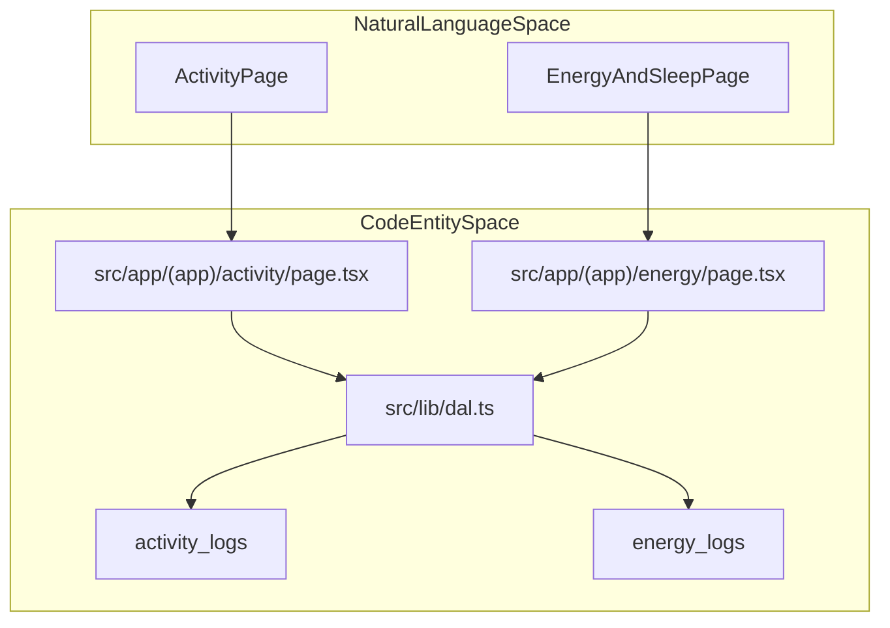
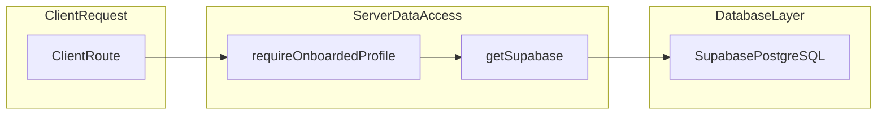

← [2.3 Database Schema, RLS & Migrations](2.3-database-schema-rls-migrations.md) · [Contents](../README.md) · [3.1 Activity Tracking](3.1-activity-tracking.md) →

---

# Tracking Features (App)

Relevant source files

The following files were used as context for generating this wiki page:

- `src/app/(app)/activity/page.tsx`
- `src/app/(app)/energy/page.tsx`

## Purpose and Scope
This page provides a high-level overview of the authenticated tracking surfaces within the `(app)` route group of the `immune.fit` application. These features encompass daily activity monitoring, energy and sleep check-ins, symptom and medication logging, onboarding flows, user settings, and data visualization primitives. 

As a parent page, this document outlines the tracking architecture and links directly to detailed child pages for specific sub-systems.

Sources: `src/app/(app)/activity/page.tsx:1-449`, `src/app/(app)/energy/page.tsx:1-439`

---

## 3.1 Activity Tracking
The activity surface (`/activity`) renders today's totals, weekly aggregates, user-defined goals, recent connected and manual workouts, and an activity logging interface. It executes Supabase queries via data access layer helpers to load user activity logs and aggregate statistics [src/app/(app)/activity/page.tsx:92-114].

For details, see [Activity Tracking](3.1-activity-tracking.md).

Sources: `src/app/(app)/activity/page.tsx:1-114`

---

## 3.2 Energy, Sleep & Insights
The energy surface (`/energy`) manages energy check-ins (`energy_logs`), rest and recovery stat tiles, sleep metrics (stages, efficiency, score), historical trend ranges, and threshold-gated insights unlocked by consistent logging [src/app/(app)/energy/page.tsx:22-42].

For details, see [Energy, Sleep & Insights](3.2-energy-sleep-insights.md).

Sources: `src/app/(app)/energy/page.tsx:22-42`

---

## 3.3 Symptoms, Medications & Reports
The symptoms and medications module handles logging physical symptoms, tracking medications, and compiling clinician-ready health reports via shared logging actions and helper utilities in `src/lib/symptoms.ts`.

For details, see [Symptoms, Medications & Reports](3.3-symptoms-medications-reports.md).

Sources: `src/app/(app)/activity/page.tsx:1-449`

---

## 3.4 Onboarding & Settings
The onboarding wizard (`/onboarding/[step]`) steps users through initial intake, profile creation, timezone configuration, and consent settings. Settings pages manage account preferences and account deletion cascades.

For details, see [Onboarding & Settings](3.4-onboarding-settings.md).

Sources: `src/app/(app)/activity/page.tsx:1-449`

---

## 3.5 Charts & Data Visualization
Data visualization is driven by reusable chart components (`LineChart`, `ColumnChart`, `ChartTable`, `StatTiles`) utilizing the `ChartPoint` data type and server-to-client formatting conventions.

For details, see [Charts & Data Visualization](3.5-charts-data-visualization.md).

Sources: `src/app/(app)/activity/page.tsx:1-14`, `src/app/(app)/energy/page.tsx:8-12`

---

## Architecture & Code Mapping

Title: "Tracking Surfaces to Code Entity Mapping"

Sources: `src/app/(app)/activity/page.tsx:1-69`, `src/app/(app)/energy/page.tsx:22-45`

Title: "Data Flow for Tracking Modules"

Sources: `src/app/(app)/activity/page.tsx:92-104`, `src/app/(app)/energy/page.tsx:54-63`

---

← [2.3 Database Schema, RLS & Migrations](2.3-database-schema-rls-migrations.md) · [Contents](../README.md) · [3.1 Activity Tracking](3.1-activity-tracking.md) →
