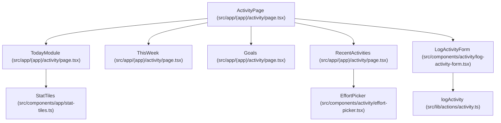
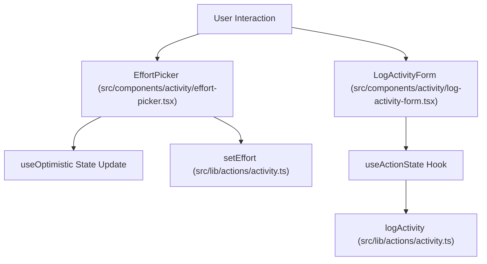

← [3 Tracking Features (App)](3-tracking-features-app.md) · [Contents](../README.md) · [3.1.1 Activity Server Actions & Goal Engine](3.1.1-activity-server-actions-goal-engine.md) →

---

# Activity Tracking

Relevant source files

The following files were used as context for generating this wiki page:

- `src/app/(app)/activity/page.tsx`
- `src/components/activity/effort-picker.tsx`
- `src/components/activity/log-activity-form.tsx`
- `src/lib/catalog/activities.ts`

## Purpose and Scope

The Activity Tracking module provides the primary authenticated surface for monitoring, logging, and managing physical activity within `immune.fit`. Located at `src/app/(app)/activity/page.tsx`, the page aggregates automated ingestion from connected wearable devices (via Open Wearables) with manual user logging, perceptual effort scoring, and customizable weekly or daily goals.

As a parent page, this document outlines the high-level architecture of the `/activity` page, its structural modules, and user-facing components. Detailed technical documentation regarding server actions, form validation, cache invalidation, and the underlying goal evaluation engine is delegated to child page [Activity Server Actions & Goal Engine](3.1.1-activity-server-actions-goal-engine.md).

Sources: `src/app/(app)/activity/page.tsx:37-41`

---

## Page Architecture & UI Modules

The `/activity` page is constructed as a `ModuleStack` containing multiple `Suspense`-wrapped server components and client-side form wrappers `src/app/(app)/activity/page.tsx:42-68`. 

### Structural Layout
- **`TodayModule`**: Fetches active daily stats (steps, distance, active minutes) and today's manual activity count via Supabase queries `src/app/(app)/activity/page.tsx:92-114`.
- **`ThisWeek`**: Renders weekly trend visualizations using `ColumnChart` and axis utilities `src/app/(app)/activity/page.tsx:50-52, 8-9`.
- **`Goals`**: Displays user-configured goals and progress metrics using `GoalCard` and `AddGoal` components `src/app/(app)/activity/page.tsx:11-12, 53-55`.
- **`RecentActivities`**: Queries the last 14 days of `activity_logs`, mapping records to activity icons (`iconFor`) and embedding an `EffortPicker` for each entry `src/app/(app)/activity/page.tsx:71-79, 117-142`.
- **`LogActivityForm`**: A manual entry interface for non-device recorded workouts `src/app/(app)/activity/page.tsx:59-61, src/components/activity/log-activity-form.tsx:15-32`.

Sources: `src/app/(app)/activity/page.tsx:42-68`, `src/components/activity/log-activity-form.tsx:15-32`, `src/components/activity/effort-picker.tsx:8-22`

---

## Interactive Components & Client Forms

The activity surface employs dedicated client components to manage immediate optimistic UI updates and interactive data entry without full page reloads.

### Effort Picker (`EffortPicker`)
The `EffortPicker` component allows users to assign or toggle perceptual exertion ratings (`easy`, `moderate`, `hard`) on individual activity logs `src/components/activity/effort-picker.tsx:8-32`. It leverages React's `useOptimistic` hook alongside `useTransition` to instantly reflect user input while triggering `setEffort` server actions in the background `src/components/activity/effort-picker.tsx:3-21`. Valid effort states are strictly typed via constants defined in `src/lib/catalog/activities.ts:18-28` `src/components/activity/effort-picker.tsx:5`.

### Manual Logging Form (`LogActivityForm`)
For activities untracked by wearable integrations, `LogActivityForm` provides a structured form supporting activity naming (with preset suggestion chips from `ACTIVITY_SUGGESTIONS`), duration steppers, optional mileage, day selection (`today` or `yesterday`), and initial effort tagging `src/components/activity/log-activity-form.tsx:15-142`. Form submission state is managed via React's `useActionState` tied to the `logActivity` server action `src/components/activity/log-activity-form.tsx:21-31`.

Sources: `src/components/activity/effort-picker.tsx:1-32`, `src/components/activity/log-activity-form.tsx:1-143`, `src/lib/catalog/activities.ts:1-29`

---

## Data Access & Server Action Overview

The `/activity` surface relies on DAL helpers (`requireUserId`, `requireOnboardedProfile`, `getSupabase`, `getToday`) to fetch filtered time-series activity data securely under Row Level Security (RLS) policies `src/app/(app)/activity/page.tsx:15`. 

Mutations such as manual logging, goal creation/removal, and effort updates are handled via dedicated server actions that validate input parameters, update the `activity_logs` or `goals` tables, and invalidate Next.js route caches.

For comprehensive implementation details on data mutations, validation rules, cache revalidation, and the underlying goal evaluation engine (`lib/goals.ts`), refer to the child page:
👉 **[Activity Server Actions & Goal Engine](3.1.1-activity-server-actions-goal-engine.md)**

Sources: `src/app/(app)/activity/page.tsx:15-34`

---

← [3 Tracking Features (App)](3-tracking-features-app.md) · [Contents](../README.md) · [3.1.1 Activity Server Actions & Goal Engine](3.1.1-activity-server-actions-goal-engine.md) →
