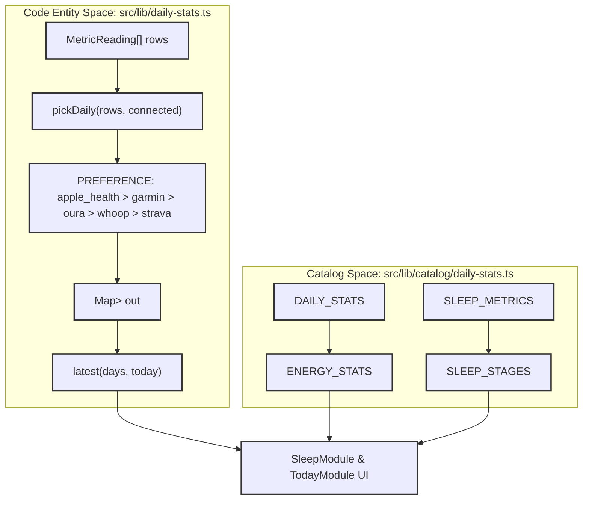
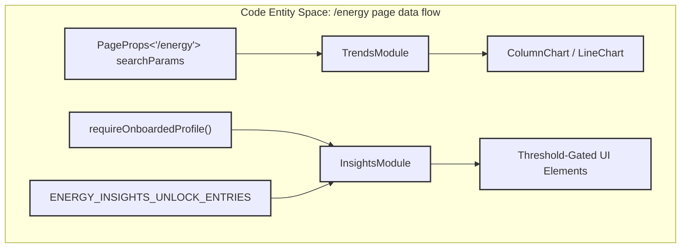

← [3.1.1 Activity Server Actions & Goal Engine](3.1.1-activity-server-actions-goal-engine.md) · [Contents](../README.md) · [3.3 Symptoms, Medications & Reports](3.3-symptoms-medications-reports.md) →

---

# Energy, Sleep & Insights

<details>
<summary>Relevant source files</summary>

The following files were used as context for generating this wiki page:

- `src/app/(app)/energy/page.tsx`
- `src/lib/catalog/daily-stats.ts`
- `src/lib/daily-stats.ts`

</details>


## Purpose and Scope

This page documents the implementation, data flow, and modular architecture of the `/energy` tracking surface in `immune.fit`. The energy surface serves as the primary dashboard for users to record subjective check-ins, view rest and recovery metrics (such as resting heart rate, HRV, and sleep stages), analyze two-week trends, and view threshold-gated insights. 

The feature leverages Next.js App Router server components wrapped in Suspense boundaries, querying the Data Access Layer (DAL) and processing wearable telemetry through provider-preference normalization pipelines.

---

## Page Architecture & Modules

The `/energy` page is structured as a single Server Component (`EnergyPage`) defined in `src/app/(app)/energy/page.tsx`. It renders a `PageHeader` followed by a `ModuleStack` containing five distinct modular blocks:

```
+-------------------------------------------------------+
|                     EnergyPage                        |
|              src/app/(app)/energy/page.tsx            |
+-------------------------------------------------------+
                           |
        +------------------+------------------+
        |                  |                  |
        v                  v                  v
+---------------+  +---------------+  +---------------+
| CheckinModule |  |  TodayModule  |  | SleepModule   |
| (energy_logs) |  |  (statTiles)  |  | (readDaily)   |
+---------------+  +---------------+  +---------------+
        |                  |                  |
        +------------------+------------------+
                           |
                           v
+-------------------------------------------------------+
|                   TrendsModule &                      |
|                  InsightsModule                       |
+-------------------------------------------------------+
```

*Sources: `src/app/(app)/energy/page.tsx:22-45`*, *`src/app/(app)/energy/page.tsx:53-167`*

### 1. Check-in Module (`CheckinModule`)
Queries the `energy_logs` table for the authenticated user (`userId`) on the current date (`today`), ordered by `logged_at` in descending order. It passes formatted records to the client component `<EnergyCheckin />`.
* `src/app/(app)/energy/page.tsx:53-72`

### 2. Rest & Recovery Module (`TodayModule`)
Retrieves daily recovery stats using `statTiles()` filtered against `ENERGY_STATS`. If no wearable is connected or no readings exist, it prompts the user to connect devices via `/connections`.
* `src/app/(app)/energy/page.tsx:75-96`

### 3. Sleep Module (`SleepModule`)
Analyzes the last 14 days of sleep metrics using `readDaily(SLEEP_METRICS, ...)`. Extracts the latest night's sleep score, efficiency, in-bed time, and sleep stages (`SLEEP_STAGES`), rendering both summary statistics and a 14-day history chart.
* `src/app/(app)/energy/page.tsx:100-167`

---

## Data Aggregation & Provider Resolution Pipeline

When multiple wearable providers (e.g., Apple Health, Garmin, Oura, Whoop) report overlapping metrics for the same day, `immune.fit` runs a deduplication and preference resolution pipeline via `src/lib/daily-stats.ts`.



### Key Functions
* `pickDaily(rows, connected)`: Iterates through raw `MetricReading` objects, validates finite numbers, filters by connected providers using a hardcoded device preference array (`apple_health` > `garmin` > `oura` > `whoop` > `strava`), and returns a nested map structure `metric -> day -> Pick`.
* `latest(days, today)`: Finds the most recent recorded day on or before `today` for a given metric map.

*Sources: `src/lib/daily-stats.ts:10-41`*, *`src/lib/catalog/daily-stats.ts:1-165`*

---

## Statistical Catalogs & Metric Mapping

Daily statistics are strictly typed and configured in `src/lib/catalog/daily-stats.ts`. Stats are partitioned into `energy` and `activity` pages.

| Metric Identifier | Label | Chart Type | Page Target | Formatting Rule |
|-------------------|-------|------------|-------------|-----------------|
| `resting_hr` | Resting heart rate | Line | Energy | `Math.round(v) + " bpm"` |
| `hrv` | HRV | Line | Energy | `Math.round(v) + " ms"` |
| `sleep_score` | Sleep score | Line | Energy | `Math.round(v)` |
| `body_battery` | Garmin Body Battery | Line | Energy | `Math.round(v)` |
| `recovery` | WHOOP Recovery | Line | Energy | `Math.round(v) + "%"` |
| `readiness` | Oura Readiness | Line | Energy | `Math.round(v)` |
| `stress` | Garmin Stress | Line | Energy | `Math.round(v)` |

Sleep stages are rendered using strict depth ordering (`sleep_deep_minutes`, `sleep_rem_minutes`, `sleep_light_minutes`, `sleep_awake_minutes`) with dynamic styling classes.

*Sources: `src/lib/catalog/daily-stats.ts:97-158`*

---

## Trends & Threshold-Gated Insights Architecture



* **Trends Module (`TrendsModule`)**: Receives `searchParams` from the Next.js page context to render historical column and line charts across configurable date ranges. Sparse labelling ensures that 30-day view columns remain legible on mobile and desktop viewports (`sparseLabel` renders a label every seventh day).
* **Insights Module (`InsightsModule`)**: Gated by thresholds defined in `src/lib/thresholds.ts` (`ENERGY_INSIGHTS_UNLOCK_ENTRIES`). Unlocks specialized analytical insights only when sufficient check-in and wearable data points have accumulated.

*Sources: `src/app/(app)/energy/page.tsx:22-50`, `src/app/(app)/energy/page.tsx:18-18`*

---

← [3.1.1 Activity Server Actions & Goal Engine](3.1.1-activity-server-actions-goal-engine.md) · [Contents](../README.md) · [3.3 Symptoms, Medications & Reports](3.3-symptoms-medications-reports.md) →
