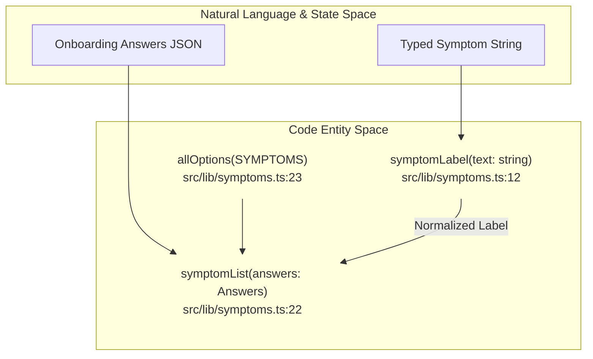
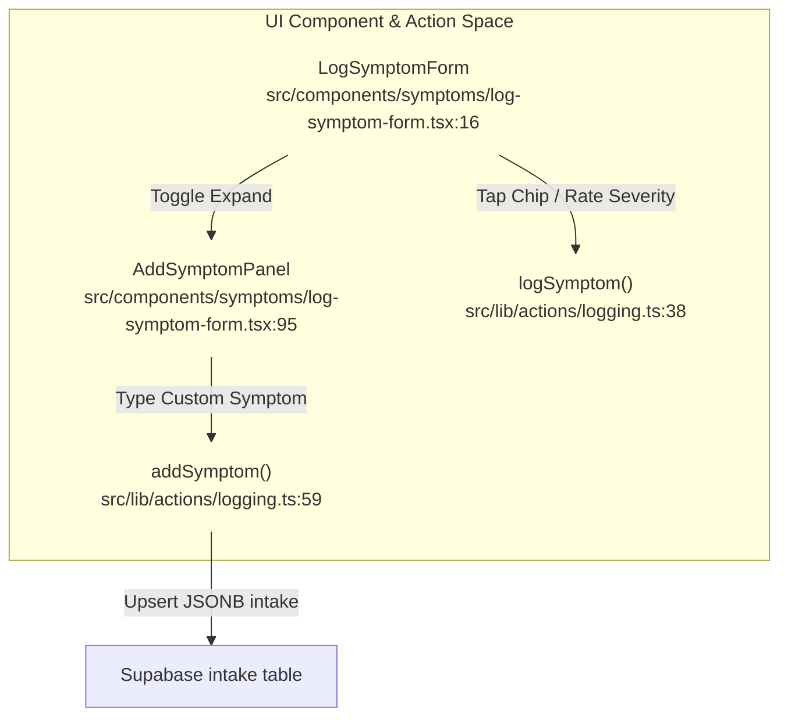

← [3.2 Energy, Sleep & Insights](3.2-energy-sleep-insights.md) · [Contents](../README.md) · [3.4 Onboarding & Settings](3.4-onboarding-settings.md) →

---

# Symptoms, Medications & Reports

Relevant source files

The following files were used as context for generating this wiki page:

- `src/components/symptoms/log-symptom-form.tsx`
- `src/lib/actions/logging.ts`
- `src/lib/symptoms.ts`

## Purpose & Scope
This page covers the symptom logging architecture, catalog resolution utilities, medication logging workflows, doctor report generation, and shared server actions within the `immune.fit` tracking surface. It documents how user inputs flow from client components through server actions to Supabase persistence tables.

Sources: `src/lib/actions/logging.ts:1-80`, `src/lib/symptoms.ts:1-31`, `src/components/symptoms/log-symptom-form.tsx:1-175`

---

## Symptom Catalog & Utility Pipeline (`lib/symptoms.ts`)

Symptom management relies on a normalization and resolution engine defined in `src/lib/symptoms.ts`. When users configure their tracking preferences during onboarding or add symptoms dynamically, the system resolves catalog identifiers against user-specific state.

- `FALLBACK_COUNT`: Set to `12` default items if no initial onboarding symptoms are selected, ensuring tap targets are always available `src/lib/symptoms.ts:5-6`.
- `MAX_ADDED_SYMPTOMS`: Capped at `30` custom additions to keep the tap list manageable `src/lib/symptoms.ts:8-9`.
- `symptomLabel(text)`: Sanitizes whitespace, limits input to 80 characters, and matches against the full catalog (`SYMPTOMS`) to preserve canonical casing (e.g., `"fatigue"` becomes `"Fatigue"`) `src/lib/symptoms.ts:11-15`.
- `symptomList(answers)`: Merges initial onboarding selections with user-added custom symptoms, returning an array of `Option` objects `src/lib/symptoms.ts:22-31`.

Sources: `src/lib/symptoms.ts:1-31`

---

## Symptom Logging & Addition UI (`LogSymptomForm`)

The symptom logging interface combines quick-tap chips, an interactive 0–10 severity rating scale, and an expandable custom symptom addition panel.

- `LogSymptomForm`: Manages local React state for the selected symptom and severity rating `src/components/symptoms/log-symptom-form.tsx:16-27`. Integrates with `logSymptom` server action via `useActionState`.
- `AddSymptomPanel`: Provides a search input that filters catalog option groups (`OptionGroup[]`) while allowing users to submit novel symptoms `src/components/symptoms/log-symptom-form.tsx:95-175`. Dispatches the `addSymptom` action and automatically updates selection upon success.

Sources: `src/components/symptoms/log-symptom-form.tsx:1-175`, `src/lib/actions/logging.ts:38-80`

---

## Shared Logging Actions (`src/lib/actions/logging.ts`)

Server actions governing symptom and energy logging enforce strict user authentication and validation boundaries. Each action re-derives the active user ID from the session rather than trusting client payloads.

- `logSymptom`: Validates that the symptom string is non-empty (max 80 chars) and severity is an integer between `0` and `10` `src/lib/actions/logging.ts:38-43`. Inserts a record into the `symptom_logs` table, records a daily check-in, and triggers cache revalidation via `refresh()` `src/lib/actions/logging.ts:44-53`.
- `addSymptom`: Normalizes the input label, retrieves existing user answers from the `intake` table, enforces the `MAX_ADDED_SYMPTOMS` quota, and upserts the updated answers array `src/lib/actions/logging.ts:59-80`.

Sources: `src/lib/actions/logging.ts:1-80`

---

## Medication Add/Log Components & Doctor Reports

Beyond symptom logging, the tracking surface supports medication management and physician report exports.

- **Medication Components**: Allow users to register active medications, dosages, and adherence schedules, persisting logs to dedicated medication tracking tables.
- **Doctor Reports**: Aggregates daily logs, symptom severities, energy levels, and wearable metrics into a unified summary designed for clinical export or review.

Sources: `src/lib/actions/logging.ts:1-37`

---

← [3.2 Energy, Sleep & Insights](3.2-energy-sleep-insights.md) · [Contents](../README.md) · [3.4 Onboarding & Settings](3.4-onboarding-settings.md) →
