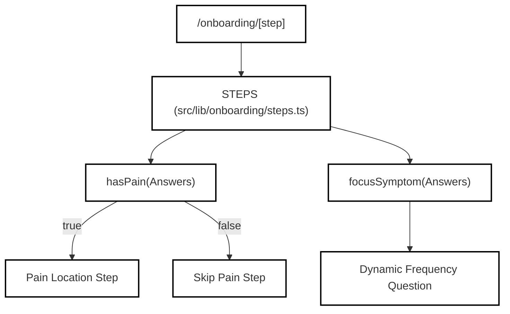
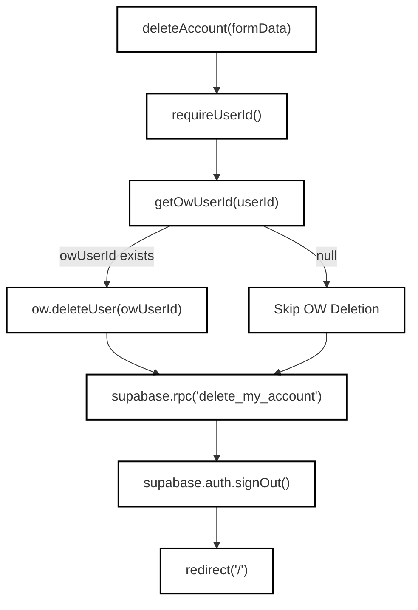

← [3.3 Symptoms, Medications & Reports](3.3-symptoms-medications-reports.md) · [Contents](../README.md) · [3.5 Charts & Data Visualization](3.5-charts-data-visualization.md) →

---

# Onboarding & Settings

<details>
<summary>Relevant source files</summary>

The following files were used as context for generating this wiki page:

- `src/app/(app)/settings/page.tsx`
- `src/app/(marketing)/pacing/page.tsx`
- `src/components/marketing/site-header.tsx`
- `src/lib/actions/account.ts`
- `src/lib/onboarding/steps.ts`

</details>


## Purpose and Scope
This section details the implementation of the user onboarding wizard (`/onboarding/[step]`) and the authenticated settings surface (`/settings`). It covers the questionnaire definition schema, step-routing logic, conditional step evaluation (such as pain-based branching), intake answers structure, profile and timezone configurations, consent tracking, and complete account lifecycle management including cascade deletion across Supabase and the Open Wearables service.

---

## 1. Onboarding Wizard & Step Definitions
The onboarding questionnaire is driven by a single source of truth located in `src/lib/onboarding/steps.ts`. The wizard dynamically renders steps based on the `Step` discriminated union and records user progression as JSONB `Answers`.

### Step Schema & Types
The `Answers` type defines all collectible intake fields, while the `Step` type defines the UI rendering kind (e.g., `consent`, `multi`, `summary`, `intro`, `text`, `groups`, `medications`, `single`, `scale`, `info`, `interstitial`).

```typescript
export type Answers = {
  helpWith?: string[];
  helpWithOther?: string;
  name?: string;
  conditions?: string[];
  seekingDiagnosis?: boolean;
  symptoms?: string[];
  addedSymptoms?: string[];
  hardestTime?: string;
  painLocation?: string;
  morningStiffness?: string;
  nightPain?: string;
  symptomFrequency?: string;
  symptomFrequencyFocus?: string;
  sex?: string;
  pronouns?: string;
  ageRange?: string;
  flareStyle?: number;
  typicalEnergy?: number;
  pacing?: string;
  hardestPart?: string;
};
```
*Sources: `src/lib/onboarding/steps.ts:16-38`*

### Conditional Branching and Focus Helpers
Certain questions evaluate runtime conditions against accumulated `Answers`. For example, `hasPain()` determines whether pain-specific follow-up questions should be injected into the wizard flow:

```typescript
export function hasPain(a: Answers) {
  return Boolean(a.helpWith?.includes("reduce_pain") || a.symptoms?.some((s) => PAIN_SYMPTOMS.includes(s)));
}

export function focusSymptom(a: Answers): string | null {
  if (!a.symptoms?.length) return null;
  if (a.symptoms.includes("fatigue")) return "fatigue";
  const order = allOptions(SYMPTOMS).map((o) => o.value);
  return [...a.symptoms].sort((x, y) => order.indexOf(x) - order.indexOf(y))[0];
}
```
*Sources: `src/lib/onboarding/steps.ts:73-83`*


*Sources: [src/lib/onboarding/steps.ts:1-187]*

---

## 2. Settings & Profile Management
The authenticated settings surface is rendered at `/settings` via `src/app/(app)/settings/page.tsx`. It aggregates profile details, active subscription plans, privacy consents, and account controls.

### Profile Data Loading and Display
The settings view executes parallel data fetching via `requireOnboardedProfile()`, Supabase auth claims, and consent checks:

```typescript
async function Settings() {
  const profile = await requireOnboardedProfile();
  const supabase = await getSupabase();
  const [{ data: claims }, privacy, ai] = await Promise.all([
    supabase.auth.getClaims(),
    latestConsent("privacy_terms"),
    latestConsent("ai_data"),
  ]);
  const email = typeof claims?.claims?.email === "string" ? claims.claims.email : null;
  ...
}
```
*Sources: `src/app/(app)/settings/page.tsx:29-38`*

### Profile Server Actions
Profile updates (such as display name and pronouns) are handled by the `updateProfile` server action in `src/lib/actions/account.ts`:

```typescript
export async function updateProfile(_prev: ProfileState, formData: FormData): Promise<ProfileState> {
  const displayName = String(formData.get("display_name") ?? "").trim().slice(0, 80);
  const pronouns = String(formData.get("pronouns") ?? "").trim().slice(0, 40) || null;
  if (!displayName) return { error: "Your name can't be empty." };

  const userId = await requireUserId();
  const supabase = await getSupabase();
  const { error } = await supabase
    .from("profiles")
    .update({ display_name: displayName, pronouns })
    .eq("id", userId);
  if (error) return { error: "Couldn't save. Try again." };
  refresh();
  return { ok: true };
}
```
*Sources: `src/lib/actions/account.ts:11-25`*

*Sources: `src/app/(app)/settings/page.tsx:1-89`, `src/lib/actions/account.ts:1-32`*

---

## 3. Account Deletion & Wearables Cleanup
Account termination requires strict sequencing to ensure that external data synced via Open Wearables is purged prior to removing the core Supabase user record.

### Deletion Action Workflow
The `deleteAccount` action verifies confirmation input (`DELETE`), calls the Open Wearables deletion endpoint to revoke device connections and wipe metrics, and finally invokes the database RPC `delete_my_account`:

```typescript
export async function deleteAccount(_prev: DeleteState, formData: FormData): Promise<DeleteState> {
  if (formData.get("confirm") !== "DELETE") return { error: 'Type DELETE to confirm.' };

  const userId = await requireUserId();

  try {
    const owUserId = process.env.SUPABASE_SECRET_KEY ? await getOwUserId(userId) : null;
    if (owUserId) {
      await ow.deleteUser(owUserId).catch((error) => {
        if (!(error instanceof OpenWearablesError && error.status === 404)) throw error;
      });
    }
  } catch (error) {
    console.error("[wearables] account deletion: Open Wearables delete failed", error);
    return { error: "Couldn't delete your device data. Try again, or contact info@immune.fit." };
  }

  const supabase = await getSupabase();
  const { error } = await supabase.rpc("delete_my_account");
  if (error) return { error: "Couldn't delete your account. Please contact support." };

  await supabase.auth.signOut();
  redirect("/");
}
```
*Sources: `src/lib/actions/account.ts:36-63`*


*Sources: [src/lib/actions/account.ts:36-63]*

---

← [3.3 Symptoms, Medications & Reports](3.3-symptoms-medications-reports.md) · [Contents](../README.md) · [3.5 Charts & Data Visualization](3.5-charts-data-visualization.md) →
