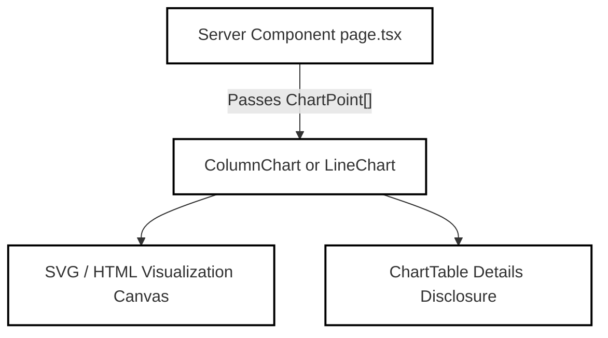
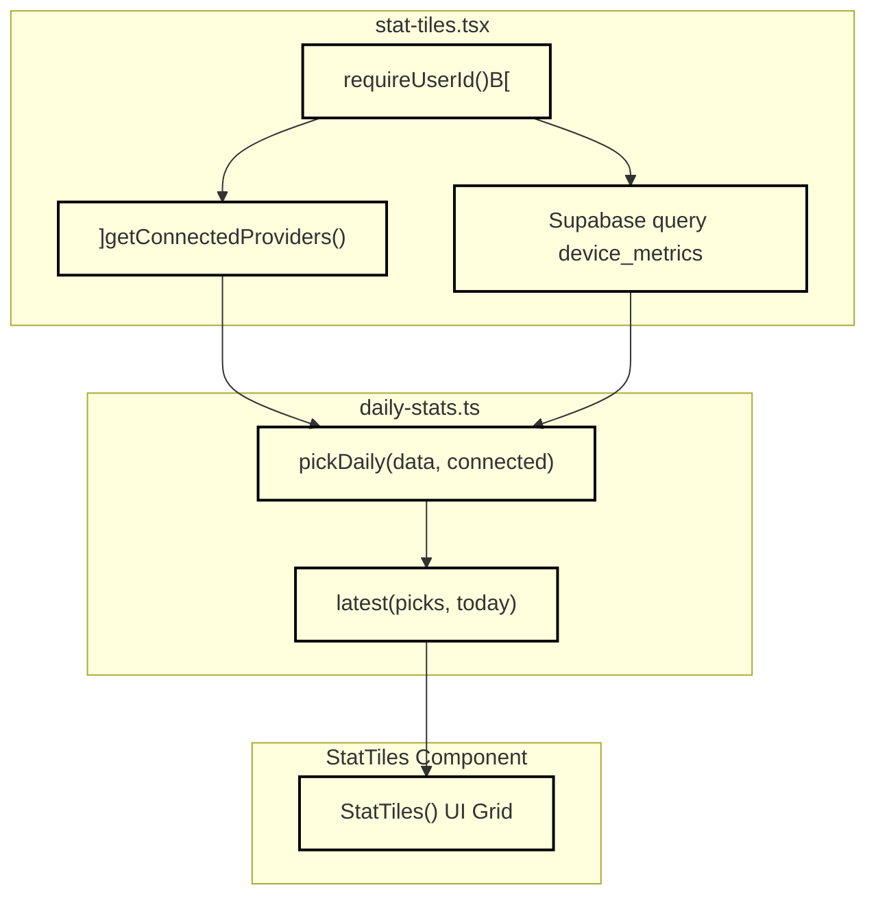

← [3.4 Onboarding & Settings](3.4-onboarding-settings.md) · [Contents](../README.md) · [4 Wearables Integration (Open Wearables)](4-wearables-integration-open-wearables.md) →

---

# Charts & Data Visualization

<details>
<summary>Relevant source files</summary>

The following files were used as context for generating this wiki page:

- `src/app/(app)/symptoms/page.tsx`
- `src/components/activity/goal-card.tsx`
- `src/components/activity/goal-form.tsx`
- `src/components/app/stat-tiles.tsx`
- `src/components/charts/axis.ts`
- `src/components/charts/chart-table.tsx`
- `src/components/charts/column-chart.tsx`
- `src/components/charts/line-chart.tsx`
- `src/components/charts/types.ts`
- `src/components/energy/energy-checkin.tsx`

</details>


This page documents the visualization architecture of `immune.fit`, covering the core data types, client-side chart primitives (`LineChart`, `ColumnChart`, `ChartTable`), axis scaling helpers, server-side metric aggregations (`statTiles`), and the server-to-client formatting conventions required by Next.js Server Components passing data down to Client Components.

---

## 1. Data Model & Formatting Conventions (`ChartPoint`)

Charts in the application are rendered as Client Components (marked `"use client"`) to support interactivity like tooltips, crosshairs, and pointer tracking `[src/components/charts/column-chart.tsx:1]`, `[src/components/charts/line-chart.tsx:1]`. However, data processing and queries occur on the server. Because JavaScript functions cannot be serialized across the Server-to-Client boundary, Server Components pre-format values or provide pre-computed strings via the `ChartPoint` type `[src/components/charts/types.ts:1-14]`.

The `ChartPoint` type defines the universal shape of a single data point across all charts:

```typescript
export type ChartPoint = {
  key: string;
  label: string; // x-axis tick
  value: number | null;
  detail: string; // tooltip / table label, e.g. "Tue, Oct 14"
  display?: string;
};
```

- `value: null` represents missing data or unlogged days, which are rendered as distinct visual gaps (or dropped lines) rather than falling back to `0` `[src/components/charts/types.ts:1]`, `[src/components/charts/line-chart.tsx:13]`.
- `display` allows Server Components to supply locale-formatted strings (e.g., `"12,400"`), bypassing client-side internationalization limitations `[src/components/charts/types.ts:7-13]`.

Sources: `[src/components/charts/types.ts:1-14]`, `[src/components/charts/column-chart.tsx:1-11]`, `[src/components/charts/line-chart.tsx:1-13]`

---

## 2. Chart Components (`LineChart`, `ColumnChart`, `ChartTable`)

### ColumnChart
`ColumnChart` renders single-series categorical data as vertical bars with rounded caps `[src/components/charts/column-chart.tsx:8-11]`. It accepts points, maximum scale values, ticks, and optional target thresholds `[src/components/charts/column-chart.tsx:12-35]`.
- Bars are restricted to a maximum width of `24px` with a minimum height of `3px` for non-null values `[src/components/charts/column-chart.tsx:9]`, `[src/components/charts/64-68]`.
- Null values render as small horizontal baseline indicators (`h-0.5 w-2.5 bg-line`) `[src/components/charts/column-chart.tsx:61-62]`.
- Interactive hover states trigger a fixed tooltip positioned at `bottom-full` displaying `p.detail` and `valueLabel` `[src/components/charts/column-chart.tsx:70-80]`.

### LineChart
`LineChart` renders continuous time-series data inside an SVG canvas with a 10% accent area wash, interactive crosshairs, and keyboard navigation (`ArrowLeft`, `ArrowRight`) `[src/components/charts/line-chart.tsx:9-13]`.
- Component width is dynamically observed via `ResizeObserver` `[src/components/charts/line-chart.tsx:35-41]`.
- Contiguous non-null points are segmented into distinct SVG `<path>` elements, ensuring null gaps break the line cleanly `[src/components/charts/line-chart.tsx:48-55]`.

### ChartTable
Every chart automatically includes a disclosure-wrapped fallback table via `ChartTable` `[src/components/charts/chart-table.tsx:4-12]`. This guarantees accessibility compliance by exposing all underlying chart metrics in semantic HTML `<table>` format without requiring mouse hover or pointer interaction `[src/components/charts/chart-table.tsx:13-33]`.


*Figure 3.5.1: Chart Component Rendering Flow linking `page.tsx` data producers to chart display layers (`ColumnChart`, `LineChart`, `ChartTable`).*

Sources: `[src/components/charts/column-chart.tsx:1-110]`, `[src/components/charts/line-chart.tsx:1-147]`, `[src/components/charts/chart-table.tsx:1-34]`

---

## 3. Axis & Scaling Helpers (`niceMax`, `compact`)

To prevent hardcoded chart ceiling limits, axis calculations rely on pure mathematical utility functions defined in `src/components/charts/axis.ts`:

- `niceMax(v: number)`: Calculates clean ceiling bounds for charts by evaluating powers of ten multiplied by `1`, `2`, or `5` at or above the target value `[src/components/charts/axis.ts:2-7]`.
- `compact(t: number)`: Formats large numeric axis ticks into compact strings (e.g., `12400` becomes `"12.4k"`) to preserve layout width on mobile viewports `[src/components/charts/axis.ts:9-10]`.

Sources: `[src/components/charts/axis.ts:1-10]`

---

## 4. Stat Tiles & Daily Aggregations (`statTiles`, `StatTiles`, `readDaily`)

Stat tiles summarize wearable and daily metric telemetry across the authenticated app surfaces (such as the energy and activity dashboards) `[src/components/app/stat-tiles.tsx:30-45]`.


*Figure 3.5.2: Server-side Dataflow mapping `statTiles` execution through `readDaily` to the `StatTiles` grid UI component.*

### Implementation Details
- `readDaily(metrics, from)`: Queries the `device_metrics` Supabase table for the active user ID across a specified list of metric keys starting from a given `Day` offset `[src/components/app/stat-tiles.tsx:9-22]`. It concurrently retrieves connected providers `[src/components/app/stat-tiles.tsx:12-20]` and delegates resolution logic to `pickDaily` `[src/components/app/stat-tiles.tsx:21]`.
- `statTiles(stats, today)`: Iterates over a catalog of `DailyStat` definitions, extracts the latest recorded value within a 7-day window (`addDays(today, -6)`), and omits metrics that lack telemetry `[src/components/app/stat-tiles.tsx:35-45]`.
- `StatTiles`: Renders a responsive CSS grid (`grid-cols-2 sm:grid-cols-3`) displaying formatted values alongside captions indicating time elapsed and device source provenance (`deviceName`) if multiple providers are connected `[src/components/app/stat-tiles.tsx:47-76]`.

Sources: `[src/components/app/stat-tiles.tsx:1-79]`, `[src/app/(app)/symptoms/page.tsx:41-104]`, `[src/components/activity/goal-card.tsx:14-40]`

---

← [3.4 Onboarding & Settings](3.4-onboarding-settings.md) · [Contents](../README.md) · [4 Wearables Integration (Open Wearables)](4-wearables-integration-open-wearables.md) →
