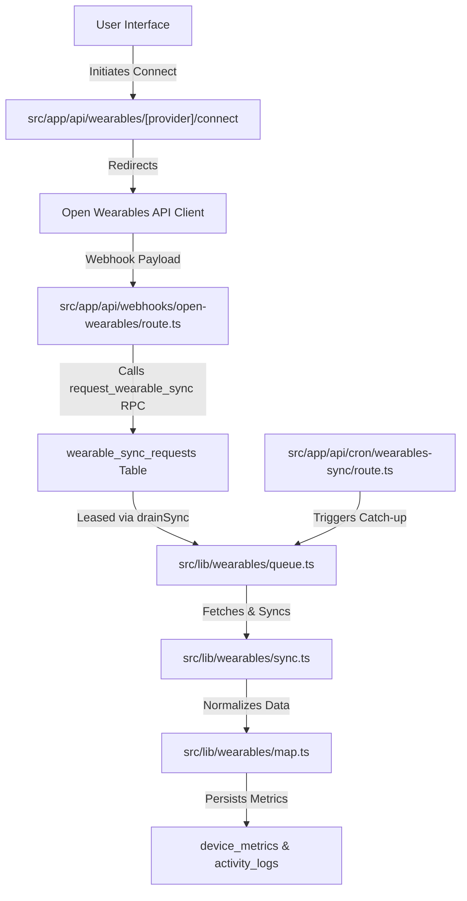

← [3.5 Charts & Data Visualization](3.5-charts-data-visualization.md) · [Contents](../README.md) · [4.1 Provider Connection Flow](4.1-provider-connection-flow.md) →

---

# Wearables Integration (Open Wearables)

Relevant source files

The following files were used as context for generating this wiki page:

- `src/app/api/cron/wearables-sync/route.ts`
- `src/app/api/webhooks/open-wearables/route.ts`
- `src/lib/wearables/config.ts`
- `src/lib/wearables/queue.ts`
- `supabase/migrations/20261019190000_wearable_sync_queue.sql`

This page provides a high-level overview of the wearables data pipeline within `immune.fit`. The system integrates external health data providers (such as Oura, Whoop, Garmin, and Strava) via Open Wearables (OW), handling OAuth connections, Svix-verified webhooks, a debounced synchronization queue, and normalization into internal database tables.

As a parent page, this document outlines the macro architecture and data flow. For deep technical specifications, consult the child pages linked below:
- **[Provider Connection Flow](4.1-provider-connection-flow.md)** — OAuth initiation, callback handling, `wearable_accounts`, device catalogs, and disconnection workflows.
- **[Sync Queue, Webhooks & Cron](4.2-sync-queue-webhooks-cron.md)** — Svix webhook verification, `wearable_sync_requests`, `drainSync` leasing logic, and daily cron catch-ups.
- **[Metric Mapping & AI Source Rules](4.3-metric-mapping-ai-source-rules.md)** — Normalization in `wearables/map.ts`, Open Wearables API wrappers (`client.ts`), and strict `AI_RULES`/`aiAllowedSources` data filters.

---

## Pipeline Architecture & Data Flow

The wearables integration follows an asynchronous, event-driven architecture designed to prevent rate-limiting and database connection exhaustion from high-frequency event bursts (e.g., bulk Apple Health uploads) `src/lib/wearables/queue.ts:7-13`. 

### Architecture Diagram: Natural Language to Code Entity Space

**Sources:**
- `src/lib/wearables/queue.ts` `src/lib/wearables/queue.ts:7-87`
- `src/app/api/webhooks/open-wearables/route.ts` `src/app/api/webhooks/open-wearables/route.ts:24-62`
- `src/app/api/cron/wearables-sync/route.ts` `src/app/api/cron/wearables-sync/route.ts:25-43`
- `supabase/migrations/20261019190000_wearable_sync_queue.sql` `supabase/migrations/20261019190000_wearable_sync_queue.sql:10-34`

---

## 4.1 Provider Connection Flow

Device integration begins when a user connects an external provider through the UI settings or connections page. The application uses dynamic Next.js API routes (`/api/wearables/[provider]/connect` and corresponding callback endpoints) to broker OAuth handshakes with Open Wearables. Connected accounts are tracked securely via the `wearable_accounts` table using Supabase service role privileges. 

For full details on route handlers, session validation, device catalog mapping (`src/lib/catalog/devices.ts`), and teardown logic, see **[Provider Connection Flow](4.1-provider-connection-flow.md)**.

**Sources:**
- `src/lib/wearables/config.ts` `src/lib/wearables/config.ts:15-20`

---

## 4.2 Sync Queue, Webhooks & Cron

Open Wearables notifies the application of data changes via webhooks. To handle high-volume event streams (such as initial device synchronizations emitting hundreds of events per minute), incoming webhook requests are verified using Svix headers and collapsed into a single pending window per user in the `wearable_sync_requests` table `supabase/migrations/20261019190000_wearable_sync_queue.sql:10-34`. 

Background execution (`after()`) runs the `drainSync` routine with leasing safeguards to process payloads safely `src/lib/wearables/queue.ts:45-87`. Additionally, a daily cron job (`src/app/api/cron/wearables-sync/route.ts`) acts as a catch-up mechanism to ensure no data is missed due to dropped webhooks `src/app/api/cron/wearables-sync/route.ts:25-43`.

For implementation details on Svix verification, lease locking, and cron schedules (`vercel.json`), see **[Sync Queue, Webhooks & Cron](4.2-sync-queue-webhooks-cron.md)**.

**Sources:**
- `src/lib/wearables/queue.ts` `src/lib/wearables/queue.ts:1-120`
- `src/app/api/webhooks/open-wearables/route.ts` `src/app/api/webhooks/open-wearables/route.ts:1-62`
- `src/app/api/cron/wearables-sync/route.ts` `src/app/api/cron/wearables-sync/route.ts:1-43`
- `supabase/migrations/20261019190000_wearable_sync_queue.sql` `supabase/migrations/20261019190000_wearable_sync_queue.sql:1-36`

---

## 4.3 Metric Mapping & AI Source Rules

Once a sync window is processed, raw payloads retrieved from Open Wearables must be mapped into canonical application structures (`device_metrics` and `activity_logs`). This normalization layer (`src/lib/wearables/map.ts`) standardizes metrics across different hardware vendors. Furthermore, the AI companion relies on strict source governance (`AI_RULES` and `aiAllowedSources`) to restrict context ingestion to verified providers (such as Strava, Garmin, and Oura), preventing low-quality or duplicate inputs from influencing AI insights.

For technical deep-dives into normalization algorithms, API wrappers (`src/lib/wearables/client.ts`), and source restrictions, see **[Metric Mapping & AI Source Rules](4.3-metric-mapping-ai-source-rules.md)**.

**Sources:**
- `src/lib/wearables/config.ts` `src/lib/wearables/config.ts:1-24`

---

← [3.5 Charts & Data Visualization](3.5-charts-data-visualization.md) · [Contents](../README.md) · [4.1 Provider Connection Flow](4.1-provider-connection-flow.md) →
