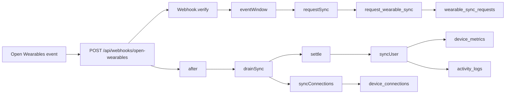
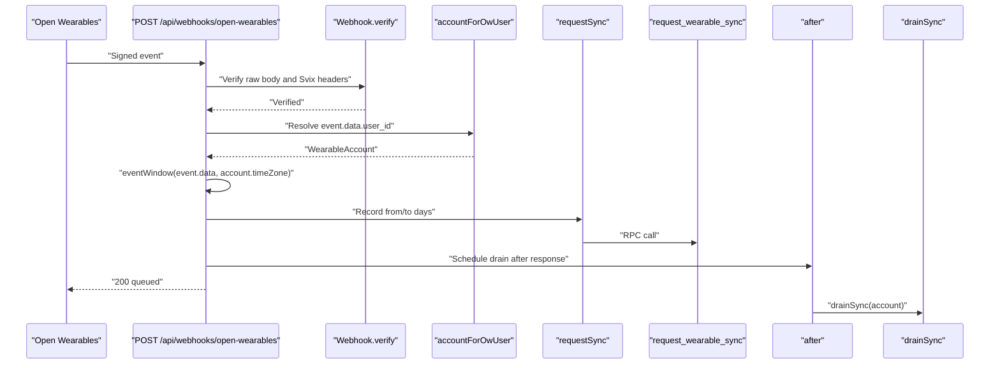
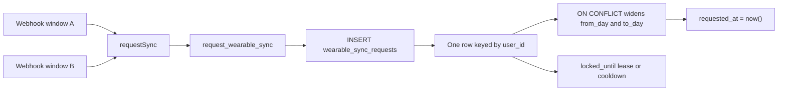
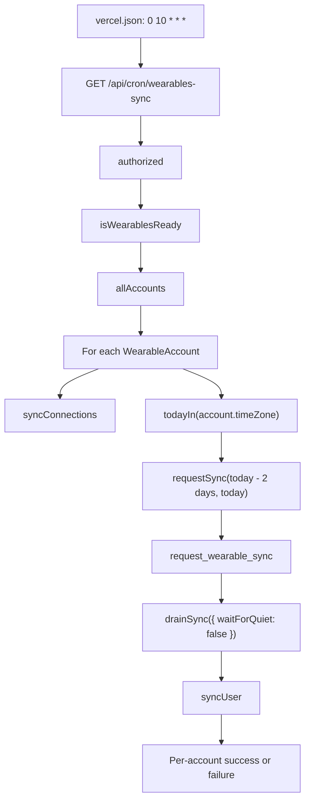

← [4.1 Provider Connection Flow](4.1-provider-connection-flow.md) · [Contents](../README.md) · [4.3 Metric Mapping & AI Source Rules](4.3-metric-mapping-ai-source-rules.md) →

---

# Sync Queue, Webhooks & Cron

Relevant source files

The following files were used as context for generating this wiki page:

- `src/app/api/cron/wearables-sync/route.ts`
- `src/app/api/webhooks/open-wearables/route.ts`
- `src/lib/wearables/queue.ts`
- `src/lib/wearables/sync.ts`
- `supabase/migrations/20261018200000_open_wearables.sql`
- `supabase/migrations/20261019190000_wearable_sync_queue.sql`
- `vercel.json`

## Purpose and scope

This page documents the wearable sync pipeline: how Open Wearables (OW) webhook events are verified and queued, how `drainSync` leases and settles pending work, and how the daily cron refreshes connection status and catches up on recent data. It covers the queue schema and RPC, the webhook and cron routes, and the sync operations they invoke. `src/app/api/webhooks/open-wearables/route.ts:12-22``src/lib/wearables/queue.ts:7-18``src/app/api/cron/wearables-sync/route.ts:20-24``supabase/migrations/20261019190000_wearable_sync_queue.sql:10-36`

Sources: `src/app/api/webhooks/open-wearables/route.ts`, `src/lib/wearables/queue.ts`, `src/app/api/cron/wearables-sync/route.ts`, `supabase/migrations/20261019190000_wearable_sync_queue.sql`

## Architecture at a glance

Webhook events do not directly trigger a full sync. A verified data event is converted to a day window and recorded through `requestSync`; the route schedules `drainSync` with Next.js `after()`. The queue coalesces changed-day windows per user, and the drain re-reads those days from OW. The daily cron independently refreshes connection status, queues a three-day window, and drains immediately. `src/app/api/webhooks/open-wearables/route.ts:24-57``src/lib/wearables/queue.ts:7-18``src/app/api/cron/wearables-sync/route.ts:20-42`

**Diagram: Natural-language sync pipeline mapped to code entities**

Sources: `src/app/api/webhooks/open-wearables/route.ts:1-5,24-57`, `src/lib/wearables/queue.ts:32-45,61-78,102-121`, `src/lib/wearables/sync.ts:21-57,59-104,113-138`, `supabase/migrations/20261019190000_wearable_sync_queue.sql:10-34`

The queue exists to collapse bursts of events into one pending request per user. Its implementation comments describe the motivating case: a phone’s first Apple Health upload can generate hundreds of events in minutes, making one sync per event overload OW. The queue merges the affected date ranges and lets a drain re-read the combined window after events quiet down. `src/lib/wearables/queue.ts:7-18``supabase/migrations/20261019190000_wearable_sync_queue.sql:1-8`

Sources: `src/lib/wearables/queue.ts`, `supabase/migrations/20261019190000_wearable_sync_queue.sql`

## Webhook verification and event handling

`POST` in `src/app/api/webhooks/open-wearables/route.ts` reads `OPEN_WEARABLES_WEBHOOK_SECRET`. If it is absent, the route returns `503`. Otherwise it reads the raw request body and verifies it with Svix, supplying the `svix-id`, `svix-timestamp`, and `svix-signature` headers. A `WebhookVerificationError` returns `401`; other verification errors are rethrown. The route comment notes that verification also rejects signatures older than five minutes. `src/app/api/webhooks/open-wearables/route.ts:24-39`

Sources: `src/app/api/webhooks/open-wearables/route.ts`

After verification, the handler parses the event and reads `event.data.user_id`. Missing user IDs return an ignored response. `accountForOwUser` resolves the OW identity to a wearable account; an unknown user also returns an ignored response. Connection events, identified by the `connection.` prefix, call `syncConnections` immediately and return success. Other events are mapped to a day range with `eventWindow`, recorded with `requestSync`, and followed by an `after()` callback that invokes `drainSync`. `src/app/api/webhooks/open-wearables/route.ts:40-57`

Sources: `src/app/api/webhooks/open-wearables/route.ts`

The route returns a successful queued response after the request is recorded, rather than waiting for the data sync. If handling throws, it logs the event type and returns `500`; the route comment explains that recording failures return an error so Svix can retry. The route sets `maxDuration` to 300 seconds. `src/app/api/webhooks/open-wearables/route.ts:7-8,19-22,45-61`

Sources: `src/app/api/webhooks/open-wearables/route.ts`

**Diagram: Webhook request path mapped to route and queue functions**

Sources: `src/app/api/webhooks/open-wearables/route.ts:24-57`, `src/lib/wearables/queue.ts:32-38,45-45`, `supabase/migrations/20261019190000_wearable_sync_queue.sql:22-34`

## Event windows and queued requests

`eventWindow(data, timeZone)` recursively looks for date values under the keys `date`, `start_time`, `end_time`, `timestamp`, and `recorded_at`. It limits traversal depth to four and array traversal to 10,000 items. Date-only strings are retained as days; other parseable date strings are converted using `dayIn` for the account’s timezone. `src/lib/wearables/sync.ts:106-132`

Sources: `src/lib/wearables/sync.ts`

If no dates are found, `eventWindow` falls back to today and the previous two days in the account’s timezone. Otherwise it selects the earliest and latest discovered days, then clamps both to a range no earlier than `MAX_SYNC_DAYS` before today and no later than today. `MAX_SYNC_DAYS` is 90. `src/lib/wearables/sync.ts:15-16,113-138`

Sources: `src/lib/wearables/sync.ts`

`requestSync(userId, from, to)` calls the admin client’s `request_wearable_sync` RPC with `p_user_id`, `p_from`, and `p_to`. If the RPC returns an error, `requestSync` throws. `src/lib/wearables/queue.ts:32-39`

Sources: `src/lib/wearables/queue.ts`

The migration defines `wearable_sync_requests` with one row per user: `user_id` is the primary key and references `auth.users`; `from_day` and `to_day` hold the pending window, with a constraint that `to_day >= from_day`; `requested_at` defaults to the current time; and `locked_until` stores the lease or cooldown deadline. RLS is enabled, with no grant intentionally provided. `supabase/migrations/20261019190000_wearable_sync_queue.sql:10-20`

Sources: `supabase/migrations/20261019190000_wearable_sync_queue.sql`

The `request_wearable_sync(p_user_id, p_from, p_to)` SQL function inserts a normalized range using `least` and `greatest`. On a user conflict, it widens the existing window to include the new range and updates `requested_at` to `now()`, which records the latest event time for quiet-period settling. Execution is revoked from `public`, `anon`, and `authenticated`; the application invokes it through its admin client. `supabase/migrations/20261019190000_wearable_sync_queue.sql:22-36``src/lib/wearables/queue.ts:32-38`

Sources: `supabase/migrations/20261019190000_wearable_sync_queue.sql`, `src/lib/wearables/queue.ts`

**Diagram: Queue request semantics mapped to database entities**

Sources: `src/lib/wearables/queue.ts:32-39,50-59,82-85`, `supabase/migrations/20261019190000_wearable_sync_queue.sql:10-37`

## `drainSync`: leasing, settling, syncing, and completion

`drainSync(account, { waitForQuiet = true })` uses the admin client to claim a queue row before processing. It sets `locked_until` to the current time plus `LEASE_MS` (330,000 ms), but only when the existing lock is null or expired. The update is filtered by the account’s `userId`; if the claim errors, the function throws, and if no row is claimed it returns without syncing. The code comments describe concurrent claims as serializing on the row so only one run wins. `src/lib/wearables/queue.ts:20-28,45-59`

Sources: `src/lib/wearables/queue.ts`

After a successful claim, the drain loops while elapsed time is below `BUDGET_MS` (200,000 ms). Each iteration calls `settle(userId, waitForQuiet)`. If there is no pending row, it returns. Otherwise it calls `syncUser` for that pending range, then tries to delete the queue row only if both `user_id` and the captured `requested_at` still match. This conditional delete prevents a request updated during the sync from being treated as completed. `src/lib/wearables/queue.ts:24-25,61-79`

Sources: `src/lib/wearables/queue.ts`

When the conditional delete succeeds, `refreshConnections` calls `syncConnections` and the drain returns. A connection refresh failure is logged and does not turn a completed data sync into a failure. If the budget expires while events are still arriving, the drain clears `locked_until` so a later webhook or cron can take over. If an exception occurs, it updates `locked_until` to five minutes in the future (`COOLDOWN_MS`) and rethrows; the pending request remains available for a later attempt. `src/lib/wearables/queue.ts:28,68-85,89-100`

Sources: `src/lib/wearables/queue.ts`

`settle(userId, waitForQuiet)` repeatedly reads the user’s pending `from_day`, `to_day`, and `requested_at`. It returns `null` if the row disappeared. Otherwise it returns the window immediately when `waitForQuiet` is false, when the latest request has been idle for at least `QUIET_MS` (10,000 ms), or when settling has waited `MAX_WAIT_MS` (45,000 ms). Until one of those conditions is met, it sleeps and checks again. `src/lib/wearables/queue.ts:20-23,102-120`

Sources: `src/lib/wearables/queue.ts`

**Diagram: `drainSync` lease and settle lifecycle**

```mermaid
stateDiagram-v2
  [*] --> Claim: "drainSync(account)"
  Claim --> Return: "No row claimed"
  Claim --> Settling: "Lease acquired"
  Settling --> Return: "No pending row"
  Settling --> Syncing: "Quiet, max wait, or waitForQuiet=false"
  Syncing --> DeleteCheck: "syncUser completed"
  DeleteCheck --> Refresh: "requested_at still matches; row deleted"
  DeleteCheck --> Settling: "New request arrived during sync"
  Refresh --> Return: "syncConnections attempted"
  Settling --> Release: "Budget exhausted"
  Release --> [*]: "locked_until cleared"
  Syncing --> Cooldown: "Error"
  Cooldown --> [*]: "locked_until set to cooldown deadline"
  Return --> [*]
```

Sources: `src/lib/wearables/queue.ts:45-85,89-100,102-121`

## Sync work and destination tables

`syncUser(account, from, to)` pads the requested range by one day at both ends because OW reads date-only bounds as whole UTC days. It concurrently requests health scores, sleep summaries, activity summaries, workouts, and timeseries for resting heart rate and two HRV types. It maps the returned data with `toMetricRows` and `toWorkoutRows`. `src/lib/wearables/sync.ts:59-88`

Sources: `src/lib/wearables/sync.ts`

The sync writes metric rows to `device_metrics` in chunks of 500, using the natural-key conflict target `user_id,provider,metric,recorded_on`. Workout rows are written to `activity_logs` in chunks of 500, using `user_id,source,external_id`. Both writes are upserts, allowing webhook, cron, and retry runs to overlap idempotently. Database errors are raised as exceptions. The sync comments specify that device data does not count as a check-in. `src/lib/wearables/sync.ts:9-13,18,89-104`

Sources: `src/lib/wearables/sync.ts`

The earlier Open Wearables migration establishes the metric uniqueness constraint on `(user_id, provider, metric, recorded_on)` and describes `device_metrics` as one value per user, provider, metric, and day. `supabase/migrations/20261018200000_open_wearables.sql:38-51`

Sources: `supabase/migrations/20261018200000_open_wearables.sql`

## Daily catch-up cron

`GET` in `src/app/api/cron/wearables-sync/route.ts` authorizes the request by comparing the `Authorization` header with `Bearer $CRON_SECRET`. The comparison first checks equal byte lengths and then uses `timingSafeEqual`; a missing secret or mismatch returns `401`. The route sets `maxDuration` to 300 seconds. `src/app/api/cron/wearables-sync/route.ts:1-18,25-27`

Sources: `src/app/api/cron/wearables-sync/route.ts`

If wearables are not configured, the route returns a successful skipped response. Otherwise it loads all accounts and processes each independently: refresh connection status with `syncConnections`, compute today in that account’s timezone, queue a window from two days before today through today, and call `drainSync` with `waitForQuiet: false`. Per-account exceptions increment a failure count and are logged; the response reports whether all accounts succeeded, the account count, and failures. `src/app/api/cron/wearables-sync/route.ts:25-42`

Sources: `src/app/api/cron/wearables-sync/route.ts`

The cron schedule is declared in `vercel.json` for `/api/cron/wearables-sync` with expression `0 10 * * *`. The route’s comment characterizes this job as daily catch-up: it refreshes connection status, re-reads the last three days, and picks up pending work left by a failed webhook sync. `vercel.json:1-4``src/app/api/cron/wearables-sync/route.ts:20-24`

Sources: `vercel.json`, `src/app/api/cron/wearables-sync/route.ts`

**Diagram: Scheduled catch-up mapped to route and queue functions**

Sources: `vercel.json:1-4`, `src/app/api/cron/wearables-sync/route.ts:1-42`, `src/lib/wearables/queue.ts:32-45`, `src/lib/wearables/sync.ts:59-104`

## Operational behavior and failure recovery

| Situation | Behavior |
|---|---|
| Webhook secret is not configured | The webhook route returns `503`. `src/app/api/webhooks/open-wearables/route.ts:24-27` |
| Svix signature is invalid or stale | Verification throws `WebhookVerificationError`; the route returns `401`. `src/app/api/webhooks/open-wearables/route.ts:28-39` |
| Event has no usable OW user ID, or account is unknown | The route returns an ignored success response. `src/app/api/webhooks/open-wearables/route.ts:40-48` |
| Event is a connection event | The route calls `syncConnections` immediately and returns success. `src/app/api/webhooks/open-wearables/route.ts:49-52` |
| Another drain holds an unexpired lease | The new drain claims no row and returns without processing. `src/lib/wearables/queue.ts:50-59` |
| Events continue arriving during a drain | The upsert widens the pending range and changes `requested_at`; the current drain’s conditional delete will not clear the updated request. `supabase/migrations/20261019190000_wearable_sync_queue.sql:28-34``src/lib/wearables/queue.ts:68-79` |
| A drain fails | It pushes `locked_until` five minutes into the future and rethrows; a later webhook or daily cron can retry the pending work. `src/lib/wearables/queue.ts:15-18,28,83-85``src/app/api/cron/wearables-sync/route.ts:20-24` |
| Connection refresh fails after a completed sync | The error is logged; it does not undo the completed data sync. `src/lib/wearables/queue.ts:89-100` |
| Cron authorization fails | The route returns `401`. `src/app/api/cron/wearables-sync/route.ts:10-18,25-27` |

Sources: `src/app/api/webhooks/open-wearables/route.ts`, `src/lib/wearables/queue.ts`, `src/app/api/cron/wearables-sync/route.ts`, `supabase/migrations/20261019190000_wearable_sync_queue.sql`

## Key code entities

| Entity | Role |
|---|---|
| `POST` in `src/app/api/webhooks/open-wearables/route.ts` | Verifies Svix requests, resolves accounts, records data-event windows, and schedules a drain. `src/app/api/webhooks/open-wearables/route.ts:24-61` |
| `eventWindow` | Extracts, bounds, and clamps a webhook’s changed-day range. `src/lib/wearables/sync.ts:106-138` |
| `requestSync` | Invokes the `request_wearable_sync` RPC and throws on RPC errors. `src/lib/wearables/queue.ts:32-39` |
| `request_wearable_sync` | Inserts or widens the user’s single pending queue row. `supabase/migrations/20261019190000_wearable_sync_queue.sql:22-36` |
| `drainSync` | Claims a lease, settles and syncs pending work, conditionally clears the request, and applies cooldown or release behavior. `src/lib/wearables/queue.ts:45-87` |
| `settle` | Waits for a quiet period or maximum wait, or returns immediately when configured not to wait. `src/lib/wearables/queue.ts:102-120` |
| `syncUser` | Reads OW data and upserts normalized metrics and workouts into Supabase. `src/lib/wearables/sync.ts:59-104` |
| `syncConnections` | Mirrors OW provider connection status into `device_connections`. `src/lib/wearables/sync.ts:20-57` |
| `GET` in `src/app/api/cron/wearables-sync/route.ts` | Authenticates the cron request and performs per-account catch-up. `src/app/api/cron/wearables-sync/route.ts:25-43` |

Sources: `src/app/api/webhooks/open-wearables/route.ts`, `src/lib/wearables/queue.ts`, `src/lib/wearables/sync.ts`, `src/app/api/cron/wearables-sync/route.ts`, `supabase/migrations/20261019190000_wearable_sync_queue.sql`

---

← [4.1 Provider Connection Flow](4.1-provider-connection-flow.md) · [Contents](../README.md) · [4.3 Metric Mapping & AI Source Rules](4.3-metric-mapping-ai-source-rules.md) →
