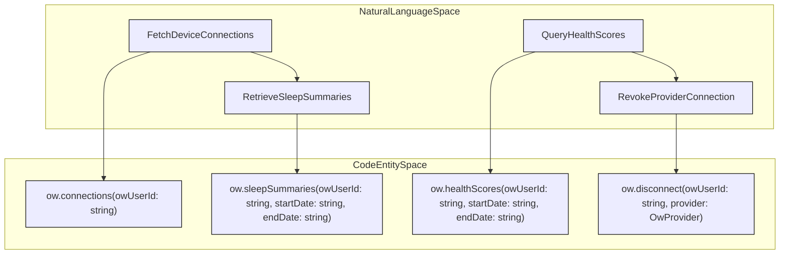
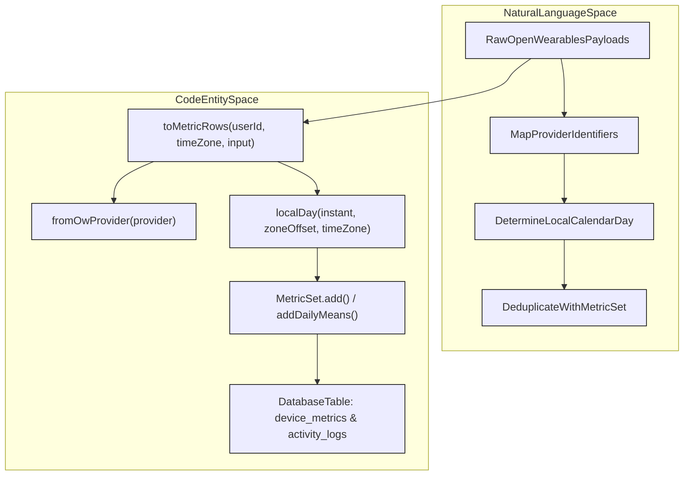

← [4.2 Sync Queue, Webhooks & Cron](4.2-sync-queue-webhooks-cron.md) · [Contents](../README.md) · [5 AI Companion (Chat & Voice)](5-ai-companion-chat-voice.md) →

---

# Metric Mapping & AI Source Rules

Relevant source files

The following files were used as context for generating this wiki page:

- `src/lib/catalog/devices.ts`
- `src/lib/wearables/client.ts`
- `src/lib/wearables/map.ts`

This page details the normalization pipeline and governance rules for wearable data in `immune.fit`. It covers how raw payloads from the self-hosted Open Wearables (OW) API are fetched via a typed client, normalized into internal schema rows through dedicated mapping logic, and filtered against strict AI privacy and API compliance rules before reaching downstream context windows.

---

## 1. Open Wearables API Wrapper (`src/lib/wearables/client.ts`)

The Open Wearables API wrapper provides a strongly-typed, server-only interface for interacting with the self-hosted Open Wearables instance. Because the API key possesses elevated privileges across all OW users, this module is protected with `import "server-only"` `src/lib/wearables/client.ts:1-10`.

Key components include:
* `OpenWearablesError`: Custom error class capturing non-2xx HTTP responses with status tracking while deliberately omitting response bodies to protect health data `src/lib/wearables/client.ts:12-19`.
* `request()`: Core fetch utility handling authorization headers (`X-Open-Wearables-API-Key`), query serialization, and a 20-second timeout `src/lib/wearables/client.ts:103-128`.
* `all()`: Cursor-based pagination iterator that walks paginated endpoints up to `MAX_PAGES` (50) with a page size of 1000 items `src/lib/wearables/client.ts:96-141`.
* `ow` namespace object: Exposes endpoint wrappers such as `createUser`, `connections`, `disconnect`, `healthScores`, `sleepSummaries`, and `activitySummaries` `src/lib/wearables/client.ts:146-201`.

*Sources: `src/lib/wearables/client.ts:1-201`*

---

## 2. Metric Normalization & Mapping (`src/lib/wearables/map.ts`)

Raw data payloads retrieved from Open Wearables are transformed into database-ready rows via pure functions located in `src/lib/wearables/map.ts`. This ensures that mapping operations are deterministic and securely scoped to a supplied user ID `src/lib/wearables/map.ts:8-11`.

### Source Mapping & Local Days
* `FROM_OW`: Maps OW provider strings (`apple`, `garmin`, `whoop`, `oura`) to internal `DeviceId` types. Notably, Strava is intentionally excluded from local persistence due to API policy restrictions `src/lib/wearables/map.ts:20-25`.
* `localDay()`: Computes the local calendar date (`Day`) of a reading by applying UTC offset adjustments if present, falling back to the user's timezone via `dayIn()` `src/lib/wearables/map.ts:36-41`.

### Conflict Resolution with `MetricSet`
The `MetricSet` class acts as an in-memory aggregation buffer enforcing uniqueness over `(provider, metric, day)`. When duplicate metrics arrive, precedence is resolved via:
1. **Priority level**: Higher priority integers win outright (e.g., nightly RMSSD summary beats an all-day average sample) `src/lib/wearables/map.ts:56-80`.
2. **Timestamp tie-breaker**: At equal priority, the most recently recorded reading (`recorded_at`) is retained `src/lib/wearables/map.ts:67`.

*Sources: `src/lib/wearables/map.ts:20-168`*

---

## 3. AI Source Rules & Privacy Restrictions (`src/lib/catalog/devices.ts`)

To comply with third-party developer agreements and privacy regulations, `src/lib/catalog/devices.ts` defines governance rules (`AI_RULES`) for each wearable provider. These rules dictate whether metric rows and activity logs originating from a given source may be injected into AI companion context windows `src/lib/catalog/devices.ts:64-87`.

### Provider Policy Breakdown

| Provider | AI Allowed? | Governing Condition / Agreement |
| :--- | :--- | :--- |
| **Whoop** | `true` | Requires explicit user AI consent `src/lib/catalog/devices.ts:69`. |
| **Oura** | `true` | Requires explicit user AI consent; prohibits embeddings and data retention by AI providers per Oura API Agreement `src/lib/catalog/devices.ts:70-73`. |
| **Apple Health** | `true` | Requires explicit user AI consent; prohibited from advertising or data mining per App Review Guideline 5.1.3 `src/lib/catalog/devices.ts:74-77`. |
| **Garmin** | `false` | Blocked until privacy policy includes an explicit AI transparency statement and user consent per Garmin Connect Developer Program Agreement §15.7, §15.10 `src/lib/catalog/devices.ts:78-82`. |
| **Strava** | `false` | Permanently blocked. Strava API Policy §5.3 strictly prohibits AI application usage and context window ingestion `src/lib/catalog/devices.ts:83-86`. |

The helper function `aiAllowedSources()` filters the device catalog to return only permitted device IDs, serving as a runtime security guard before context assembly `src/lib/wearables/map.ts:20-25`, `src/lib/catalog/devices.ts:89-91`.

*Sources: `src/lib/catalog/devices.ts:12-91`*

---

← [4.2 Sync Queue, Webhooks & Cron](4.2-sync-queue-webhooks-cron.md) · [Contents](../README.md) · [5 AI Companion (Chat & Voice)](5-ai-companion-chat-voice.md) →
