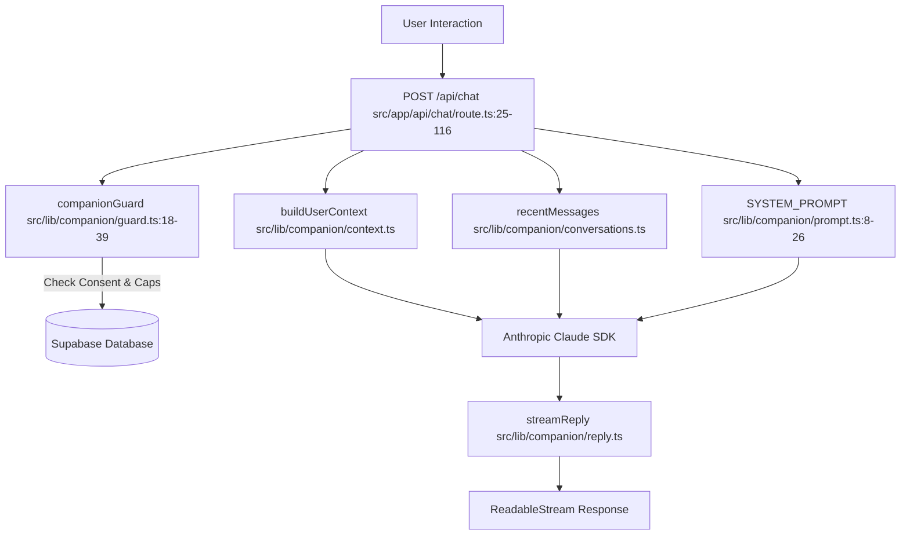

← [4.3 Metric Mapping & AI Source Rules](4.3-metric-mapping-ai-source-rules.md) · [Contents](../README.md) · [5.1 Text Chat Pipeline](5.1-text-chat-pipeline.md) →

---

# AI Companion (Chat & Voice)

Relevant source files

The following files were used as context for generating this wiki page:

- `src/app/api/chat/route.ts`
- `src/lib/companion/guard.ts`
- `src/lib/companion/prompt.ts`

## Purpose and Scope

The AI Companion subsystem provides a supportive, context-aware interactive layer inside `immune.fit` designed specifically for individuals managing chronic and autoimmune conditions. Powered by Anthropic Claude and Deepgram voice capabilities, the companion listens to check-ins, tracks daily symptoms and energy levels, and promotes safe pacing habits without dispensing medical advice. 

This is a parent wiki page. For detailed technical implementations, refer to the child pages:
- [Text Chat Pipeline](5.1-text-chat-pipeline.md)
- [Voice Mode](5.2-voice-mode.md)
- [Chat UI Components](5.3-chat-ui-components.md)

---

## 1. Companion Architecture & Request Flow

When a user interacts with the companion—whether via text or voice mode—requests flow through a robust validation and streaming pipeline. The system enforces daily rate limiting, data consent checks, and robust error handling to ensure a seamless experience.

Title: AI Companion Request Flow

Sources: `src/app/api/chat/route.ts:25-116`, `src/lib/companion/guard.ts:18-39`, `src/lib/companion/prompt.ts:8-26`

---

## 2. Text Chat Pipeline

The text chat pipeline manages real-time streaming responses from Claude. Incoming messages are processed via `POST /api/chat`, which ensures the user has provided AI data consent and stays under the `DAILY_MESSAGE_CAP` of 150 messages per 24 hours [src/lib/companion/guard.ts:7-37]. The system fetches relevant user context and conversation history, streams the response chunk-by-chunk using a `ReadableStream`, and asynchronously persists both user and assistant messages to the database [src/app/api/chat/route.ts:25-116].

For comprehensive details on prompt construction, conversation persistence, sentence chunking, and safety guards, see [Text Chat Pipeline](5.1-text-chat-pipeline.md).

Sources: `src/app/api/chat/route.ts:25-116`, `src/lib/companion/guard.ts:1-40`, `src/lib/companion/prompt.ts:1-30`

---

## 3. Voice Mode

Voice Mode extends the companion experience into real-time audio interaction using Deepgram Nova-3 (for speech-to-text transcription) and Aura-2 (for text-to-speech synthesis). It leverages audio worklets for client-side PCM audio streaming and specialized token-generation routes to safely handle streaming connections. When operating in voice mode, prompts are appended with `VOICE_ADDENDUM` to ensure responses sound natural when read aloud [src/lib/companion/prompt.ts:28-29].

For detailed documentation on client audio worklets, token endpoints, and speech formatting, see [Voice Mode](5.2-voice-mode.md).

Sources: `src/lib/companion/prompt.ts:28-29`, `src/app/api/chat/route.ts:10-34`

---

## 4. Chat UI Components

The user interface for the companion is built around modular React components that handle streaming responses, message bubbles, and dynamic connection states. The UI consumes the companion client streams smoothly, rendering plain-text output while gracefully managing loading states, input throttling, and accessibility features.

For further information on component architecture and rendering logic, see [Chat UI Components](5.3-chat-ui-components.md).

Sources: `src/app/api/chat/route.ts:85-116`

---

← [4.3 Metric Mapping & AI Source Rules](4.3-metric-mapping-ai-source-rules.md) · [Contents](../README.md) · [5.1 Text Chat Pipeline](5.1-text-chat-pipeline.md) →
