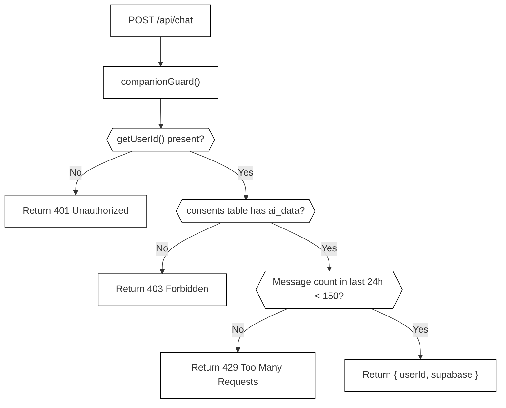
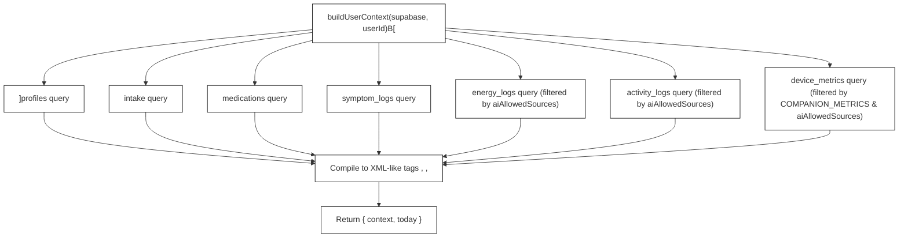
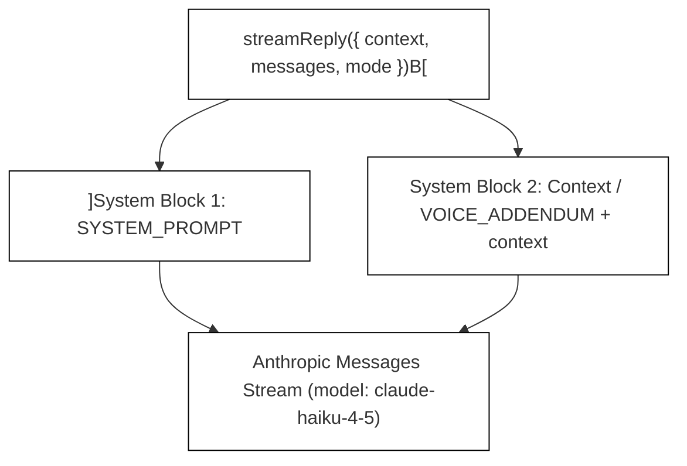
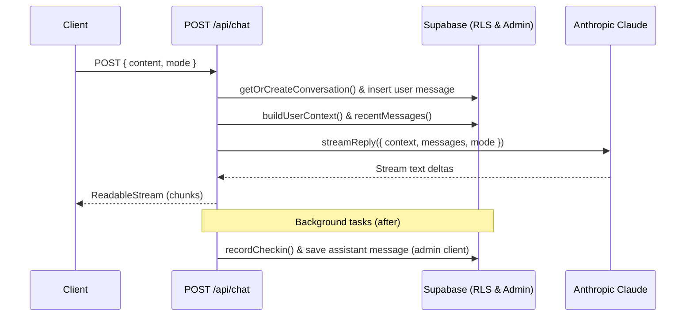

← [5 AI Companion (Chat & Voice)](5-ai-companion-chat-voice.md) · [Contents](../README.md) · [5.2 Voice Mode](5.2-voice-mode.md) →

---

# Text Chat Pipeline

Relevant source files

The following files were used as context for generating this wiki page:

- `src/app/api/chat/route.ts`
- `src/lib/actions/chat.ts`
- `src/lib/companion/context.ts`
- `src/lib/companion/conversations.ts`
- `src/lib/companion/guard.ts`
- `src/lib/companion/prompt.ts`
- `src/lib/companion/reply.ts`
- `src/lib/companion/sentences.ts`

## Purpose and Scope

This page documents the technical architecture and implementation of the text chat pipeline within `immune.fit`. The pipeline handles user message ingestion, guardrail validation, context aggregation from user logs and device metrics, prompt structuring with Anthropic Claude Haiku, conversation session management, streaming responses over HTTP, and persistent background storage. 

Sources: ``src/app/api/chat/route.ts:1-123``, ``src/lib/companion/guard.ts:1-39``

---

## 1. Request Guardrails & Rate Limiting (`companionGuard`)

Before any request hits the Anthropic API or processes local database entries, `POST /api/chat` invokes `companionGuard()` to validate user access rights, data-sharing consent, and rate compliance `src/app/api/chat/route.ts:25-27`, `[src/lib/companion/guard.ts:13-39]`.

The guard performs three sequential checks:
1. **Authentication**: Resolves the user session via `getUserId()`. If unauthenticated, it aborts with a `401` status `src/lib/companion/guard.ts:19-20`.
2. **Consent**: Queries the `consents` table for an active `ai_data` record associated with the user ID. If missing, it rejects with a `403` status `src/lib/companion/guard.ts:24-34`.
3. **Daily Message Cap**: Counts user-role messages created within the past 24 hours (`24 * 60 * 60 * 1000` ms). If the total meets or exceeds `DAILY_MESSAGE_CAP` (set to `150`), it responds with a `429` rate-limit error `src/lib/companion/guard.ts:7`, `[src/lib/companion/guard.ts:23-37]`.

Sources: ``src/lib/companion/guard.ts:1-39``, ``src/app/api/chat/route.ts:25-27``

---

## 2. Context Assembly & Privacy Filtering (`buildUserContext`)

To personalize companion responses without compromising patient data boundaries, `buildUserContext()` gathers a compact textual representation of the user's profile, intake responses, active medications, symptoms, energy logs, activity records, and device metrics over a rolling window of `DAYS_BACK` (7 days) `src/lib/companion/context.ts:13`, `[src/lib/companion/context.ts:41-86]`.

### Data Aggregation Pipeline
Using `Promise.all`, the function queries Supabase concurrently across multiple tables using the user's RLS-scoped client `src/lib/companion/context.ts:55-86`:
* **`profiles`**: Retrieves `display_name`, `pronouns`, `age_range`, and `timezone` to anchor time calculations (`todayIn`, `addDays`) `src/lib/companion/context.ts:45-51`.
* **`intake`**: Reads JSON survey responses (`answers`) to extract condition catalogs, symptoms of concern, pacing style, and baseline energy levels `src/lib/companion/context.ts:56`, `[src/lib/companion/context.ts:88-122]`.
* **`medications`**: Fetches active medications (`active = true`) with doses and frequencies `src/lib/companion/context.ts:57`, `[src/lib/companion/context.ts:124-128]`.
* **`symptom_logs`**, **`energy_logs`**, and **`activity_logs`**: Gathers logs from the past 7 days `src/lib/companion/context.ts:58-77`.
* **`device_metrics`**: Restricts metrics to `COMPANION_METRICS` (e.g., `body_battery`, `hrv`, `sleep_score`) `src/lib/companion/context.ts:19-22`, `[src/lib/companion/context.ts:78-85]`.

### AI Source Restrictions
Activity logs, energy logs, and device metrics enforce strict filtering via `aiAllowedSources()` `src/lib/companion/context.ts:38`, `[src/lib/companion/context.ts:68]`, `[src/lib/companion/context.ts:75]`, `[src/lib/companion/context.ts:82]`. Data originating from restricted wearable providers (such as Garmin or Strava) is scrubbed or excluded before reaching external AI APIs, fulfilling privacy compliance requirements.

Sources: ``src/lib/companion/context.ts:1-159``

---

## 3. Prompt Engineering & System Structure (`SYSTEM_PROMPT` & `streamReply`)

The companion utilizes Anthropic Claude Haiku 4.5 (`claude-haiku-4-5`) configured via `src/lib/companion/reply.ts` `src/lib/companion/reply.ts:11`. 

### System Block Architecture
System instructions are split into two discrete blocks passed to the Anthropic messages stream `src/lib/companion/reply.ts:34-39`:
1. **`SYSTEM_PROMPT`**: Contains static, identity-defining instructions `src/lib/companion/prompt.ts:8-26`. It instructs the model to act as a warm check-in companion for chronic/autoimmune conditions, maintaining short responses (1-3 sentences), plain text output (no markdown or bold symbols), single-question limits, and adherence to safety boundaries regarding medical advice, emergency triage (911), and crisis support (988) `src/lib/companion/prompt.ts:8-26`. Because it contains no dynamic per-user data, it remains byte-identical across calls.
2. **Context Block**: Houses user-specific details produced by `buildUserContext()`. In voice mode, this block is prepended with `VOICE_ADDENDUM` to enforce spoken-friendly formatting `src/lib/companion/prompt.ts:28-29`, `[src/lib/companion/reply.ts:36]`.

Sources: ``src/lib/companion/prompt.ts:1-29``, ``src/lib/companion/reply.ts:1-48``

---

## 4. Conversation State & Persistence

Conversations are managed as rolling threads categorized by mode (`text` or `voice`) `src/lib/companion/conversations.ts:6`, `[src/lib/companion/conversations.ts:9-26]`. 

### Flow of Message Persistence
1. **Session Resolution**: `getOrCreateConversation()` fetches the most recent conversation record for the user and mode, or instantiates a new one if none exists `src/lib/companion/conversations.ts:9-26`.
2. **User Message Insertion**: The incoming user message is saved to the `messages` table with role `user` `src/app/api/chat/route.ts:37`.
3. **History Retrieval**: `recentMessages()` fetches up to 30 recent messages in ascending chronological order, ensuring the array always starts with a `user` role turn by shifting leading assistant messages `src/lib/companion/conversations.ts:33-48`.
4. **Background Check-in Trigger**: `after(() => recordCheckin(supabase, userId, today))` runs concurrently to log user activity without blocking response streaming `src/app/api/chat/route.ts:44`.
5. **Assistant Reply Archival**: Once the stream concludes, the final message is processed through `plain()` (removing asterisks) `src/app/api/chat/route.ts:16`, and saved using `createAdminClient()` with service-role privileges `src/app/api/chat/route.ts:64-76`. This ensures persistence even if the client disconnects mid-stream (guarded by `after()`) `src/app/api/chat/route.ts:83`.

Sources: ``src/app/api/chat/route.ts:25-116``, ``src/lib/companion/conversations.ts:1-48``

---

## 5. Streaming, Chunking & Sentence Splitting

The API route returns a `ReadableStream<Uint8Array>` response configured with `Cache-Control: no-store` and a custom `X-Reply-Id` header `src/app/api/chat/route.ts:113-115`.

### Stream Handling & Fallback
* **Plain Text Transformation**: The helper `plain(text)` strips all asterisks (`*`) from streamed chunks to prevent stray markdown formatting in UI chat bubbles `src/app/api/chat/route.ts:14-16`.
* **Cancellation & Disconnection**: If a client cancels the stream (`cancel()` callback), the `open` flag is toggled to `false`, but background promise resolution (`finished`) continues uninterrupted to ensure the model's reply is successfully stored in the database `src/app/api/chat/route.ts:83`, `[src/app/api/chat/route.ts:108-110]`.
* **Sentence Chunking**: For spoken modes or structural rendering, text can be segmented via `splitSentences()`. This utility evaluates punctuation boundaries (`[.!?]+`) and groups short fragments (fewer than 16 characters, such as `"Oh."`) with adjacent sentences to ensure natural cadence `src/lib/companion/sentences.ts:7-26`.

Sources: ``src/app/api/chat/route.ts:85-116``, ``src/lib/companion/sentences.ts:1-26``

---

← [5 AI Companion (Chat & Voice)](5-ai-companion-chat-voice.md) · [Contents](../README.md) · [5.2 Voice Mode](5.2-voice-mode.md) →
