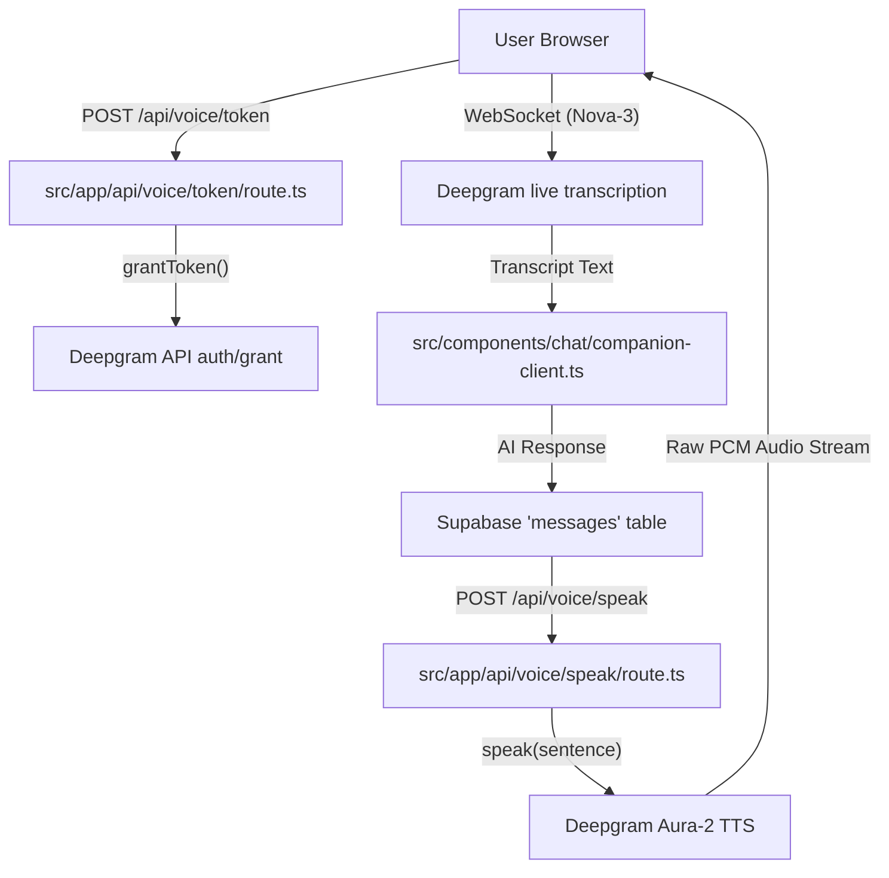
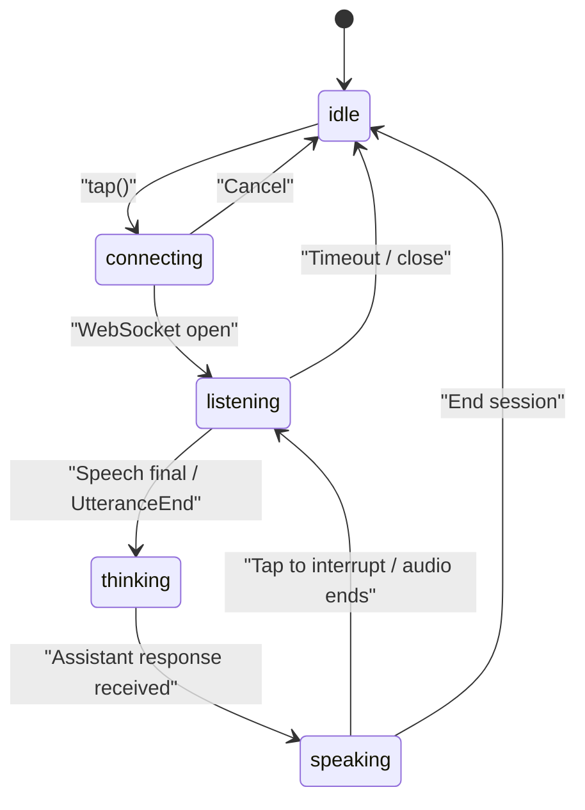
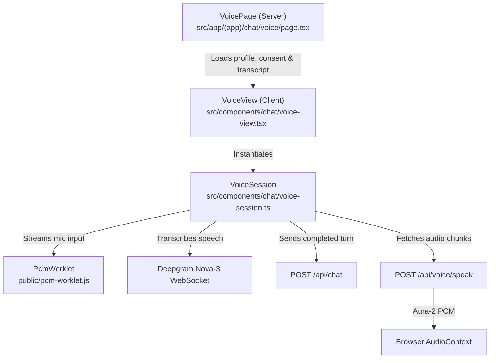

← [5.1 Text Chat Pipeline](5.1-text-chat-pipeline.md) · [Contents](../README.md) · [5.3 Chat UI Components](5.3-chat-ui-components.md) →

---

# Voice Mode

Relevant source files

The following files were used as context for generating this wiki page:

- `public/pcm-worklet.js`
- `src/app/(app)/chat/page.tsx`
- `src/app/(app)/chat/voice/page.tsx`
- `src/app/api/voice/speak/route.ts`
- `src/app/api/voice/token/route.ts`
- `src/components/chat/voice-session.ts`
- `src/components/chat/voice-view.tsx`
- `src/lib/voice/deepgram.ts`
- `src/lib/voice/format.ts`

Voice Mode (hosted at `/chat/voice`) provides a hands-free, half-duplex conversational interface with the Claude-powered health companion. It combines browser-side audio capture and worklet processing with Deepgram Nova-3 (live speech-to-text) and Deepgram Aura-2 (text-to-speech synthesis). This page details the client audio architecture, token authorization, server-side speech generation, and UI state coordination.

---

## 1. Architecture & Pipeline Overview

Voice Mode operates on a half-duplex check-in loop: **Listen $\rightarrow$ Send $\rightarrow$ Think $\rightarrow$ Speak $\rightarrow$ Listen**. 

When the user taps the microphone, the browser requests a short-lived Deepgram token via `/api/voice/token`, captures raw microphone input through an `AudioWorkletNode`, downsamples it to 16 kHz mono 16-bit PCM, and streams it over a WebSocket to Deepgram Nova-3. Once speech finalizes, the transcript is sent to the AI companion pipeline, and the resulting assistant reply is synthesized sentence-by-sentence via Deepgram Aura-2 through `/api/voice/speak`.

Sources: `src/app/(app)/chat/voice/page.tsx`, `src/app/api/voice/token/route.ts`, `src/app/api/voice/speak/route.ts`, `src/lib/voice/deepgram.ts`, `src/components/chat/voice-session.ts`

---

## 2. Client-Side Audio & Worklet Processing

Microphone capture and real-time audio chunking are handled by `VoiceSession` in conjunction with a custom low-level audio worklet.

### Audio Worklet Processor (`pcm-worklet.js`)
To support mobile browsers (including iOS Safari where `MediaRecorder` outputs containerized MP4 formats that cannot be streamed easily), the application utilizes an `AudioWorkletProcessor` (`public/pcm-worklet.js`). 
* The worklet runs on the dedicated audio worker thread ``public/pcm-worklet.js:6-38``.
* It averages incoming sample channels down to 16 kHz mono, clamps values between `-1` and `1`, and converts floating-point samples into 16-bit little-endian integers (`Int16Array`, Deepgram `linear16`) ``public/pcm-worklet.js:20-27``.
* It batches samples into ~100 ms buffers (1600 samples) and posts them back to the main thread via message ports ``public/pcm-worklet.js:13,30-31``.

### VoiceSession Class
`VoiceSession` (`src/components/chat/voice-session.ts`) controls the entire lifecycle of a voice turn.
* **States (`VoiceStatus`)**: `"idle" | "connecting" | "listening" | "thinking" | "speaking"` ``src/components/chat/voice-session.ts:5``.
* **Microphone Management**: Acquires media streams with echo cancellation, noise suppression, and auto gain control `[src/components/chat/voice-session.ts:158-160]`. It fully releases the microphone input while the companion speaks, ensuring that mobile operating systems route playback through the primary speaker instead of the telephony earpiece and preventing silence streams from hitting Deepgram `[src/components/chat/voice-session.ts:62-70]`.
* **Single Tap Interaction**: The primary UI action (`tap()`) adapts based on state: initiating connection/listening, submitting pending speech, interrupting active speech playback, or canceling `[src/components/chat/voice-session.ts:87-112]`.

Sources: `src/components/chat/voice-session.ts`, `public/pcm-worklet.js`

---

## 3. Deepgram Token Grant & API Helpers

Server-side integrations with Deepgram are encapsulated in `src/lib/voice/deepgram.ts` and exposed securely via API routes.

### Token Granting (`/api/voice/token`)
The browser cannot be exposed to the primary Deepgram API key. Instead, `/api/voice/token` (`src/app/api/voice/token/route.ts`) gates access through `companionGuard()` (verifying user session, AI consent, and daily rate caps) before requesting a short-lived token from Deepgram ``src/app/api/voice/token/route.ts:9-11``.
* `grantToken()` (`src/lib/voice/deepgram.ts:33-43`) makes a `POST` request to `https://api.deepgram.com/v1/auth/grant` with a strict TTL of `30` seconds ``src/lib/voice/deepgram.ts:37``.

### Speech Synthesis Helper
* `speak(text)` (`src/lib/voice/deepgram.ts:46-62`) invokes Deepgram's `/speak` endpoint.
* Configures the Aura-2 voice model (`VOICE = "aura-2-vesta-en"`) ``src/lib/voice/deepgram.ts:15``.
* Specifies `encoding: "linear16"`, `container: "none"`, and `sample_rate` matching `SPEECH_SAMPLE_RATE` (`24_000` Hz) `[src/lib/voice/deepgram.ts:48-51]`, ``src/lib/voice/format.ts:6``.
* Enforces `mip_opt_out: "true"` across all requests to ensure zero audio data retention or model training by third parties ``src/lib/voice/deepgram.ts:8,52``.

Sources: `src/app/api/voice/token/route.ts`, `src/lib/voice/deepgram.ts`, `src/lib/voice/format.ts`

---

## 4. Text-to-Speech Streaming (`/api/voice/speak`)

When the AI companion generates a text response, the client requests audio playback sentence-by-sentence via `POST /api/voice/speak` (`src/app/api/voice/speak/route.ts`).

* **Validation & Security**: The route validates request parameters (`messageId`, sentence index) and executes `companionGuard()` alongside an RLS-scoped Supabase lookup for the specific message row ``src/app/api/voice/speak/route.ts:16-27``.
* **Time Constraint**: Enforces `SPEAKABLE_FOR_MS` (`10 * 60 * 1000`, or 10 minutes) to prevent replaying stale messages ``src/app/api/voice/speak/route.ts:8,31``.
* **Sentence Splitting & Streaming**: Splits the message content into discrete sentences using `splitSentences`, truncates to 1,000 characters, and streams raw PCM audio headers back to the client (`Content-Type: audio/L16;rate=24000;channels=1`) ``src/app/api/voice/speak/route.ts:30-38``.

Sources: `src/app/api/voice/speak/route.ts`, `src/lib/companion/sentences.ts`

---

## 5. Voice UI Components & State Machine

The voice experience is assembled through Next.js server pages and React client components.

* **Server Page (`src/app/(app)/chat/voice/page.tsx`)**: Validates onboarded profiles (`requireOnboardedProfile()`), verifies user ID, checks AI data consent (`latestConsent("ai_data")`), fetches recent transcript turns (up to 20 messages in the `voice` conversation category), and renders `VoiceView` ``src/app/(app)/chat/voice/page.tsx:30-41``.
* **Client View (`src/components/chat/voice-view.tsx`)**: Manages external store sync for browser voice support detection (`voiceSupported`), renders live transcription and assistant response bubbles, and positions the floating action button (FAB) for touch controls (`Mic`, `MicOff`, `Square` for interruption) ``src/components/chat/voice-view.tsx:31,111-128``.

Sources: `src/app/(app)/chat/voice/page.tsx`, `src/components/chat/voice-view.tsx`, `src/components/chat/voice-session.ts`

---

← [5.1 Text Chat Pipeline](5.1-text-chat-pipeline.md) · [Contents](../README.md) · [5.3 Chat UI Components](5.3-chat-ui-components.md) →
