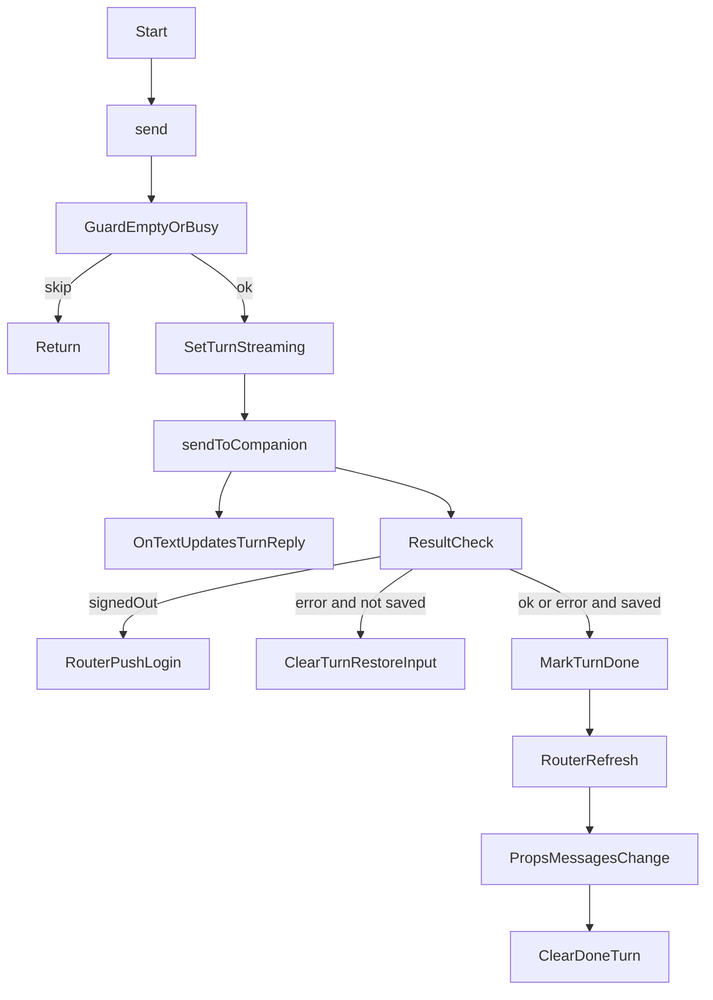
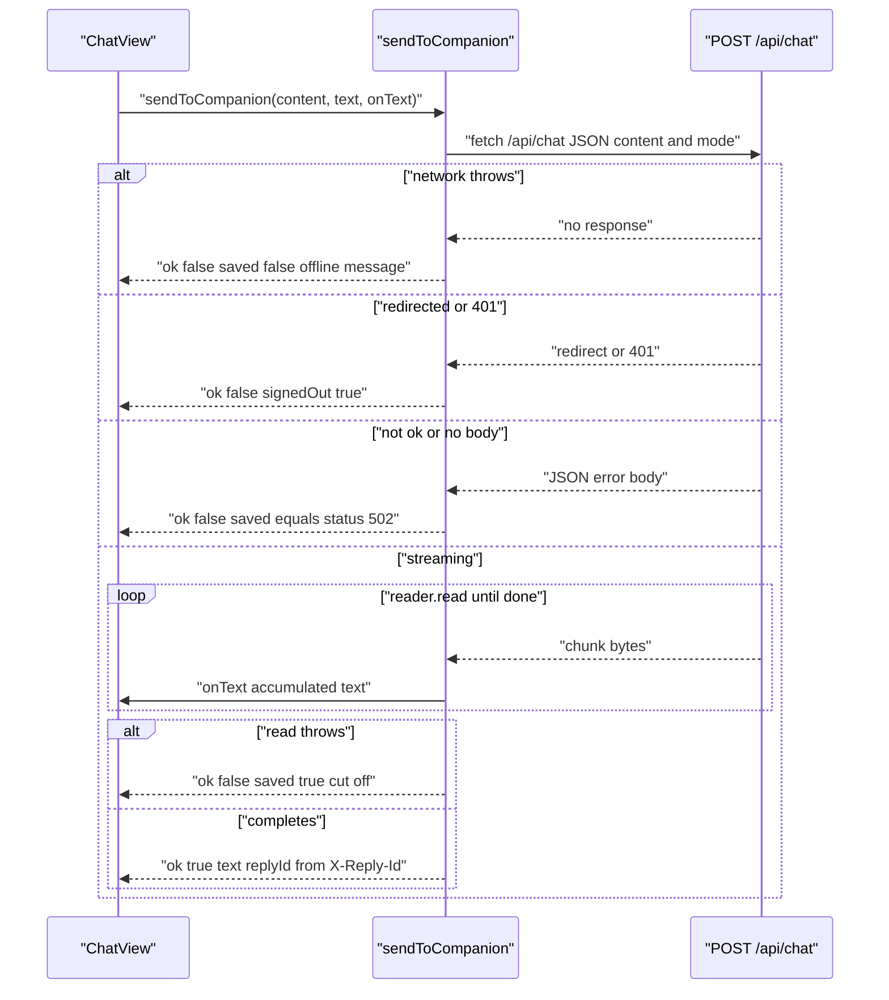

← [5.2 Voice Mode](5.2-voice-mode.md) · [Contents](../README.md) · [6 Marketing Site & Legal](6-marketing-site-legal.md) →

---

# Chat UI Components

Relevant source files

The following files were used as context for generating this wiki page:

- `src/components/chat/bubble.tsx`
- `src/components/chat/chat-view.tsx`
- `src/components/chat/companion-client.ts`

## Purpose and Scope

This page documents the browser-side chat surface of the AI companion: the `ChatView` client component, the `Bubble` and `TypingDots` primitives, and the `sendToCompanion` client that consumes the streamed reply from `POST /api/chat`. It covers component props, local state, the turn lifecycle, error and signed-out handling, and how the view reconciles with server-rendered messages after a refresh. Server-side prompt construction and persistence are covered in `5.1 Text Chat Pipeline`; voice playback is covered in `5.2 Voice Mode`.

Sources: `src/components/chat/chat-view.tsx`, `src/components/chat/bubble.tsx`, `src/components/chat/companion-client.ts`

## Component Map

| Symbol | Defined in | Role |
|---|---|---|
| `ChatView` | `src/components/chat/chat-view.tsx:23-132` | Client messaging screen: renders the transcript, composer, and in-flight turn |
| `ChatMessage` | `src/components/chat/chat-view.tsx:10` | Row shape for saved messages (`id`, `role`, `content`, `created_at`) |
| `Turn` | `src/components/chat/chat-view.tsx:13` | Local type for the in-flight exchange (`user`, `reply`, `done`) |
| `Bubble` | `src/components/chat/bubble.tsx:4-22` | `li` message bubble, aligned by role |
| `TypingDots` | `src/components/chat/bubble.tsx:25-38` | Animated placeholder shown while no reply text exists |
| `sendToCompanion` | `src/components/chat/companion-client.ts:11-50` | Fetches `/api/chat` and streams decoded text to a callback |
| `ReplyResult` | `src/components/chat/companion-client.ts:5-9` | Discriminated result union returned to the caller |
| `FormError` | imported at `src/components/chat/chat-view.tsx:6` | Error banner from `@/components/ui/field` |

Sources: `src/components/chat/chat-view.tsx`, `src/components/chat/bubble.tsx`, `src/components/chat/companion-client.ts`

## ChatView

### Props and Inputs

`ChatView` takes `{ name, messages }`, where `name` is nullable and `messages` is a `ChatMessage[]` supplied by the parent server page (`src/components/chat/chat-view.tsx:23`). The `name` value personalizes the greeting at `src/components/chat/chat-view.tsx:72`.

The component is marked `"use client"` at `src/components/chat/chat-view.tsx:1` and uses `useRouter` from `next/navigation` (`src/components/chat/chat-view.tsx:4`) to redirect and refresh.

### Local State

| State | Declaration | Purpose |
|---|---|---|
| `turn` | `src/components/chat/chat-view.tsx:25` | The in-flight exchange, or `null` |
| `error` | `src/components/chat/chat-view.tsx:26` | Last send error shown under the composer |
| `inputRef` | `src/components/chat/chat-view.tsx:27` | Uncontrolled textarea reference; value is read and cleared directly from the DOM |
| `shown` | `src/components/chat/chat-view.tsx:30` | Last `messages` prop seen, used for reconciliation |

The composer is uncontrolled: `send()` reads `input.value` at `src/components/chat/chat-view.tsx:45` and clears it at `src/components/chat/chat-view.tsx:47`.

`busy` is derived as `turn !== null && !turn.done` at `src/components/chat/chat-view.tsx:36` and disables the submit button at `src/components/chat/chat-view.tsx:118`.

### Reconciliation with Server Props

When the `messages` prop identity changes, the component stores the new array and clears a finished turn (`src/components/chat/chat-view.tsx:30-34`). This is the handoff from the optimistic turn to the saved rows: a `router.refresh()` re-renders the server page with new `messages`, and the `done` turn is dropped so the saved user and assistant rows are the only copies on screen.

If the turn is still streaming when props change, it is kept; only `turn?.done` triggers clearing.

### Turn Lifecycle

`send()` is defined at `src/components/chat/chat-view.tsx:43-66`.

1. Guard: returns early if content is empty or `busy` (`src/components/chat/chat-view.tsx:46`).
2. Clears the textarea and error, then sets `turn` with `reply: ""` and `done: false` (`src/components/chat/chat-view.tsx:47-49`).
3. Calls `sendToCompanion(content, "text", onText)` (`src/components/chat/chat-view.tsx:51-53`). The callback replaces `turn.reply` with the text so far.
4. On failure:
   - Signed-out: `router.push("/login")` (`src/components/chat/chat-view.tsx:56`).
   - Any failure: sets `error` (`src/components/chat/chat-view.tsx:57`).
   - If `saved` is false, the turn is removed and the original text is restored into the textarea if it is still empty (`src/components/chat/chat-view.tsx:58-62`).
   - If `saved` is true, execution falls through: the turn is marked done and the page refreshes, because the user row already exists server-side.
5. On success or saved-failure: marks `done` (`src/components/chat/chat-view.tsx:64`) and calls `startTransition(() => router.refresh())` (`src/components/chat/chat-view.tsx:65`).

Diagram title: Turn lifecycle in `ChatView.send`. Symbols reference `src/components/chat/chat-view.tsx:43-66` and `src/components/chat/chat-view.tsx:30-34`.

Sources: `src/components/chat/chat-view.tsx`

### Scroll and Live Region

A `useEffect` scrolls the document to the bottom when `messages.length`, `turn?.user`, or `turn?.reply` changes (`src/components/chat/chat-view.tsx:39-41`). The message list is an `ol` with `aria-live="polite"` at `src/components/chat/chat-view.tsx:70` so assistive tech announces new bubbles.

Sources: `src/components/chat/chat-view.tsx`

### Rendering Structure

The transcript is rendered in this order inside the `ol` (`src/components/chat/chat-view.tsx:70-87`):

1. A fixed greeting `Bubble` with `role="assistant"` (`src/components/chat/chat-view.tsx:71-73`).
2. Saved messages mapped to `Bubble` by `m.id` (`src/components/chat/chat-view.tsx:74-78`).
3. When `turn` exists: a user `Bubble` with `pending` set while no reply has arrived and the turn is not done (`src/components/chat/chat-view.tsx:81`).
4. An assistant `Bubble` that shows `turn.reply`, or `TypingDots` when the reply is empty and the turn is open (`src/components/chat/chat-view.tsx:84`).

The composer is a `sticky` footer (`src/components/chat/chat-view.tsx:89`) offset by `--spacing-tabbar` and safe-area insets on mobile and reset to `bottom-0` on `lg`. The textarea has `maxLength={8000}` (`src/components/chat/chat-view.tsx:105`). Enter submits; Shift+Enter inserts a newline; IME composition is excluded via `isComposing` (`src/components/chat/chat-view.tsx:108-113`).

The submit button uses `aria-label="Send"` and is disabled while `busy` (`src/components/chat/chat-view.tsx:115-118`). Errors render through `FormError` (`src/components/chat/chat-view.tsx:124-128`).

Sources: `src/components/chat/chat-view.tsx`

## Bubble and TypingDots

### Bubble

`Bubble` is an `li` with props `role`, optional `pending`, and `children` (`src/components/chat/bubble.tsx:4-12`). Role controls alignment and color:

| `role` | Classes applied | Source |
|---|---|---|
| `user` | `self-end rounded-br-md bg-accent text-on-accent` | `src/components/chat/bubble.tsx:16` |
| `assistant` | `self-start rounded-bl-md bg-surface` | `src/components/chat/bubble.tsx:16` |

When `pending` is true, `opacity-70` is appended (`src/components/chat/bubble.tsx:17`). Text is rendered with `whitespace-pre-wrap` (`src/components/chat/bubble.tsx:15`) so model line breaks survive.

The docstring at `src/components/chat/bubble.tsx:3` states the component is shared by Text and Talk modes, which is why it lives in `components/chat` and not in the chat view.

### TypingDots

`TypingDots` renders three spans with delays `0`, `150`, and `300` ms (`src/components/chat/bubble.tsx:28-35`), animated with `animate-bounce`. The wrapper has `role="status"` and `aria-label="Writing a reply"` (`src/components/chat/bubble.tsx:27`).

Sources: `src/components/chat/bubble.tsx`

## companion-client: Streaming Consumption

### Contract

`sendToCompanion(content, mode, onText)` (`src/components/chat/companion-client.ts:11-15`) posts `{ content, mode }` as JSON to `/api/chat` (`src/components/chat/companion-client.ts:18-22`) and resolves to a `ReplyResult` (`src/components/chat/companion-client.ts:5-9`).

`ReplyResult` is a discriminated union:

| Variant | Fields | Meaning |
|---|---|---|
| `{ ok: true }` | `text`, `replyId` | Full reply streamed; `replyId` is read from the `X-Reply-Id` header and is used by voice playback |
| `{ ok: false }` | `error`, `saved`, `signedOut?` | `saved` means the user message was persisted even though no reply arrived |

### Read Loop

Diagram title: `sendToCompanion` request and stream handling. Symbols reference `src/components/chat/companion-client.ts:11-50`.

Key details:

- Network failure is caught at `src/components/chat/companion-client.ts:23-25`.
- `res.redirected` or status `401` maps to `signedOut` at `src/components/chat/companion-client.ts:28-30`.
- Non-OK responses parse an optional `error` JSON field (`src/components/chat/companion-client.ts:31-34`). `saved` is set only when status is `502`, meaning the server stored the user message but failed to produce a reply.
- The body is read with `getReader()` and decoded with a streaming `TextDecoder` (`{ stream: true }`) at `src/components/chat/companion-client.ts:36-43` so multi-byte UTF-8 characters split across chunks decode correctly.
- Each chunk triggers `onText` with the full accumulated string (`src/components/chat/companion-client.ts:44`), not a delta. `ChatView` stores this directly as `turn.reply`.
- Mid-stream read errors return `saved: true` (`src/components/chat/companion-client.ts:46-48`).
- On success, `replyId` comes from the `X-Reply-Id` response header (`src/components/chat/companion-client.ts:49`).

Sources: `src/components/chat/companion-client.ts`

## UI State Matrix

The combined effect of `sendToCompanion` results and `ChatView` state:

| Condition | `turn` | `error` | Input | Next step |
|---|---|---|---|---|
| Sending, no text yet | `{reply:"", done:false}` | `null` | Cleared, disabled button | Shows pending user bubble and `TypingDots` |
| Streaming | `reply` growing | `null` | Disabled | Assistant bubble updates per chunk |
| Offline or non-502 failure | `null` | message | Text restored | User retries |
| 502 failure | `done:true` | message | Cleared | Refresh shows saved user row |
| Mid-stream cut-off | `done:true` | message | Cleared | Refresh shows saved rows |
| Signed out | unchanged | `null` | unchanged | `router.push("/login")` |
| Success | `done:true` | `null` | Cleared | Refresh replaces turn with saved rows |

Sources: `src/components/chat/chat-view.tsx`, `src/components/chat/companion-client.ts`

## Known Behavior Notes

- The `saved` flag drives whether a failed turn is rolled back locally. Only a failure with `saved: false` removes the optimistic bubble and restores the text; otherwise the bubble stays and a refresh is triggered so server state becomes authoritative (`src/components/chat/chat-view.tsx:58-65`).
- The greeting bubble at `src/components/chat/chat-view.tsx:71-73` is not persisted; it is rendered on every render regardless of `messages`.
- `ChatView` does not abort in-flight requests on unmount; the `fetch` call in `sendToCompanion` has no `AbortController`.

Sources: `src/components/chat/chat-view.tsx`, `src/components/chat/companion-client.ts`

## Glossary Pointers

- **ChatView**: client messaging component in `src/components/chat/chat-view.tsx`.
- **Turn**: the local in-flight exchange type at `src/components/chat/chat-view.tsx:13`.
- **Bubble**: message `li` primitive at `src/components/chat/bubble.tsx:4`.
- **TypingDots**: pending-reply indicator at `src/components/chat/bubble.tsx:25`.
- **saved flag**: `ReplyResult` field meaning the user message was persisted, at `src/components/chat/companion-client.ts:9`.

Sources: `src/components/chat/chat-view.tsx`, `src/components/chat/bubble.tsx`, `src/components/chat/companion-client.ts`

---

← [5.2 Voice Mode](5.2-voice-mode.md) · [Contents](../README.md) · [6 Marketing Site & Legal](6-marketing-site-legal.md) →
