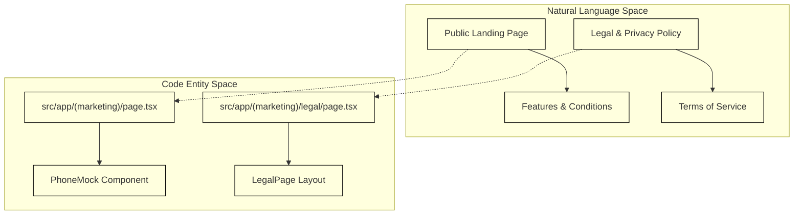
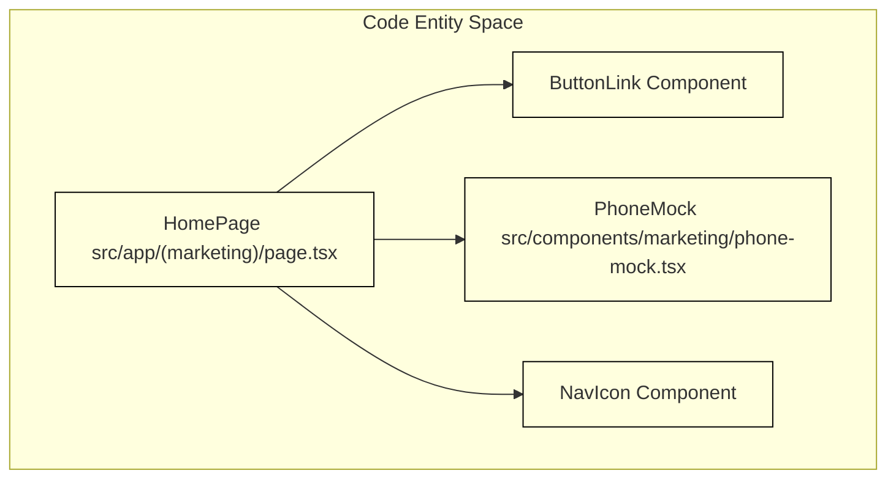

← [5.3 Chat UI Components](5.3-chat-ui-components.md) · [Contents](../README.md) · [6.1 Marketing Pages & Layout](6.1-marketing-pages-layout.md) →

---

# Marketing Site & Legal

Relevant source files

The following files were used as context for generating this wiki page:

- `src/app/(marketing)/page.tsx`

This page provides an overview of the desktop-first static marketing surface and legal documentation pages for `immune.fit`. The marketing surface serves as the public-facing entry point, introducing users to the app's core concepts—tracking energy, symptoms, and training side by side—while enforcing static rendering constraints and strict separation from authenticated application state.

For details, see the child pages:
- [Marketing Pages & Layout](6.1-marketing-pages-layout.md)
- [Legal Pages (Terms & Privacy)](6.2-legal-pages-terms-privacy.md)

Sources: `src/app/(marketing)/page.tsx:1-164`

---

## 6.1 Marketing Pages & Layout

The marketing section lives under the `(marketing)` route group and houses the main landing page, feature highlights, and public navigation shell. It operates under strict static rendering constraints, ensuring that no session reads or user-specific database queries execute during initial static generation or public browsing.

For details, see [Marketing Pages & Layout](6.1-marketing-pages-layout.md).

Sources: `src/app/(marketing)/page.tsx:1-96`

---

## 6.2 Legal Pages (Terms & Privacy)

Legal documentation, including the Terms of Service and Privacy Policy, is managed via a shared layout structure (`LegalPage`). It relies on structured configuration arrays for sections, supports draft warning banners, and uses standard placeholder markers (`Tbd`) for incomplete clauses prior to final legal review.

For details, see [Legal Pages (Terms & Privacy)](6.2-legal-pages-terms-privacy.md).

Sources: `src/app/(marketing)/page.tsx:1-164`

---

← [5.3 Chat UI Components](5.3-chat-ui-components.md) · [Contents](../README.md) · [6.1 Marketing Pages & Layout](6.1-marketing-pages-layout.md) →
