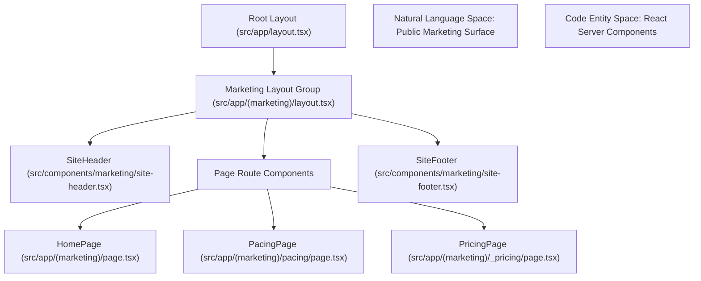
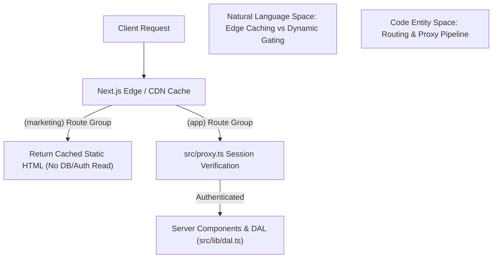

← [6 Marketing Site & Legal](6-marketing-site-legal.md) · [Contents](../README.md) · [6.2 Legal Pages (Terms & Privacy)](6.2-legal-pages-terms-privacy.md) →

---

# Marketing Pages & Layout

<details>
<summary>Relevant source files</summary>

The following files were used as context for generating this wiki page:

- `src/app/(app)/settings/page.tsx`
- `src/app/(marketing)/_pricing/page.tsx`
- `src/app/(marketing)/pacing/page.tsx`
- `src/app/(marketing)/page.tsx`
- `src/components/marketing/site-footer.tsx`
- `src/components/marketing/site-header.tsx`

</details>


## Purpose and Scope

This section covers the public-facing marketing surface of `immune.fit`, housed within the Next.js App Router `(marketing)` route group. The marketing layout provides a desktop-first, static presentation layer designed to convert visitors, explain chronic/autoimmune pacing, detail product features, and link users to authentication flows (`/login`, `/signup`). A strict architectural constraint for this surface is **zero session reads**, ensuring that all marketing pages and layout wrappers remain fully cacheable at the CDN edge.

Sources: `src/components/marketing/site-header.tsx:5-6`

---

## Static Rendering Constraints & Architecture

To optimize performance and edge cacheability, the marketing layout and its sub-components avoid calling authentication utilities (such as `getSupabase()`, `requireUserId()`, or cookie reads). 

As explicitly documented in `src/components/marketing/site-header.tsx`, the public header is static on purpose so that pages under the `(marketing)` route group avoid dynamic server-side rendering overhead:

```typescript
/** Public site header. Static on purpose: no session read, so marketing pages stay CDN-cached. */
export function SiteHeader() { ... }
```

Sources: `src/components/marketing/site-header.tsx:5-6`

### Marketing Component Hierarchy



Sources: `src/components/marketing/site-header.tsx:1-30`, `src/components/marketing/site-footer.tsx:4-34`, `src/app/(marketing)/page.tsx:64-164`, `src/app/(marketing)/pacing/page.tsx:34-95`, `src/app/(marketing)/_pricing/page.tsx:27-46`

---

## Site Header and Footer Layouts

The framing of the marketing pages is handled by reusable layout primitives located in `src/components/marketing/`.

### Site Header (`SiteHeader`)
`SiteHeader` renders a sticky navigation header (`src/components/marketing/site-header.tsx:8`) with a maximum width container (`src/components/marketing/site-header.tsx:9`), containing:
*   A `Wordmark` component (`src/components/marketing/site-header.tsx:10`).
*   Navigation links pointing to internal page sections (`/#how`) and guides (`/pacing`) (`src/components/marketing/site-header.tsx:11-18`).
*   Authentication entry points (`/login` and `/signup`) utilizing `ButtonLink` (`src/components/marketing/site-header.tsx:19-26`).

### Site Footer (`SiteFooter`)
`SiteFooter` provides secondary navigation, legal links, and disclaimer text (`src/components/marketing/site-footer.tsx:4-34`). It includes:
*   The `Wordmark` and a wellness disclaimer noting that `immune.fit` is a wellness tool rather than medical care (`src/components/marketing/site-footer.tsx:8-13`).
*   Footer navigation links to `/pacing`, `/privacy`, `/terms`, `/login`, and a direct mailto contact link (`src/components/marketing/site-footer.tsx:14-30`).

Sources: `src/components/marketing/site-header.tsx:1-30`, `src/components/marketing/site-footer.tsx:4-34`

---

## Landing Page (`HomePage`)

The root landing page (`src/app/(marketing)/page.tsx`) organizes its content into distinct conversion and educational segments:

1.  **Hero Section**: Features a headline targeted at "athletes with an immune system that argues back", a description of pacing, call-to-action buttons (`/signup`, `/#how`), and the `PhoneMock` component visualizing application screens (`src/app/(marketing)/page.tsx:68-97`).
2.  **How It Works Section**: Outlines a 3-step onboarding workflow (`STEPS` array: text/voice check-ins, timeline comparison, and zone-based training) (`src/app/(marketing)/page.tsx:100-115`).
3.  **Features Grid**: Displays card elements for core tracking modules (`FEATURES` array: Symptoms, Energy, Activity, and Companion) alongside a doctor report highlight banner (`src/app/(marketing)/page.tsx:118-140`).
4.  **Target Conditions**: Lists chronic conditions supported by the platform (`CONDITIONS` array including Ankylosing spondylitis, Long COVID, POTS, ME/CFS, etc.) (`src/app/(marketing)/page.tsx:142-159`).
5.  **Privacy Section**: Emphasizes data ownership and security guarantees (`src/app/(marketing)/page.tsx:162-164`).

Sources: `src/app/(marketing)/page.tsx:1-164`

---

## Pacing Guide and Pricing Pages

### Pacing Guide (`PacingPage`)
Located at `src/app/(marketing)/pacing/page.tsx`, the pacing guide provides long-form educational content regarding chronic illness pacing, boom-and-bust cycles, and post-exertional malaise (PEM) (`src/app/(marketing)/pacing/page.tsx:34-95`). It defines an ordered list of steps (`STEPS` array) detailing how to find a baseline, stop before exhaustion, and spread load across weekly schedules (`src/app/(marketing)/pacing/page.tsx:11-32`).

### Pricing Page (`PricingPage`)
Located at `src/app/(marketing)/_pricing/page.tsx`, the pricing component structures feature availability across two tiers (`FREE` and `PREMIUM`) via the `Plan` sub-component (`src/app/(marketing)/_pricing/page.tsx:27-81`):
*   **Free Plan**: Includes daily check-ins, text companions, symptom/energy tracking, medication reminders, and up to 3 activity goals (`src/app/(marketing)/_pricing/page.tsx:9-15`).
*   **Premium Plan**: Highlights upcoming features including voice check-ins, doctor reports, device integrations (Garmin, WHOOP, Oura, Strava), and energy-vs-load trends (`src/app/(marketing)/_pricing/page.tsx:17-25`).

Sources: `src/app/(marketing)/pacing/page.tsx:1-95`, `src/app/(marketing)/_pricing/page.tsx:1-81`

---

## Caching and Request Lifecycle



Sources: `src/components/marketing/site-header.tsx:5-6`

---

← [6 Marketing Site & Legal](6-marketing-site-legal.md) · [Contents](../README.md) · [6.2 Legal Pages (Terms & Privacy)](6.2-legal-pages-terms-privacy.md) →
