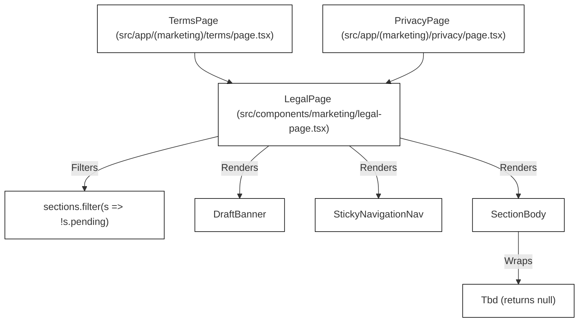
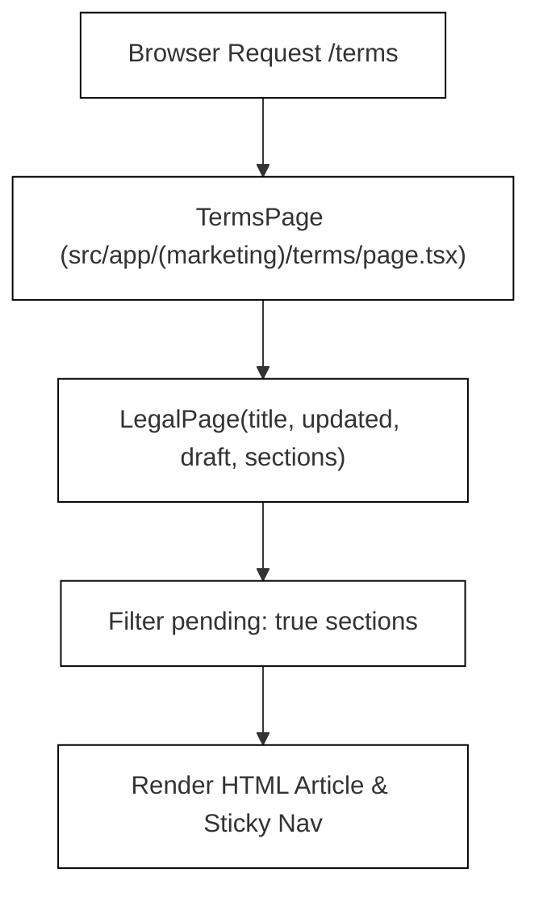

← [6.1 Marketing Pages & Layout](6.1-marketing-pages-layout.md) · [Contents](../README.md) · [7 Operations & Deployment](7-operations-deployment.md) →

---

# Legal Pages (Terms & Privacy)

Relevant source files

The following files were used as context for generating this wiki page:

- `.env.example`
- `src/app/(marketing)/privacy/page.tsx`
- `src/app/(marketing)/terms/page.tsx`
- `src/components/marketing/legal-page.tsx`
- `src/lib/supabase/proxy.ts`

This page details the implementation of the legal surfaces within the marketing route group (`src/app/(marketing)/`), specifically covering the `Terms of Use` and `Privacy Policy` pages, along with their shared layout components, draft handling, and `Tbd` placeholder mechanisms `src/components/marketing/legal-page.tsx:1-62`, `src/app/(marketing)/terms/page.tsx:1-136`, `src/app/(marketing)/privacy/page.exports` `src/app/(marketing)/privacy/page.tsx:1-162`.

---

## 1. Legal Layout & Components (`src/components/marketing/legal-page.tsx`)

The shared layout for legal documentation is encapsulated in `LegalPage`, which structures both terms and privacy documents with a responsive two-column grid: a sticky sidebar navigation on desktop and a vertical stack of content sections on mobile and desktop `src/components/marketing/legal-page.tsx:5-53`.

### Key Functions and Props

*   `LegalPage`: React component receiving `title`, `updated`, an optional `draft` boolean, and a `sections` array `src/components/marketing/legal-page.tsx:5-15`.
*   `sections` Filtering: Automatically filters out sections marked with `pending: true` using `sections.filter((s) => !s.pending)` `src/components/marketing/legal-page.tsx:16-17`.
*   `Tbd`: Placeholder component utilized inside section bodies to mark unreviewed or draft legal text `src/components/marketing/legal-page.tsx:55-62`. Currently returns `null` while open items are tracked externally `src/components/marketing/legal-page.tsx:59-62`.
*   Draft Banner: Conditionally renders a warning banner when `draft` is true, indicating the document has not yet been reviewed by legal counsel `src/components/marketing/legal-page.tsx:20-24`.

Title: Legal Component Architecture

Sources: `src/components/marketing/legal-page.tsx:1-62`

---

## 2. Terms of Use Implementation (`src/app/(marketing)/terms/page.tsx`)

The Terms of Use page is a static Server Component exporting page metadata and rendering the `LegalPage` component with 13 structured sections `src/app/(marketing)/terms/page.tsx:1-136`.

### Structure and Data Flow

*   Metadata: Sets document title via Next.js metadata export `export const metadata: Metadata = { title: "Terms of use" }` `src/app/(marketing)/terms/page.tsx:4`.
*   Draft Status: Passes `draft` flag and `updated="October 17, 2026"` `src/app/(marketing)/terms/page.tsx:11-13`.
*   Sections Inventory:
    *   `acceptance`: Agreement to terms upon account creation `src/app/(marketing)/terms/page.tsx:15-19`.
    *   `eligibility`: Age restrictions (16+) with a `<Tbd>` placeholder for parental consent rules `src/app/(marketing)/terms/page.tsx:20-28`.
    *   `service`: Explicit disclaimers stating `immune.fit` is a wellness tool, not a medical provider `src/app/(marketing)/terms/page.tsx:30-45`.
    *   `plans`: Free vs Premium plan placeholders `src/app/(marketing)/terms/page.tsx:46-54`.
    *   `ai`: AI check-in response disclaimers `src/app/(marketing)/terms/page.tsx:55-64`.
    *   `license`: Personal, non-transferable use grants `src/app/(marketing)/terms/page.tsx:65-74`.
    *   `content`: User ownership of logged data `src/app/(marketing)/terms/page.tsx:75-79`.
    *   `termination`: Account deletion workflows via settings `src/app/(marketing)/terms/page.tsx:80-84`.
    *   `warranties`, `liability`, `disputes`: Marked with `pending: true` and `<Tbd>` elements `src/app/(marketing)/terms/page.tsx:85-114`.
    *   `changes` & `contact`: App notification policies and `info@immune.fit` contact routing `src/app/(marketing)/terms/page.tsx:115-133`.

Title: Terms Page Data Flow

Sources: `src/app/(marketing)/terms/page.tsx:1-136`

---

## 3. Privacy Policy Implementation (`src/app/(marketing)/privacy/page.tsx`)

The Privacy Policy page details data collection practices, AI processing guardrails (Anthropic Claude and Deepgram), Open Wearables self-hosted architecture, and security measures `src/app/(marketing)/privacy/page.tsx:1-162`.

### Core Privacy Sections

*   `plain-language`: Guarantees that personal health data is never sold or shared without explicit permission `src/app/(marketing)/privacy/page.tsx:15-26`.
*   `collect`: Outlines account details, health logs, technical logs, and connected device payloads sourced through Open Wearables on Railway `src/app/(marketing)/privacy/page.tsx:28-53`.
*   `use`: Specifies operational use cases (trends, reminders, AI check-ins) without advertising tracking `src/app/(marketing)/privacy/page.tsx:55-64`.
*   `consent`: Documents user touchpoints for agreement recording and granular data removal `src/app/(marketing)/privacy/page.tsx:65-75`.
*   `ai`: Details Anthropic Claude API retention (30-day deletion, no model training on identifiable chat) and Deepgram Nova-3/Aura-2 voice transcript processing with model-improvement disabled `src/app/(marketing)/privacy/page.tsx:78-91`.
*   `security` & `retention`: Enforces transit/at-rest encryption, database-level RLS account isolation, and account termination procedures `src/app/(marketing)/privacy/page.tsx:93-112`.
*   `rights` & `medical`: State/GDPR data rights scopes and medical wellness disclaimers `src/app/(marketing)/privacy/page.tsx:125-152`.

Sources: `src/app/(marketing)/privacy/page.tsx:1-162`

---

← [6.1 Marketing Pages & Layout](6.1-marketing-pages-layout.md) · [Contents](../README.md) · [7 Operations & Deployment](7-operations-deployment.md) →
