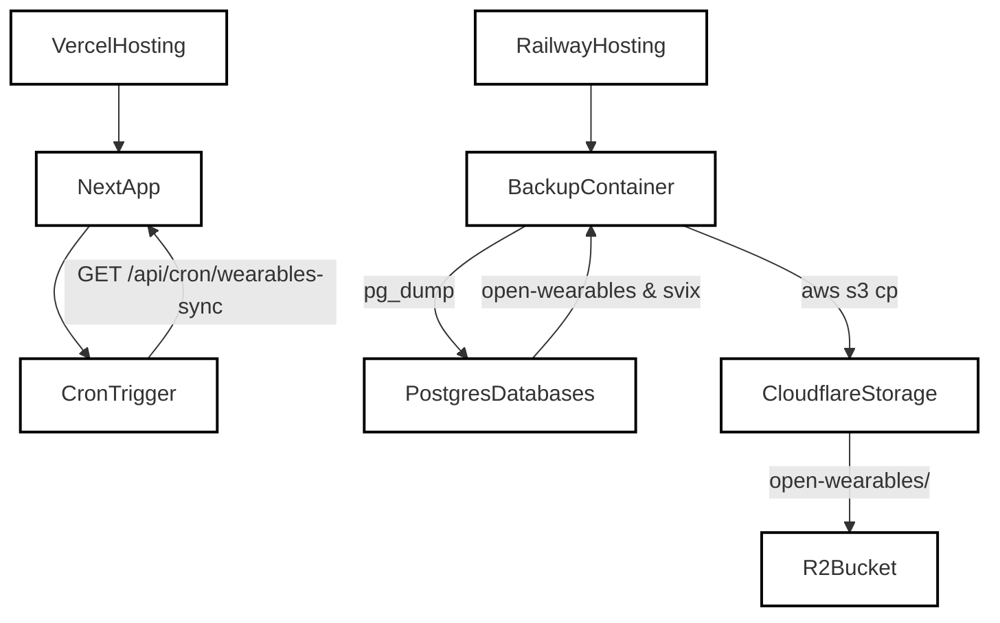
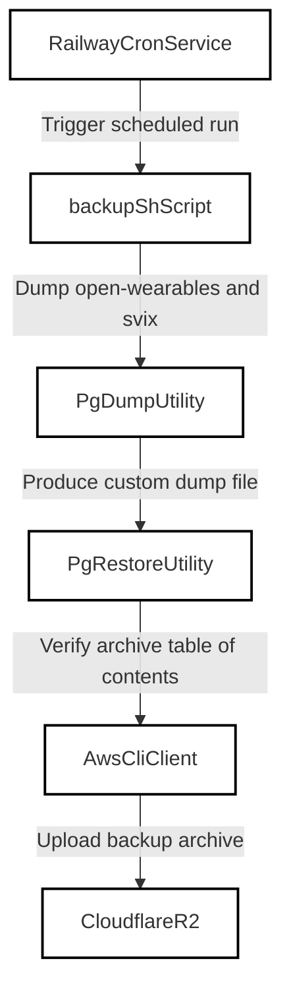

← [6.2 Legal Pages (Terms & Privacy)](6.2-legal-pages-terms-privacy.md) · [Contents](../README.md) · [7.1 Vercel Deployment & Cron](7.1-vercel-deployment-cron.md) →

---

# Operations & Deployment

Relevant source files

The following files were used as context for generating this wiki page:

- `ops/open-wearables-backup/Dockerfile`
- `ops/open-wearables-backup/README.md`
- `ops/open-wearables-backup/backup.sh`
- `ops/open-wearables-backup/railway.json`
- `vercel.json`

This page provides an overview of the operational infrastructure, hosting environments, and deployment pipelines supporting `immune.fit`. The application is primarily hosted on Vercel as a Next.js application, while supporting auxiliary infrastructure like the self-hosted Open Wearables backend running on Railway and backed up to Cloudflare R2.

For deep technical details, see the child pages:
- [Vercel Deployment & Cron](7.1-vercel-deployment-cron.md)
- [Open Wearables Backup Job (ops/)](7.2-open-wearables-backup-job-ops.md)

---

## 7.1 Vercel Deployment & Cron

The primary Next.js application is deployed on Vercel, leveraging the App Router, server actions, and edge runtime capabilities. Environment configuration, build setups, and authenticated background tasks are managed directly via Vercel deployment primitives. 

Vercel coordinates scheduled tasks through `vercel.json` [vercel.json:1-4], which defines cron jobs such as the daily wearables sync trigger at `/api/cron/wearables-sync` [vercel.json:3-3]. These endpoints rely on secure secret validation (`CRON_SECRET`) to ensure unauthorized callers cannot execute background sync cycles.

For details, see [Vercel Deployment & Cron](7.1-vercel-deployment-cron.md).

Sources:
- `vercel.json` [vercel.json:1-4]

---

## 7.2 Open Wearables Backup Job (`ops/`)

To safeguard self-hosted Open Wearables instances, an automated backup service runs on Railway. The `ops/open-wearables-backup` directory contains a containerized solution built specifically to dump PostgreSQL databases and archive them securely [ops/open-wearables-backup/README.md:1-10].

The setup uses a custom Docker image (`postgres:17-alpine` with `aws-cli`) defined in `ops/open-wearables-backup/Dockerfile` [ops/open-wearables-backup/Dockerfile:1-8]. Nightly cron executions are configured in `ops/open-wearables-backup/railway.json` [ops/open-wearables-backup/railway.json:1-11] to run `ops/open-wearables-backup/backup.sh` [ops/open-wearables-backup/backup.sh:1-20], which targets both the `open-wearables` and `svix` databases, verifying their integrity via `pg_restore --list` [ops/open-wearables-backup/backup.sh:15-15] before pushing custom-format dumps (`pg_format=custom`) to Cloudflare R2 [ops/open-wearables-backup/README.md:1-9].

For details, see [Open Wearables Backup Job (ops/)](7.2-open-wearables-backup-job-ops.md).

Sources:
- `ops/open-wearables-backup/railway.json` [ops/open-wearables-backup/railway.json:1-11]
- `ops/open-wearables-backup/README.md` [ops/open-wearables-backup/README.md:1-49]
- `ops/open-wearables-backup/backup.sh` [ops/open-wearables-backup/backup.sh:1-20]
- `ops/open-wearables-backup/Dockerfile` [ops/open-wearables-backup/Dockerfile:1-8]

---

## Operations & Deployment Architecture

The following diagram illustrates the high-level infrastructure topology connecting Vercel, Railway, Supabase, and Cloudflare R2 storage.

Sources:
- `vercel.json` [vercel.json:1-4]
- `ops/open-wearables-backup/railway.json` [ops/open-wearables-backup/railway.json:1-11]
- `ops/open-wearables-backup/backup.sh` [ops/open-wearables-backup/backup.sh:1-20]

---

## Backup Execution Flow

The following diagram details the execution flow of the backup script containerized in `ops/open-wearables-backup/backup.sh` and orchestrated via Railway.

Sources:
- `ops/open-wearables-backup/backup.sh` [ops/open-wearables-backup/backup.sh:1-20]
- `ops/open-wearables-backup/railway.json` [ops/open-wearables-backup/railway.json:1-11]
- `ops/open-wearables-backup/Dockerfile` [ops/open-wearables-backup/Dockerfile:1-8]

---

← [6.2 Legal Pages (Terms & Privacy)](6.2-legal-pages-terms-privacy.md) · [Contents](../README.md) · [7.1 Vercel Deployment & Cron](7.1-vercel-deployment-cron.md) →
