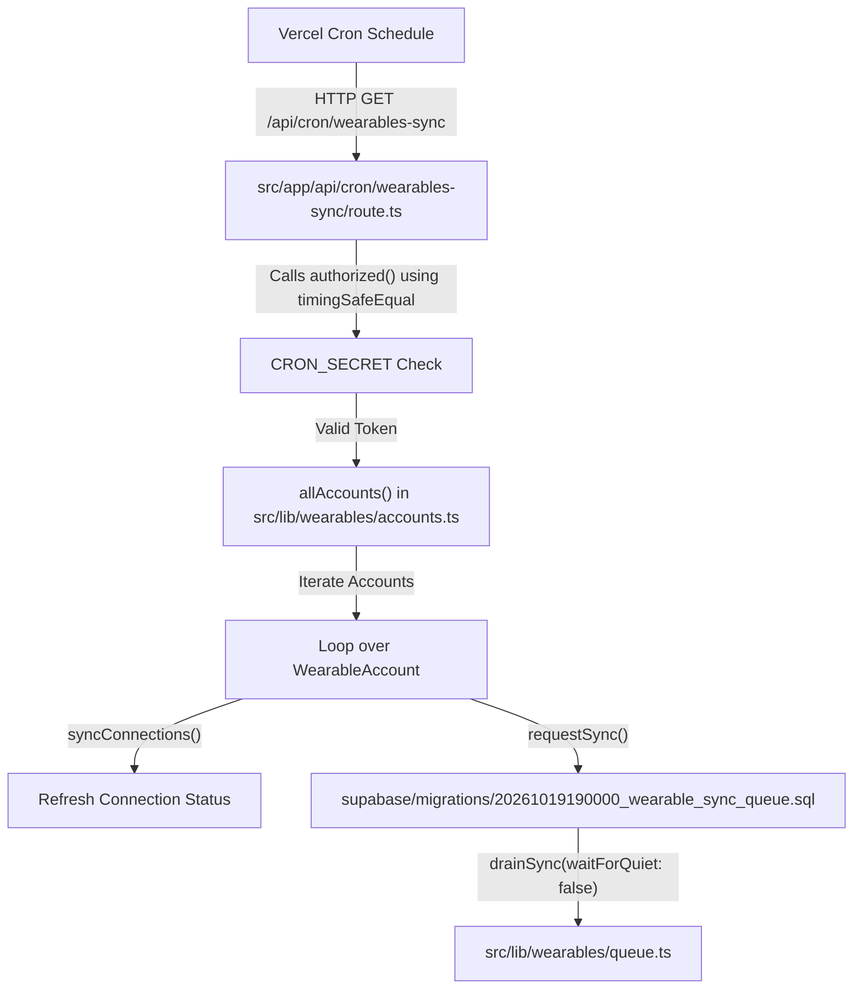
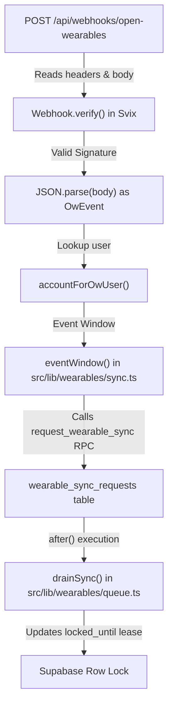

← [7 Operations & Deployment](7-operations-deployment.md) · [Contents](../README.md) · [7.2 Open Wearables Backup Job (ops/)](7.2-open-wearables-backup-job-ops.md) →

---

# Vercel Deployment & Cron

<details>
<summary>Relevant source files</summary>

The following files were used as context for generating this wiki page:

- `next.config.ts`
- `src/app/api/cron/wearables-sync/route.ts`
- `src/app/api/webhooks/open-wearables/route.ts`
- `src/lib/wearables/queue.ts`
- `supabase/migrations/20261019190000_wearable_sync_queue.sql`
- `vercel.json`

</details>


## Purpose and Scope
This page details the Vercel production hosting configuration, scheduled cron jobs, runtime environment variables, security header policies, and the Next.js build-time architecture for `immune.fit`. It focuses on the operational machinery that drives background synchronization, webhook processing, request validation using constant-time cryptographic checks, and edge-hardening through `next.config.ts`.

Sources: `vercel.json`, `next.config.ts`, `src/app/api/cron/wearables-sync/route.ts`

---

## Vercel Cron Configuration (`vercel.json`)
Vercel periodic background tasks are declared centrally in `vercel.json` using standard cron syntax. The application defines a daily cron job targeting the Open Wearables synchronization pipeline.

The cron job triggers a GET request to `/api/cron/wearables-sync` once per day at 10:00 UTC. Vercel automatically injects an `Authorization: Bearer <CRON_SECRET>` header into this request, matching the secret configured in the Vercel project environment settings.

```json
{
  "$schema": "https://openapi.vercel.sh/vercel.json",
  "crons": [{ "path": "/api/cron/wearables-sync", "schedule": "0 10 * * *" }]
}
```

Sources: `vercel.json`

---

## Cron Authentication & Execution (`src/app/api/cron/wearables-sync/route.ts`)
The API route backing the cron job executes a daily catch-up sweep. It iterates through all active user accounts, refreshes connection states, re-reads the prior three days of metric data, and drains any deferred sync items left pending by failed or throttled webhooks.

### Security Implementation (`authorized`)
To prevent unauthorized external invocation of the cron route, `src/app/api/cron/wearables-sync/route.ts` enforces strict token validation using Node's cryptographic `timingSafeEqual` function to mitigate timing attacks:

```typescript
function authorized(request: Request): boolean {
  const secret = process.env.CRON_SECRET;
  const given = request.headers.get("authorization") ?? "";
  if (!secret) return false;
  const want = Buffer.from(`Bearer ${secret}`);
  const got = Buffer.from(given);
  return got.length === want.length && timingSafeEqual(got, want);
}
```

The route execution handler sets `maxDuration = 300` to allow sufficient time for bulk account synchronization sweeps.

Sources: `src/app/api/cron/wearables-sync/route.ts`

---

## Next.js Build Configuration & Security Headers (`next.config.ts`)
The production build is governed by `next.config.ts`, which enforces response-level security headers across all routes (`/:path*`), enables component caching, and configures Turbopack integration for CSS modules.

### Security Headers
Every HTTP response includes:
- `Strict-Transport-Security`: Forces HTTPS for 2 years (`max-age=63072000; includeSubDomains; preload`).
- `X-Content-Type-Options`: Set to `nosniff`.
- `X-Frame-Options`: Set to `DENY` to prevent clickjacking.
- `Referrer-Policy`: Set to `strict-origin-when-cross-origin`.
- `Permissions-Policy`: Explicitly locks down device peripherals while preserving microphone access for voice check-ins (`microphone=(self)`).

Sources: `next.config.ts`

---

## Architecture & Data Flow

### Diagram: Cron Trigger to Synchronization Pipeline
This diagram maps the natural language execution flow of Vercel cron triggers to their concrete code entities in the codebase.



Sources: `vercel.json`, `src/app/api/cron/wearables-sync/route.ts`, `src/lib/wearables/queue.ts`, `supabase/migrations/20261019190000_wearable_sync_queue.sql`

### Diagram: Webhook Verification and Sync Queuing Lifecycle
This diagram illustrates how incoming Open Wearables webhook payloads are cryptographically verified via Svix, recorded in the synchronization queue, and processed asynchronously.



Sources: `src/app/api/webhooks/open-wearables/route.ts`, `src/lib/wearables/queue.ts`, `supabase/migrations/20261019190000_wearable_sync_queue.sql`

---

← [7 Operations & Deployment](7-operations-deployment.md) · [Contents](../README.md) · [7.2 Open Wearables Backup Job (ops/)](7.2-open-wearables-backup-job-ops.md) →
