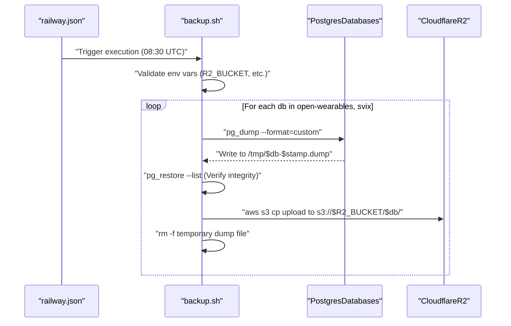
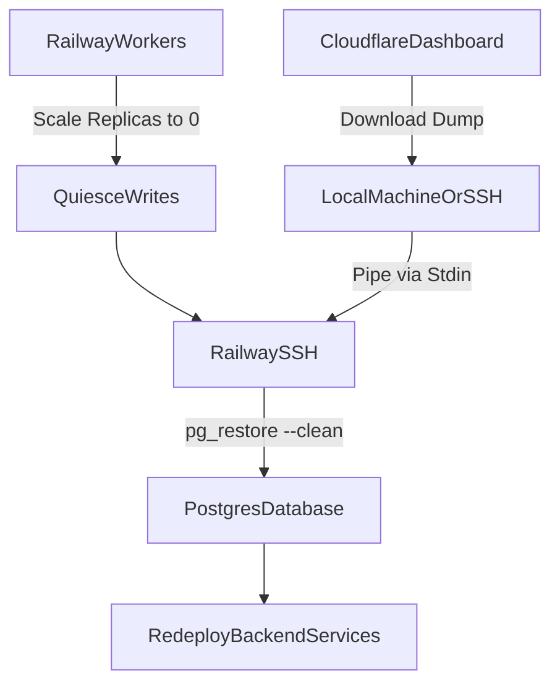

← [7.1 Vercel Deployment & Cron](7.1-vercel-deployment-cron.md) · [Contents](../README.md) · [8 Glossary](8-glossary.md) →

---

# Open Wearables Backup Job (ops/)

<details>
<summary>Relevant source files</summary>

The following files were used as context for generating this wiki page:

- `ops/open-wearables-backup/Dockerfile`
- `ops/open-wearables-backup/README.md`
- `ops/open-wearables-backup/backup.sh`
- `ops/open-wearables-backup/railway.json`

</details>


The Open Wearables backup service provides an automated, self-hosted disaster recovery pipeline for the Open Wearables Postgres databases (`open-wearables` and `svix`) `ops/open-wearables-backup/README.md:1-6`. Because Railway's built-in automated backups require a Pro tier plan `ops/open-wearables-backup/README.md:3`, this lightweight containerized cron job runs nightly, packages custom-format database dumps, validates archive integrity, and securely transmits them to a Cloudflare R2 object storage bucket `ops/open-wearables-backup/README.md:3-8`.

---

## 1. Container Architecture & Build Configuration (`Dockerfile`)

The backup environment is encapsulated within a custom container image rooted in Alpine Linux `ops/open-wearables-backup/Dockerfile:1-2`. To ensure compatibility with server-side operations, the base image explicitly matches the major version (`17`) of the target Railway Postgres instance, preventing protocol mismatches where `pg_dump` rejects newer server versions `ops/open-wearables-backup/Dockerfile:1-2`.

The image installs the standard AWS CLI package to handle multipart and single-part object uploads to Cloudflare R2, copies the orchestration script into the system path, and sets the container entrypoint to execute the script directly upon startup `ops/open-wearables-backup/Dockerfile:3-7`.

```dockerfile
# Same major version as the Railway Postgres it dumps (17); pg_dump refuses newer servers.
FROM postgres:17-alpine
RUN apk add --no-cache aws-cli
COPY backup.sh /usr/local/bin/backup.sh
RUN chmod +x /usr/local/bin/backup.sh
# Replaces the image's server entrypoint: this container only runs the backup and exits.
ENTRYPOINT ["/usr/local/bin/backup.sh"]
```

Sources: `ops/open-wearables-backup/Dockerfile:1-7`

---

## 2. Backup Execution Pipeline (`backup.sh`)

The core execution logic resides in `backup.sh` `ops/open-wearables-backup/backup.sh:1-19`. Operating under strict shell error-handling rules (`set -eu`), the script immediately aborts if any environment variable is missing or if any internal command fails `ops/open-wearables-backup/backup.sh:7`.

### Data Flow & Execution Sequence


Sources: `ops/open-wearables-backup/backup.sh:1-19`

### Step-by-Step Logic
1. **Environment Validation:** Verifies the presence of required Cloudflare R2 and authentication variables: `R2_BUCKET`, `R2_ENDPOINT`, `AWS_ACCESS_KEY_ID`, and `AWS_SECRET_ACCESS_KEY` `ops/open-wearables-backup/backup.sh:8`.
2. **Timestamp Generation:** Establishes a uniform UTC timestamp string in `YYYY-MM-DDTHHMMZ` format `ops/open-wearables-backup/backup.sh:10`.
3. **Database Iteration:** Loops across both required databases: `open-wearables` (containing user accounts, health metrics, and OAuth connections) and `svix` (containing webhook endpoints and signing secrets) `ops/open-wearables-backup/backup.sh:6,11`.
4. **Custom Dump Creation:** Executes `pg_dump` with custom archive formatting into `/tmp` `ops/open-wearables-backup/backup.sh:12-13`.
5. **Integrity Validation:** Runs `pg_restore --list` against the generated dump file `ops/open-wearables-backup/backup.sh:14-15`. Reading the table of contents will fail if the archive is truncated or corrupted, preventing silent backup failures `ops/open-wearables-backup/backup.sh:14-15`.
6. **Cloudflare R2 Upload:** Uploads the verified archive to the designated bucket using the AWS CLI configured with a custom S3 endpoint URL (`--endpoint-url`) `ops/open-wearables-backup/backup.sh:16`.
7. **Cleanup:** Removes the temporary file from the container's scratch space `ops/open-wearables-backup/backup.sh:17-18`.

Sources: `ops/open-wearables-backup/backup.sh:1-19`

---

## 3. Railway Cron Orchestration (`railway.json`)

The Railway platform configuration defines how the backup service is built and scheduled `ops/open-wearables-backup/railway.json:1-11`. It declares the Dockerfile builder and enforces execution constraints tailored for episodic batch workloads `ops/open-wearables-backup/railway.json:3-9`.

```json
{
  "$schema": "https://railway.com/railway.schema.json",
  "build": {
    "builder": "DOCKERFILE",
    "dockerfilePath": "Dockerfile"
  },
  "deploy": {
    "cronSchedule": "30 8 * * *",
    "restartPolicyType": "NEVER"
  }
}
```

- **`cronSchedule` (`"30 8 * * *"`)**: Triggers the container execution daily at 08:30 UTC `ops/open-wearables-backup/railway.json:8`.
- **`restartPolicyType` (`"NEVER"`)**: Ensures the container terminates successfully after completing its backup routine and does not loop or restart upon exit `ops/open-wearables-backup/railway.json:9`.

Sources: `ops/open-wearables-backup/railway.json:1-11`

---

## 4. Operational Runbook & Disaster Recovery (`README.md`)

### Environment Variables & R2 Compatibility
The backup service requires specific runtime variables configured on the Railway service (`pg-backup`):
- **Postgres Target:** `PGHOST`, `PGPORT`, `PGUSER`, and `PGPASSWORD` linking to the main database cluster `ops/open-wearables-backup/README.md:11-12`.
- **Cloudflare R2 Storage:** `R2_BUCKET`, `R2_ENDPOINT`, `AWS_ACCESS_KEY_ID`, and `AWS_SECRET_ACCESS_KEY` sourced from a scoped R2 API token `ops/open-wearables-backup/README.md:12-13`.
- **AWS CLI Adjustments:** `AWS_DEFAULT_REGION=auto`, along with `AWS_REQUEST_CHECKSUM_CALCULATION=WHEN_REQUIRED` and `AWS_RESPONSE_CHECKSUM_VALIDATION=WHEN_REQUIRED` `ops/open-wearables-backup/README.md:14-16`. These checksum configurations prevent Cloudflare R2 from rejecting newer AWS CLI header structures `ops/open-wearables-backup/README.md:15-16`.

### Deployment Workflow
Because the backup service is maintained outside of automated GitHub repository webhooks for isolation, deployments are executed via the Railway CLI from a linked directory `ops/open-wearables-backup/README.md:18-23`:

```bash
railway up ~/immune.fit/ops/open-wearables-backup --path-as-root --service pg-backup --ci
```

Sources: `ops/open-wearables-backup/README.md:1-24`

### Restoration Procedure
In the event of data corruption or catastrophic failure, databases can be restored following these recovery steps `ops/open-wearables-backup/README.md:31-48`:


Sources: `ops/open-wearables-backup/README.md:31-48`

1. **Retrieve Archive:** Download the target `.dump` file from the Cloudflare R2 bucket dashboard `ops/open-wearables-backup/README.md:33-34`.
2. **Quiesce Write Operations:** Stop all active write transactions in Railway by removing or scaling active deployments of `backend`, `celery-worker`, and `celery-beat` to `0` replicas `ops/open-wearables-backup/README.md:35-36`.
3. **Execute Restore via SSH:** Stream the archive into the Postgres container using `railway ssh` and `pg_restore` `ops/open-wearables-backup/README.md:37-44`:
   ```bash
   railway ssh --service Postgres -i ~/.ssh/railway_ed25519 -- \
     pg_restore -U postgres --clean --if-exists --no-owner -d open-wearables < open-wearables-<stamp>.dump
   railway ssh --service Postgres -i ~/.ssh/railway_ed25519 -- \
     pg_restore -U postgres --clean --if-exists --no-owner -d svix < svix-<stamp>.dump
   ```
4. **Restore Services:** Redeploy backend services (`backend`, `celery-worker`, `celery-beat`) `ops/open-wearables-backup/README.md:46-47`. Client applications will automatically re-upload missed health metrics during subsequent sync cycles `ops/open-wearables-backup/README.md:47-48`.

Sources: `ops/open-wearables-backup/README.md:25-48`

---

← [7.1 Vercel Deployment & Cron](7.1-vercel-deployment-cron.md) · [Contents](../README.md) · [8 Glossary](8-glossary.md) →
