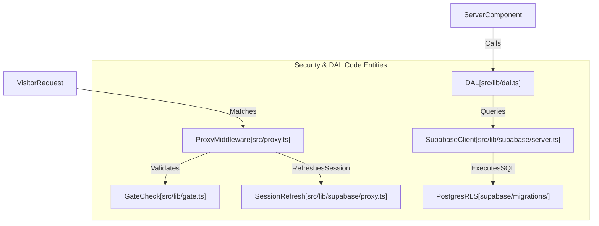

← [7.2 Open Wearables Backup Job (ops/)](7.2-open-wearables-backup-job-ops.md) · [Contents](../README.md)

---

# Glossary

Relevant source files

The following files were used as context for generating this wiki page:

- `AGENTS.md`
- `src/components/charts/chart-table.tsx`
- `src/components/charts/line-chart.tsx`
- `src/components/charts/types.ts`
- `src/lib/dal.ts`
- `src/lib/supabase/types.ts`

## Purpose and Scope
This page provides a technical glossary of core architectural abstractions, database models, UI primitives, and pipeline terms specific to the `immune.fit` codebase. Each entry details implementation patterns, operational context, and explicit code pointers.

Sources: `AGENTS.md:1-119`

---

## Architectural & Security Terms

### DAL (Data Access Layer)
The centralized server-side data access layer located in `src/lib/dal.ts`. It provides helper functions (`requireUserId()`, `getProfile()`, `requireOnboardedProfile()`, `getToday()`) that authenticate requests and query Supabase `src/lib/dal.ts:1-69`. It uses React `cache()` to deduplicate database round-trips within a single request `src/lib/dal.ts:1-14`.

Sources: `src/lib/dal.ts:1-70`, `AGENTS.md:67-74`

### OW (Open Wearables)
An open-source integration service self-hosted on Railway (`OPEN_WEARABLES_API_URL`) that handles OAuth handshakes, provider token exchanges, webhooks, and raw payload normalization `AGENTS.md:104-110`.

Sources: `AGENTS.md:104-110`

### RLS (PostgreSQL Row-Level Security)
Security policies enforced across every table in `supabase/migrations/` `AGENTS.md:77-83`. Policies restrict read and write access using `(select auth.uid()) = user_id` assertions, ensuring absolute isolation of user health records `AGENTS.md:77-83`.

Sources: `AGENTS.md:77-83`, `supabase/migrations/`

### gate / GATE_PATH & SESSION_PATHS
- `GATE_PATH`: The shared site-password gate route (`/enter`) and `immune_gate` cookie check enforced on signed-out visitors `AGENTS.md:96-100`.
- `SESSION_PATHS`: The route matchers in `src/proxy.ts` where Supabase session cookies are refreshed via `updateSession` `AGENTS.md:93-100`.

Sources: `AGENTS.md:93-100`, `src/lib/gate.ts`

### AI_RULES
Validation and data-sourcing constraints governing the Claude-powered AI companion `AGENTS.md:104-119`. Restricts data aggregation to approved third-party wearable connectors (e.g., Strava, Garmin, Oura) to prevent medical hallucination or data leakage `AGENTS.md:104-119`.

Sources: `AGENTS.md:104-119`

---

## Diagram: Natural Language Space to Code Entity Space (Architecture & Security)

Sources: `AGENTS.md:67-103`, `src/lib/dal.ts:1-70`

---

## UI Components & Visualization Primitives

### AppNav
The single navigation component responsible for rendering a bottom tab bar on mobile viewports and a collapsible sidebar at `lg` screens `AGENTS.md:45-47`. Tab highlighting logic and sub-path definitions reside in `src/lib/nav.ts` `AGENTS.md:45-47`.

Sources: `AGENTS.md:45-47`

### ModuleStack & Module
The layout frame primitives located in `src/components/app/` `AGENTS.md:40-44`. Every authenticated page renders a `PageHeader` followed by a `ModuleStack` composed of card-based `Module` containers `AGENTS.md:40-44`.

Sources: `AGENTS.md:40-44`

### LockedModule & stat tiles
- `LockedModule`: A card wrapper displaying feature unlock progress for non-premium or un-unlocked sections `AGENTS.md:41-43`.
- `stat tiles`: Summary metric presentation components embedded within energy, symptom, and activity dashboards.

Sources: `AGENTS.md:40-44`

### ChartPoint
The core TypeScript type (`ChartPoint`) defining individual data points for charts (`src/components/charts/types.ts`) `src/components/charts/types.ts:1-14`. Supports `key`, `label`, `value` (where `null` represents a logging gap), `detail`, and optional `display` strings `src/components/charts/types.ts:1-14`. Rendered via `LineChart` `src/components/charts/line-chart.tsx:1-147` and `ChartTable` `src/components/charts/chart-table.tsx:1-34`.

Sources: `src/components/charts/types.ts:1-14`, `src/components/charts/line-chart.tsx:1-147`, `src/components/charts/chart-table.tsx:1-34`

---

## Diagram: Natural Language Space to Code Entity Space (UI & Visualization)

```mermaid
graph TD
    MobileBottomBar["MobileBottomBar"] -->|"Renders"| AppNav_src_components_app_app_nav_tsx["AppNav[src/components/app/app-nav.tsx]"]
    DesktopSidebar["DesktopSidebar"] -->|"Renders"| AppNav_src_components_app_app_nav_tsx["AppNav[src/components/app/app-nav.tsx]"]
    AppPageLayout["AppPageLayout"] -->|"Contains"| ModuleStack_src_components_app["ModuleStack[src/components/app/]"]
    CardContainer["CardContainer"] -->|"Contains"| Module_src_components_app["Module[src/components/app/]"]
    RestrictedFeature["RestrictedFeature"] -->|"Renders"| LockedModule_src_components_app["LockedModule[src/components/app/]"]
    MetricSummaryCard["MetricSummaryCard"] -->|"Displays"| StatTiles_src_components_app["StatTiles[src/components/app/]"]
    TimeSeriesPoint["TimeSeriesPoint"] -->|"UsesType"| ChartPoint_src_components_charts_types_ts["ChartPoint[src/components/charts/types.ts]"]
    TimeSeriesPoint["TimeSeriesPoint"] -->|"Renders"| LineChart_src_components_charts_line_chart_tsx["LineChart[src/components/charts/line-chart.tsx]"]
    FallbackTable["FallbackTable"] -->|"Renders"| ChartTable_src_components_charts_chart_table_tsx["ChartTable[src/components/charts/chart-table.tsx]"]

    subgraph sg1 ["UI Code Entities"]
      AppNav_src_components_app_app_nav_tsx["AppNav[src/components/app/app-nav.tsx]"]
      ModuleStack_src_components_app["ModuleStack[src/components/app/]"]
      Module_src_components_app["Module[src/components/app/]"]
      LockedModule_src_components_app["LockedModule[src/components/app/]"]
      StatTiles_src_components_app["StatTiles[src/components/app/]"]
      ChartPoint_src_components_charts_types_ts["ChartPoint[src/components/charts/types.ts]"]
      LineChart_src_components_charts_line_chart_tsx["LineChart[src/components/charts/line-chart.tsx]"]
      ChartTable_src_components_charts_chart_table_tsx["ChartTable[src/components/charts/chart-table.tsx]"]
    end
```

Sources: `AGENTS.md:40-47`, `src/components/charts/types.ts:1-14`, `src/components/charts/line-chart.tsx:1-147`

---

## Data Domain & Wearables Terms

### effort & active minutes
- `effort`: Qualitative or quantitative intensity rating recorded on activity logs (`activity_logs.effort`) `src/lib/supabase/types.ts:78-139`.
- `active minutes`: Duration metric tracking physical exertion (`activity_logs.duration_min`) `src/lib/supabase/types.ts:78-139`.

Sources: `src/lib/supabase/types.ts:78-139`, `AGENTS.md:13-15`

### device_metrics & wearable_sync_requests
- `device_metrics`: Supabase table holding normalized health telemetry (heart rate, sleep, steps) ingested from providers `src/lib/supabase/types.ts:233-270`.
- `wearable_sync_requests`: Supabase table tracking asynchronous data sync queues and date windows per user `AGENTS.md:111-115`.

Sources: `src/lib/supabase/types.ts:233-270`, `AGENTS.md:111-115`

### drainSync & requestSync
- `drainSync`: Queue worker process that leases pending sync requests, fetches updated intervals from the Open Wearables API, and upserts records into `device_metrics` and `activity_logs` `AGENTS.md:111-118`.
- `requestSync`: Helper function used to register sync queue jobs when incoming webhooks or cron handlers trigger a refresh.

Sources: `AGENTS.md:111-118`

### checkins & intake
- `checkins`: Daily check-in persistence records stored in the `checkins` table `src/lib/supabase/types.ts:140-157`.
- `intake`: Questionnaire data collected via the multi-step onboarding wizard (`/onboarding/[step]`) and stored as profile attributes `AGENTS.md:48-51`.

Sources: `src/lib/supabase/types.ts:140-157`, `AGENTS.md:48-51`

### thresholds & Tbd
- `thresholds`: Configured numeric boundaries utilized by insight rules to evaluate pacing risks and symptom triggers.
- `Tbd`: Placeholder marker utilized across legal templates, feature specs, and draft documents `AGENTS.md:20-21`.

Sources: `AGENTS.md:20-21`, `AGENTS.md:104-119`

---
Sources: `AGENTS.md:1-119`, `src/lib/dal.ts:1-70`, `src/lib/supabase/types.ts:1-270`, `src/components/charts/line-chart.tsx:1-147`, `src/components/charts/types.ts:1-14`

---

← [7.2 Open Wearables Backup Job (ops/)](7.2-open-wearables-backup-job-ops.md) · [Contents](../README.md)
